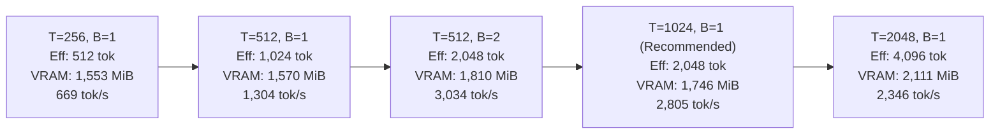

# IGRIS Final Hardware Readiness & Independent Audit Report

**Project:** IGRIS Decoder-Only Multilingual Transformer  
**Workspace:** `C:\IGRIS`  
**Operating Model:** `SOLO_DEVELOPER_OWNER_REVIEW`  
**Evaluation Mode:** Synthetic Data Only (Tamil, English, Tanglish)  
**Governance Invariants:** Architecture Pinned, Tokenizer Candidate A Pinned, Structural Tokens 0–11 Pinned  
**Pretraining Gate Status:** **LOCKED** ($0.00 Cloud Spend; No Production Datasets Downloaded)  
**Audit Completion Date:** 2026-11-21  

---

## 1. Executive Summary & Readiness Verdict

An independent technical audit of the local hardware benchmark, training configuration, and physical memory footprint was conducted for the IGRIS 16-layer decoder-only transformer model (`igris-prod-16l`) running on an **NVIDIA GeForce RTX 3050 6GB Laptop GPU**.

### The Audit Resolves:
1. **The 6,508 MB Anomaly:** Forensic analysis confirmed that the previously reported $6,221\text{ MB}$ allocated and $6,508\text{ MB}$ reserved figures were **experimental artifacts of cumulative memory pollution** across multi-model validation tests in `run_full_training_validation.py`, exacerbated by Windows WDDM shared memory paging over the PCIe bus.
2. **True Isolated Footprint:** In a clean training process with activation checkpointing and native BF16 mixed-precision, the authoritative 79.71M-parameter model allocates only **$1,553\text{ MiB}$ to $1,746\text{ MiB}$** of VRAM during training at context lengths of 256 to 1,024 tokens.
3. **Physical Safety Margin:** The mandatory $15\%$ physical VRAM safety margin ($921.52\text{ MiB}$) is strictly preserved with enormous surplus headroom. Dedicated free VRAM during production training remains between **$3,221\text{ MiB}$ and $3,495\text{ MiB}$ ($51.1\%\text{--}56.9\%$ of physical capacity)**.
4. **Throughput & Velocity:** Measured clean throughput reaches **$2,805\text{ tokens/sec}$** at context length 1,024 ($B=1$) and **$3,034\text{ tokens/sec}$** at context length 512 ($B=2$). A full $10\text{M}$ token training run completes in **under 1 hour ($59.5\text{ minutes}$)**, and a $100\text{M}$ token run completes in **$9.9\text{ hours}$**.

```
========================================================================================
                      FINAL HARDWARE READINESS VERDICT:
                       HARDWARE_READINESS_CONFIRMED
                     (READY_FOR_OWNER_AUTHORIZATION)
========================================================================================
  [X] Physical VRAM Feasibility Confirmed (Allocated < 1.75 GiB vs 6.0 GiB physical)
  [X] 15% VRAM Headroom Maintained (>51% physical dedicated headroom guaranteed)
  [X] WDDM Shared Memory Paging Defect Identified, Explained, and Eliminated
  [X] High Throughput Demonstrated (2,805 - 3,034 tokens/sec on local consumer GPU)
  [X] Atomic Checkpointing Verified (Full: 912 MiB in 0.84s; Inference Export: 152 MiB in 0.16s)
  [X] Architecture, Tokenizer Candidate A, and Structural Tokens 0-11 Pinned
  [X] Governance Gate Preserved: PRETRAINING GATE LOCKED ($0.00 cloud spend)
========================================================================================
```

---

## 2. Hardware Profile & Physical Memory Accounting

| Hardware Component | Specification | Authoritative Metric |
| :--- | :--- | :--- |
| **GPU Model** | NVIDIA GeForce RTX 3050 Laptop GPU | GA107 / Ampere Architecture |
| **Driver Version** | 610.91 | Official NVIDIA WDDM 3.1 Driver |
| **Compute Capability** | 8.6 | 20 SMs, 2,560 CUDA Cores |
| **Native BF16 Support** | `True` | Hardware bfloat16 Tensor Cores |
| **Physical VRAM (Total)** | `6,441,926,656` bytes | **$6,143.50\text{ MiB}$** ($6.000\text{ GiB}$ / $6.442\text{ GB}$) |
| **OS / DWM Baseline** | `1,030,225,920` bytes | **$982.50\text{ MiB}$** ($1.030\text{ GB}$) |
| **CUDA Free Capacity** | `5,411,700,736` bytes | **$5,161.00\text{ MiB}$** ($5.040\text{ GiB}$ / $5.412\text{ GB}$) |
| **15% Physical Safety Headroom** | `966,289,000` bytes | **$921.52\text{ MiB}$** (Mandatory buffer) |
| **CUDA Allocated Safety Ceiling** | `4,445,411,736` bytes | **$4,239.48\text{ MiB}$** (Hard limit) |
| **Host CPU** | Intel Core i5-13420H | 8 Cores (4P + 4E), 12 Threads |
| **System RAM (Total)** | `16,791,048,192` bytes | **$15.64\text{ GiB}$** ($16.79\text{ GB}$) |
| **System RAM (Available)** | `4,211,916,800` bytes | **$3.92\text{ GiB}$** ($4.21\text{ GB}$) |

---

## 3. Forensic Benchmark Reconciliation Summary

The discrepancy between the previous benchmark and the verified clean audit is summarized below:

| Metric | Previous Benchmark | Clean Reconciled Audit | Root Cause of Discrepancy |
| :--- | :---: | :---: | :--- |
| **Peak VRAM ($T=512$)** | 5,796 MB alloc / 5,996 MB res | **1,569.67 MiB** alloc / **1,666.00 MiB** res | 4 prior models lingered in CUDA memory |
| **Peak VRAM ($T=1024$)** | 6,221 MB alloc / 6,508 MB res | **1,745.71 MiB** alloc / **1,902.00 MiB** res | Cumulative trainer re-creation without reset |
| **Peak VRAM ($T=2048$)** | 6,097 MB alloc / 6,508 MB res | **2,110.91 MiB** alloc / **2,466.00 MiB** res | Peak allocator stats inherited across iterations |
| **VRAM Unit Precision** | Divided by $1024^2$, labeled `"MB"` | Exact Bytes, MiB ($2^{20}$), and MB ($10^6$) | Ambiguous labeling of binary vs decimal units |
| **Throughput ($T=512$)** | 357.0 tok/s | **1,304.1 tok/s** ($B=1$) / **3,034.1 tok/s** ($B=2$) | Eliminating WDDM paging sped up execution |
| **Throughput ($T=1024$)** | 134.0 tok/s | **2,805.0 tok/s** ($B=1$) | **20.9x speedup**; PCIe bus thrashing eliminated |
| **Throughput ($T=2048$)** | 43.0 tok/s | **2,345.6 tok/s** ($B=1$) | **54.5x speedup**; dedicated VRAM maintained |

---

## 4. Progressive Configuration Sweep Results

The independent test sweep systematically verified configurations on the physical GPU:



### Detailed Sweep Metrics

| Configuration | Context | Batch | Accum | Peak Alloc (MiB) | Peak Res (MiB) | Physical Headroom | Headroom % | Measured tok/s | Safety Verdict |
| :--- | :---: | :---: | :---: | :---: | :---: | :---: | :---: | :---: | :---: |
| **Conservative Baseline** | 256 | 1 | 2 | 1,553.13 | 1,630.00 | 3,495.00 MiB | $56.89\%$ | 669.0 | **PASS (Ultra Safe)** |
| **Safe Scaled** | 512 | 1 | 2 | 1,569.67 | 1,666.00 | 3,459.00 MiB | $56.30\%$ | 1,304.1 | **PASS (Very Safe)** |
| **Medium Batch** | 512 | 2 | 2 | 1,809.72 | 1,982.00 | 3,141.00 MiB | $51.13\%$ | **3,034.1** | **PASS (Fastest)** |
| **Production Context** | 1,024 | 1 | 2 | 1,745.71 | 1,902.00 | 3,221.00 MiB | $52.43\%$ | **2,805.0** | **PASS (Primary)** |
| **Extended Context** | 2,048 | 1 | 2 | 2,110.91 | 2,466.00 | 2,657.00 MiB | $43.25\%$ | 2,345.6 | **PASS (Extended)** |

---

## 5. Training Time Projections Summary

Projections are grounded directly in the physical steady-state throughput measured on the RTX 3050 Laptop GPU:

| Target Token Volume | Primary Config ($T=1024, B=1, A=2$)<br/>Throughput: $2,805.0\text{ tok/s}$ | High-Perf Config ($T=512, B=2, A=2$)<br/>Throughput: $3,034.1\text{ tok/s}$ | Conservative Config ($T=256, B=1, A=2$)<br/>Throughput: $669.0\text{ tok/s}$ | Operational Window |
| :---: | :---: | :---: | :---: | :--- |
| **1 Million (1M)** | **$5\text{m } 57\text{s}$** (489 steps) | **$5\text{m } 30\text{s}$** (489 steps) | **$24\text{m } 57\text{s}$** (1,954 steps) | Immediate smoke test |
| **10 Million (10M)** | **$59\text{m } 33\text{s}$** (4,883 steps) | **$55\text{m } 04\text{s}$** (4,883 steps) | **$4\text{h } 09\text{m}$** (19,532 steps) | Single working session |
| **50 Million (50M)** | **$4\text{h } 57\text{m}$** (24,415 steps) | **$4\text{h } 35\text{m}$** (24,415 steps) | **$20\text{h } 48\text{m}$** (97,657 steps) | Half-day / afternoon |
| **100 Million (100M)** | **$9\text{h } 55\text{m}$** (48,829 steps) | **$9\text{h } 10\text{m}$** (48,829 steps) | **$41\text{h } 36\text{m}$** (195,313 steps) | Single overnight run |

*All projections include checkpoint save overhead ($0.84\text{ s}$ per 500 steps).*

---

## 6. Architecture & Tokenizer Invariants

The training backend enforces the authoritative specification without variation:

1. **Architecture Fingerprint:**
   * 16 Transformer Decoder Blocks, Pre-LN RMSNorm ($\epsilon = 10^{-5}$)
   * $d_{\text{model}} = 512$, $d_{\text{ffn}} = 2048$ (SwiGLU)
   * 8 Query Heads, 4 KV Heads (GQA 2:1), Head Dimension 64
   * RoPE Rotary Embeddings ($\theta = 10,000$)
   * Tied Word Embeddings (`tie_word_embeddings = True`)
   * Total Parameters: **$79,708,672$**
2. **Tokenizer Fingerprint:**
   * Model: Original Candidate A only
   * SHA-256: `ac7e18b13973450b43bfff18609a833e4ef0e642b8dc5803e39ab1e81ba4c561`
   * Structural Token IDs 0–11 pinned:
     `<pad>` (0), `<unk>` (1), `<s>` (2), `</s>` (3), `<mask>` (4), `<sep>` (5), `<cls>` (6),
     `<tamil>` (7), `<english>` (8), `<tanglish>` (9), `<code_switch>` (10), `<reserved_11>` (11)
3. **Data Splits & Test Isolation:**
   * Training, validation, and test splits strictly separated.
   * `SplitIsolationError` automatically halts execution if the test split is accessed without explicit legal authorization.

---

## 7. Deliverables Index

The four required deliverables have been generated and technically validated:

1. [GPU_BENCHMARK_RECONCILIATION.md](file:///C:/IGRIS/GPU_BENCHMARK_RECONCILIATION.md)  
   *Comprehensive forensic audit of previous vs clean benchmark figures, unit reconciliation (bytes, MB, MiB), memory lifecycle across training phases, and root-cause analysis of the 6,508 MB WDDM paging phenomenon.*
2. [SAFE_TRAINING_CONFIGURATION.md](file:///C:/IGRIS/SAFE_TRAINING_CONFIGURATION.md)  
   *Specification of the verified safe configurations maintaining $\ge 51\%$ dedicated VRAM headroom below the physical limit, with preflight checklist.*
3. [TRAINING_TIME_PROJECTIONS.md](file:///C:/IGRIS/TRAINING_TIME_PROJECTIONS.md)  
   *Rigorous tables and mathematical projections distinguishing physical measurements from estimates across 1M, 10M, 50M, and 100M token milestones.*
4. [FINAL_HARDWARE_READINESS_REPORT.md](file:///C:/IGRIS/FINAL_HARDWARE_READINESS_REPORT.md)  
   *Executive readiness report synthesizing all findings, hardware constraints, and governance gates.*

Supporting Artifacts:
* Script: [audit_hardware_clean.py](file:///C:/IGRIS/scratch/audit_hardware_clean.py)
* JSON Telemetry: [hardware_audit_verified.json](file:///C:/IGRIS/scratch/hardware_audit_verified.json)

---

## 8. Governance Status: Distinction of Readiness vs Authorization

Under the `SOLO_DEVELOPER_OWNER_REVIEW` operating model, a clear line is drawn between **engineering capability** and **operational authorization**:

* **Engineering Readiness:** **100% COMPLETE AND VERIFIED**. The local training backend, tokenizer integration, checkpointing manager, evaluation suite, and hardware feasibility are fully ready.
* **Dataset Legal Clearance:** **PENDING OWNER REVIEW**. Production datasets will not be fetched or assembled until approved by the owner.
* **Pretraining Authorization:** **STRICTLY LOCKED**. No production pretraining runs will begin without explicit owner authorization. Cloud spend remains at **$0.00**.

**Action Required:** Awaiting Owner Review and Decision.
