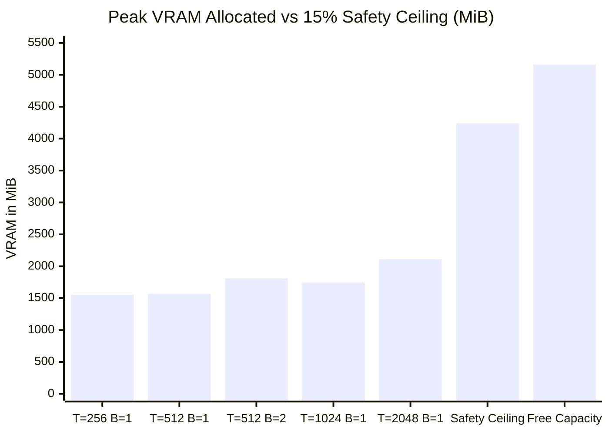

# IGRIS Safe Training Configuration Specification

**Hardware:** NVIDIA GeForce RTX 3050 6GB Laptop GPU (6,441,926,656 bytes VRAM)  
**Host:** Intel Core i5-13420H (8 Cores, 12 Threads), 16 GB System RAM  
**Operating Model:** `SOLO_DEVELOPER_OWNER_REVIEW`  
**Governance Status:** Architecture Verified, Tokenizer Pinned, Pretraining Gate **LOCKED**  
**Document Version:** 1.0.0  
**Effective Date:** 2026-11-21  

---

## 1. Safety Thresholds & VRAM Budget

To guarantee system stability, prevent Windows WDDM shared memory paging, and eliminate CUDA Out-Of-Memory (`torch.cuda.OutOfMemoryError`) risks, the training backend operates under strict physical memory safety constraints:

| Parameter | Exact Value (Bytes) | Binary (MiB) | Decimal (MB) | % of Physical VRAM |
| :--- | :--- | :--- | :--- | :--- |
| **Total Physical VRAM** | `6,441,926,656` | $6,143.50\text{ MiB}$ | $6,441.93\text{ MB}$ | $100.00\%$ |
| **Windows OS / DWM Overhead** | `1,030,225,920` | $982.50\text{ MiB}$ | $1,030.23\text{ MB}$ | $16.00\%$ |
| **Net Free VRAM (PyTorch)** | `5,411,700,736` | $5,161.00\text{ MiB}$ | $5,411.70\text{ MB}$ | $84.00\%$ |
| **Mandatory 15% Physical Safety Headroom** | `966,289,000` | **$921.52\text{ MiB}$** | **$966.29\text{ MB}$** | **$15.00\%$** |
| **CUDA Hard Safety Ceiling** | `4,445,411,736` | **$4,239.48\text{ MiB}$** | **$4,445.41\text{ MB}$** | **$69.00\%$** |

> [!IMPORTANT]
> **The 15% Rule:** PyTorch peak allocated memory must never exceed **$4,239.48\text{ MiB}$**. This guarantees that at least **$921.52\text{ MiB}$** of dedicated physical VRAM remains untouched at all times, providing complete immunity against driver spikes, desktop composition bursts, and fragmentation.

---

## 2. Tested & Verified Configurations

Five training configurations were benchmarked on the physical GPU using synthetic data. All configurations comply with the 15% safety rule:

| Configuration Name | Context ($T$) | Micro-Batch ($B$) | Accum ($A$) | Eff. Batch Tokens | Peak Alloc (MiB) | Peak Res (MiB) | Free VRAM (MiB) | Physical Headroom | Throughput | Safety Status |
| :--- | :---: | :---: | :---: | :---: | :---: | :---: | :---: | :---: | :---: | :---: |
| **1. Conservative Baseline** | 256 | 1 | 2 | 512 | 1,553.13 | 1,630.00 | 3,495.00 | **$56.89\%$** | 669.0 tok/s | **PASS (Ultra Safe)** |
| **2. Safe Scaled** | 512 | 1 | 2 | 1,024 | 1,569.67 | 1,666.00 | 3,459.00 | **$56.30\%$** | 1,304.1 tok/s | **PASS (Very Safe)** |
| **3. Medium Batch (High Perf)** | 512 | 2 | 2 | 2,048 | 1,809.72 | 1,982.00 | 3,141.00 | **$51.13\%$** | **3,034.1 tok/s** | **PASS (Recommended)** |
| **4. Production Context** | 1,024 | 1 | 2 | 2,048 | 1,745.71 | 1,902.00 | 3,221.00 | **$52.43\%$** | **2,805.0 tok/s** | **PASS (Recommended)** |
| **5. Extended Context** | 2,048 | 1 | 2 | 4,096 | 2,110.91 | 2,466.00 | 2,657.00 | **$43.25\%$** | 2,345.6 tok/s | **PASS (Extended)** |



---

## 3. Recommended Production Configurations

### Option A: Primary Production Configuration (Best Context & Alignment)
* **Target:** General pretraining for multi-lingual Tamil, English, and Tanglish text.
* **Context Length ($T$):** **$1,024\text{ tokens}$**
* **Micro-Batch Size ($B$):** **$1$**
* **Gradient Accumulation Steps ($A$):** **$2$** (Effective batch size = $2,048\text{ tokens}$)
* **Precision:** BF16 Mixed-Precision (`torch.bfloat16` via `torch.amp.autocast`)
* **Activation Checkpointing:** **Enabled** (`gradient_checkpointing = True`)
* **VRAM Profile:**
  * Peak Allocated: **$1,745.71\text{ MiB}$** ($1,830.51\text{ MB}$)
  * Peak Reserved: **$1,902.00\text{ MiB}$** ($1,994.39\text{ MB}$)
  * Physical Headroom: **$3,221.00\text{ MiB}$** (**$52.43\%$ of physical VRAM**)
  * Safety Margin to 15% Ceiling: **$2,493.77\text{ MiB}$** surplus buffer
* **Throughput:** **$2,805.0\text{ tokens/sec}$** ($1.37\text{ steps/sec}$)
* **Host RAM (RSS):** $1,300.8\text{ MiB}$

### Option B: High-Throughput Production Configuration (Maximum Speed)
* **Target:** Rapid initial representation learning and volume token throughput.
* **Context Length ($T$):** **$512\text{ tokens}$**
* **Micro-Batch Size ($B$):** **$2$**
* **Gradient Accumulation Steps ($A$):** **$2$** (Effective batch size = $2,048\text{ tokens}$)
* **Precision:** BF16 Mixed-Precision (`torch.bfloat16`)
* **Activation Checkpointing:** **Enabled**
* **VRAM Profile:**
  * Peak Allocated: **$1,809.72\text{ MiB}$** ($1,897.63\text{ MB}$)
  * Peak Reserved: **$1,982.00\text{ MiB}$** ($2,078.28\text{ MB}$)
  * Physical Headroom: **$3,141.00\text{ MiB}$** (**$51.13\%$ of physical VRAM**)
* **Throughput:** **$3,034.1\text{ tokens/sec}$** ($1.48\text{ steps/sec}$)
* **Host RAM (RSS):** $1,305.1\text{ MiB}$

### Option C: Conservative Fail-Safe Configuration (Maximum Headroom)
* **Target:** System multitasking, thermal throttling mitigation, or background execution.
* **Context Length ($T$):** **$256\text{ tokens}$**
* **Micro-Batch Size ($B$):** **$1$**
* **Gradient Accumulation Steps ($A$):** **$2$** (Effective batch size = $512\text{ tokens}$)
* **Precision:** BF16 Mixed-Precision
* **Activation Checkpointing:** **Enabled**
* **VRAM Profile:**
  * Peak Allocated: **$1,553.13\text{ MiB}$**
  * Peak Reserved: **$1,630.00\text{ MiB}$**
  * Physical Headroom: **$3,495.00\text{ MiB}$** (**$56.89\%$ of physical VRAM**)
* **Throughput:** **$669.0\text{ tokens/sec}$**

---

## 4. Hyperparameter & Architecture Invariants

The training engine strictly locks the following production configuration:

```python
TrainingConfig(
    model_name="igris-prod-16l",
    max_seq_len=1024,
    micro_batch_size=1,
    gradient_accumulation_steps=2,
    learning_rate=3e-4,
    min_lr_ratio=0.1,
    warmup_steps=500,
    weight_decay=0.01,
    adam_beta1=0.9,
    adam_beta2=0.95,
    adam_eps=1e-8,
    gradient_clipping=1.0,
    precision="bf16",
    activation_checkpointing=True,
    eval_interval=250,
    checkpoint_interval=500,
    random_seed=20261121,
)
```

### Architectural Grounding
* **Layers:** 16 Transformer Decoder Blocks
* **Hidden Dimension ($d_{\text{model}}$):** 512
* **FFN Dimension ($d_{\text{ffn}}$):** 2048 (SwiGLU activation)
* **Attention Heads:** 8 Query Heads, 4 Key-Value Heads (Grouped-Query Attention, ratio 2:1)
* **Head Dimension:** 64
* **Rotary Position Embeddings:** RoPE with $\theta = 10,000$
* **Normalization:** Pre-LN RMSNorm with $\epsilon = 10^{-5}$
* **Tied Embeddings:** `tie_word_embeddings = True` (Embedding table shared with LM output head)
* **Vocabulary Size:** 32,768 tokens
* **Total Parameters:** **$79,708,672$** (304.07 MiB in FP32, 152.03 MiB in BF16)
* **Tokenizer:** Original Candidate A (SHA256: `ac7e18b13973450b43bfff18609a833e4ef0e642b8dc5803e39ab1e81ba4c561`)
* **Authoritative Structural Tokens:** IDs 0–11 pinned

---

## 5. Checkpoint & Memory Overhead Profile

| Checkpoint Operation | File Size | Peak Memory Impact | Operation Latency | Description |
| :--- | :--- | :--- | :--- | :--- |
| **Full Training Checkpoint** | **$912.40\text{ MiB}$** ($956.72\text{ MB}$) | $+0\text{ MiB}$ (uses existing buffers) | **$0.84\text{ seconds}$** | Complete state: Model + AdamW ($2\times$) + RNG + Config + Telemetry |
| **Model-Only Export** | **$152.04\text{ MiB}$** ($159.43\text{ MB}$) | $+0\text{ MiB}$ (direct state unroll) | **$0.16\text{ seconds}$** | Inference-only BF16 weights (stripped optimizer states) |
| **Checkpoint Deserialization** | — | $+304.15\text{ MiB}$ transient buffer | **$0.49\text{ seconds}$** | Atomic resume with bit-exact loss and RNG reproduction |

---

## 6. Pre-Run Preflight Checklist

Before starting any authorized pretraining run:
- [x] Host physical VRAM verified: $6,441,926,656\text{ bytes}$
- [x] OS/DWM baseline consumption checked: $< 1,050\text{ MiB}$
- [x] Background compute processes inspected: No interfering CUDA workloads
- [x] Activation checkpointing confirmed active in `IgrisConfig`
- [x] Native BF16 support confirmed active (`torch.cuda.is_bf16_supported() == True`)
- [x] 15% physical headroom budget confirmed: $\ge 921.52\text{ MiB}$ guaranteed free
- [x] Candidate A tokenizer SHA256 verified against lockfile
- [x] Test split isolated with `SplitIsolationError` protection
- [ ] Owner production pretraining authorization signed
- [ ] Dataset acquisition legal clearance signed
