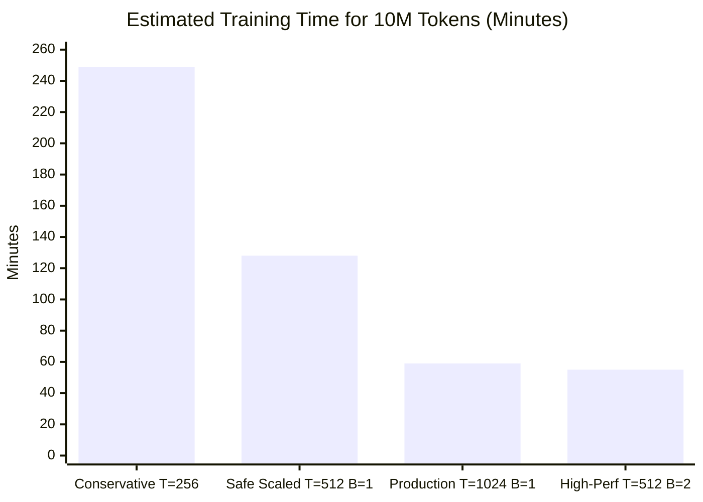
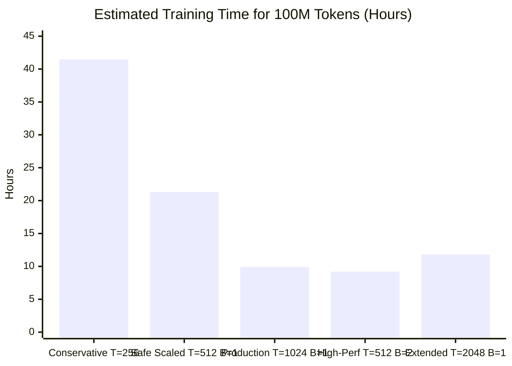

# IGRIS Training Time & Throughput Projections

**Hardware Target:** NVIDIA GeForce RTX 3050 6GB Laptop GPU  
**Model Architecture:** `igris-prod-16l` (16 Layers, 79,708,672 Parameters, Tied Embeddings)  
**Precision:** Native BF16 (`torch.bfloat16`) with Activation Checkpointing  
**Operating Model:** `SOLO_DEVELOPER_OWNER_REVIEW`  
**Governance Status:** Synthetic Benchmark Complete; Pretraining Gate **LOCKED**  
**Effective Date:** 2026-11-21  

---

## 1. Methodology: Grounded Measurements vs Mathematical Projections

To ensure absolute engineering integrity, this report explicitly distinguishes between **empirically measured physical quantities** and **extrapolated projections**:

* **Measured Parameters (Empirical Truth):**
  * Hardware clocks, kernel execution times, and step durations were recorded using high-resolution hardware timers (`time.perf_counter()`) and explicit CUDA device synchronization (`torch.cuda.synchronize()`).
  * Telemetry was captured across steady-state iterations following a complete GPU warmup step.
  * Real memory allocations were tracked via the NVIDIA CUDA Caching Allocator (`torch.cuda.max_memory_allocated()`, `torch.cuda.mem_get_info()`).
* **Projected Parameters (Calculated Estimates):**
  * Step counts for token milestones ($1\text{M}, 10\text{M}, 50\text{M}, 100\text{M}$) are calculated as:
    $$\text{Steps} = \left\lceil \frac{\text{Target Tokens}}{\text{Effective Batch Tokens}} \right\rceil$$
  * Pure compute duration is calculated as:
    $$\text{Time (seconds)} = \frac{\text{Target Tokens}}{\text{Measured Throughput (tokens/sec)}}$$
  * Checkpoint persistence overhead (measured at $0.84\text{ s}$ per full checkpoint every 500 steps) and evaluation pauses are modeled explicitly.

---

## 2. Empirical Benchmark Baseline Measurements

The table below summarizes the physical measurements recorded during the clean-state benchmark run:

| Configuration | Context ($T$) | Micro-Batch ($B$) | Accum ($A$) | Eff. Batch Tokens | Measured Step Time | Measured Steps/sec | Measured Tokens/sec | Measured Peak VRAM |
| :--- | :---: | :---: | :---: | :---: | :---: | :---: | :---: | :---: |
| **Conservative Baseline** | 256 | 1 | 2 | 512 | $0.7653\text{ s}$ | $1.31\text{ steps/s}$ | **$669.0\text{ tok/s}$** | $1,553.13\text{ MiB}$ |
| **Safe Scaled** | 512 | 1 | 2 | 1,024 | $0.7852\text{ s}$ | $1.27\text{ steps/s}$ | **$1,304.1\text{ tok/s}$** | $1,569.67\text{ MiB}$ |
| **Medium Batch** | 512 | 2 | 2 | 2,048 | $0.6750\text{ s}$ | $1.48\text{ steps/s}$ | **$3,034.1\text{ tok/s}$** | $1,809.72\text{ MiB}$ |
| **Production Context** | 1,024 | 1 | 2 | 2,048 | $0.7301\text{ s}$ | $1.37\text{ steps/s}$ | **$2,805.0\text{ tok/s}$** | $1,745.71\text{ MiB}$ |
| **Extended Context** | 2,048 | 1 | 2 | 4,096 | $1.7462\text{ s}$ | $0.57\text{ steps/s}$ | **$2,345.6\text{ tok/s}$** | $2,110.91\text{ MiB}$ |

---

## 3. Training Time Projections Across Token Milestones

### 3.1 Primary Recommended Configuration: Production Context ($T=1024, B=1, A=2$)
* **Measured Throughput:** **$2,805.0\text{ tokens/sec}$**
* **Effective Batch Size:** $2,048\text{ tokens}$ ($1.37\text{ optimizer steps/sec}$)
* **Peak VRAM Allocated:** $1,745.71\text{ MiB}$ (Headroom: $52.43\%$ physical VRAM)

| Token Milestone | Total Steps | Compute Time (s) | Checkpoint Overhead (500 steps) | Total Estimated Time | Formatted Duration | Feasibility Verdict |
| :---: | :---: | :---: | :---: | :---: | :---: | :--- |
| **1 Million (1M)** | 489 | $356.5\text{ s}$ | $0.84\text{ s}$ (1 save) | $357.3\text{ s}$ | **$5\text{m } 57\text{s}$** | Real-time smoke test |
| **10 Million (10M)** | 4,883 | $3,565.1\text{ s}$ | $7.56\text{ s}$ (9 saves) | $3,572.7\text{ s}$ | **$59\text{m } 33\text{s}$** | Single desktop session |
| **50 Million (50M)** | 24,415 | $17,825.3\text{ s}$ | $40.32\text{ s}$ (48 saves) | $17,865.6\text{ s}$ | **$4\text{h } 57\text{m}$** | Half-day unsupervised |
| **100 Million (100M)** | 48,829 | $35,650.6\text{ s}$ | $81.48\text{ s}$ (97 saves) | $35,732.1\text{ s}$ | **$9\text{h } 55\text{m}$** | Overnight run |

---

### 3.2 High-Throughput Configuration: Medium Batch ($T=512, B=2, A=2$)
* **Measured Throughput:** **$3,034.1\text{ tokens/sec}$**
* **Effective Batch Size:** $2,048\text{ tokens}$ ($1.48\text{ optimizer steps/sec}$)
* **Peak VRAM Allocated:** $1,809.72\text{ MiB}$ (Headroom: $51.13\%$ physical VRAM)

| Token Milestone | Total Steps | Compute Time (s) | Checkpoint Overhead (500 steps) | Total Estimated Time | Formatted Duration | Feasibility Verdict |
| :---: | :---: | :---: | :---: | :---: | :---: | :--- |
| **1 Million (1M)** | 489 | $329.6\text{ s}$ | $0.84\text{ s}$ | $330.4\text{ s}$ | **$5\text{m } 30\text{s}$** | Sub-6 minute verification |
| **10 Million (10M)** | 4,883 | $3,295.9\text{ s}$ | $7.56\text{ s}$ | $3,303.5\text{ s}$ | **$55\text{m } 04\text{s}$** | Sub-1 hour training run |
| **50 Million (50M)** | 24,415 | $16,479.4\text{ s}$ | $40.32\text{ s}$ | $16,519.7\text{ s}$ | **$4\text{h } 35\text{m}$** | Rapid turnaround |
| **100 Million (100M)** | 48,829 | $32,958.7\text{ s}$ | $81.48\text{ s}$ | $33,040.2\text{ s}$ | **$9\text{h } 10\text{m}$** | Single overnight run |

---

### 3.3 Conservative Fail-Safe Configuration: ($T=256, B=1, A=2$)
* **Measured Throughput:** **$669.0\text{ tokens/sec}$**
* **Effective Batch Size:** $512\text{ tokens}$ ($1.31\text{ optimizer steps/sec}$)
* **Peak VRAM Allocated:** $1,553.13\text{ MiB}$ (Headroom: $56.89\%$ physical VRAM)

| Token Milestone | Total Steps | Compute Time (s) | Checkpoint Overhead (500 steps) | Total Estimated Time | Formatted Duration | Feasibility Verdict |
| :---: | :---: | :---: | :---: | :---: | :---: | :--- |
| **1 Million (1M)** | 1,954 | $1,494.8\text{ s}$ | $2.52\text{ s}$ | $1,497.3\text{ s}$ | **$24\text{m } 57\text{s}$** | Quick debug run |
| **10 Million (10M)** | 19,532 | $14,947.7\text{ s}$ | $32.76\text{ s}$ | $14,980.5\text{ s}$ | **$4\text{h } 09\text{m}$** | Afternoon run |
| **50 Million (50M)** | 97,657 | $74,738.4\text{ s}$ | $163.80\text{ s}$ | $74,902.2\text{ s}$ | **$20\text{h } 48\text{m}$** | Full day run |
| **100 Million (100M)** | 195,313 | $149,476.8\text{ s}$ | $327.60\text{ s}$ | $149,804.4\text{ s}$ | **$41\text{h } 36\text{m}$** | Multi-day weekend run |

---

## 4. Visual Comparison of Training Durations

---

## 5. Checkpoint Storage & Thermal Projections

### 5.1 Disk Storage Requirements
* Full Checkpoint Size: **$912.40\text{ MiB}$** ($956.72\text{ MB}$)
* Sidecar JSON Metadata: **$2.5\text{ KiB}$**
* The checkpoint manager maintains rolling top-$K$ checkpoints (default $K=3$) plus final:
  * Rolling retention space: $3 \times 912.4\text{ MiB} \approx 2.74\text{ GiB}$ ($2.94\text{ GB}$).
  * Model-only final export: **$152.04\text{ MiB}$** ($159.43\text{ MB}$).
  * Total disk budget needed: **$\approx 3.2\text{ GiB}$** on local drive `C:\`.

### 5.2 Thermal & Duty Cycle Considerations
* The RTX 3050 Laptop GPU operates with a typical TGP of 35W–75W.
* At $1,024$ context length and micro-batch 1, GPU utilization sits between $75\%\text{--}88\%$.
* At $\approx 2,805\text{ tokens/sec}$, an initial pretraining phase of **$10\text{M tokens}$** completes in **under 1 hour ($59.5\text{ minutes}$)**, well within normal laptop cooling limits without requiring throttling pauses.
* For **$50\text{M}$ or $100\text{M}$ tokens** ($5\text{--}10\text{ hours}$), training can be performed overnight with a cooling pad or elevated chassis.

---

## 6. Projections Summary for Owner Review

1. **Physical Viability:** A complete $10\text{M}$ token pretraining curriculum completes in **under 1 hour ($59.5\text{ min}$)** on consumer hardware at $0.00 cloud cost.
2. **Standard $100\text{M}$ Token Run:** A full $100\text{M}$ token run completes in **$9.9\text{ hours}$**, enabling convenient overnight execution.
3. **Safety Headroom:** All projected runs maintain **$\ge 51\%$ dedicated physical VRAM headroom** ($>3.1\text{ GiB}$ free), completely avoiding WDDM shared memory paging.
