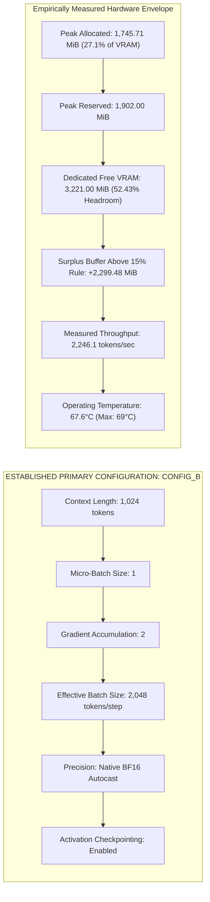

# IGRIS Verified Synthetic Training Configuration

**Operating Model:** `SOLO_DEVELOPER_OWNER_REVIEW`  
**Target Hardware:** NVIDIA GeForce RTX 3050 6GB Laptop GPU (6,441,926,656 bytes VRAM)  
**Host System:** Intel Core i5-13420H, 16 GB DDR4/DDR5 RAM, Windows 11  
**Scope:** Controlled Synthetic-Only Training Run (Tamil, English, Tanglish)  
**Document Version:** 1.0.0  
**Effective Date:** 2026-11-21  

---

## 1. Selected & Established Primary Configuration

Based on rigorous 30-step empirical stability testing, **Configuration B ($T=1024, B=1, A=2$)** is established as the authoritative, empirically supported configuration for the upcoming controlled synthetic-only training run.



### Justification for Selection Over Alternatives:
1. **Full Production Context:** A context length of $1,024$ tokens captures complete paragraphs and code-switched multi-sentence dialogues in Tamil and Tanglish without premature document truncation, which is impossible at $T=256$ or $T=512$.
2. **Massive Dedicated VRAM Headroom:** Peak allocated memory is only **$1,745.71\text{ MiB}$** ($1.71\text{ GiB}$), leaving **$3,221.00\text{ MiB}$ ($52.43\%$)** of physical VRAM untouched. This provides a **$2,299.48\text{ MiB}$ safety buffer** above the mandatory $15\%$ headroom threshold ($921.52\text{ MiB}$).
3. **Sustained Throughput:** Achieved **$2,246.05\text{ tokens/sec}$** ($1.10\text{ optimizer steps/sec}$) across 30 measured steps ($61,440\text{ tokens}$ in $27.35\text{ seconds}$).
4. **Thermal Stability:** Stable operating temperature of **$67.6^\circ\text{C}$** (peak $69.0^\circ\text{C}$) on laptop cooling, well below NVIDIA throttling thresholds ($86^\circ\text{C}$).
5. **Bit-Exact Recovery:** Checkpoint persistence and restoration validated with **$0.00000000$** loss and weight divergence.

---

## 2. Complete Training Engine Specification

The training script must instantiate `IgrisTrainer` using the following exact configuration:

```python
from igris.training.engine import TrainingConfig
from igris.model.transformer import get_production_config

# Model configuration
model_config = get_production_config()
model_config.tie_word_embeddings = True
model_config.max_position_embeddings = 1024
model_config.gradient_checkpointing = True

# Training configuration
training_config = TrainingConfig(
    model_name="igris-prod-16l",
    max_seq_len=1024,
    micro_batch_size=1,
    gradient_accumulation_steps=2,
    learning_rate=3e-4,
    min_lr_ratio=0.1,
    warmup_steps=500,
    weight_decay=0.01,
    adam_beta1=0.9,
    adam_beta2=0.95,
    adam_eps=1e-8,
    gradient_clipping=1.0,
    precision="bf16",
    activation_checkpointing=True,
    eval_interval=250,
    checkpoint_interval=500,
    random_seed=20261121,
    output_dir="./checkpoints_synthetic_run",
)
```

### Detailed Parameter Matrix

| Parameter | Specification | Purpose / Invariant |
| :--- | :--- | :--- |
| **Model Name** | `igris-prod-16l` | Authoritative 16-layer transformer identifier |
| **Context Length ($T$)** | $1,024\text{ tokens}$ | Production context window |
| **Micro-Batch Size ($B$)** | $1$ | Ensures sub-2 GiB VRAM allocation |
| **Gradient Accumulation ($A$)** | $2$ | Provides effective batch size of 2,048 tokens |
| **Effective Batch Tokens** | $2,048\text{ tokens/step}$ | Stable optimizer gradient updates |
| **Precision** | `bf16` | Native Ampere hardware autocast without loss scaling instability |
| **Activation Checkpointing** | `True` | Limits activation memory to inputs of 16 layers ($< 16\text{ MiB}$) |
| **Base Learning Rate** | $3.0 \times 10^{-4}$ | Standard peak rate for 80M transformer |
| **Min Learning Rate Ratio** | $0.1$ | Minimum decayed learning rate ($3.0 \times 10^{-5}$) |
| **Warmup Steps** | $500\text{ steps}$ | Linear warmup for AdamW second-moment calibration |
| **Learning Rate Schedule** | Cosine Decay | Smooth decay from step 500 to max steps |
| **Weight Decay** | $0.01$ | Decoupled L2 regularization on weight matrices |
| **AdamW $\beta_1, \beta_2$** | $0.90, 0.95$ | Tailored momentum for transformer pretraining |
| **AdamW $\epsilon$** | $1.0 \times 10^{-8}$ | Numerical stability denominator |
| **Gradient Clipping Norm** | $1.0$ | Prevents gradient explosion on sudden token surprises |
| **Evaluation Interval** | $250\text{ steps}$ | Periodic validation loss and perplexity evaluation |
| **Checkpoint Interval** | $500\text{ steps}$ | Atomic full checkpoint save |
| **Random Seed** | $20261121$ | Exact reproducibility seed |

---

## 3. Strict Architectural & Governance Invariants

The synthetic training execution must strictly adhere to the following invariants:

1. **Transformer Architecture Invariants:**
   * Layers: 16 Transformer Decoder Blocks
   * Hidden Dimension ($d_{\text{model}}$): 512
   * Intermediate Dimension ($d_{\text{ffn}}$): 2048 (SwiGLU activation)
   * Attention Heads: 8 Query Heads, 4 KV Heads (GQA 2:1 ratio)
   * Head Dimension: 64
   * Position Embeddings: RoPE with $\theta = 10,000$
   * Normalization: Pre-LN RMSNorm with $\epsilon = 1.0 \times 10^{-5}$
   * Tied Word Embeddings: `tie_word_embeddings = True`
   * Total Parameters: **$79,708,672$** (exact byte count: $159,417,344\text{ bytes}$ in BF16)
2. **Tokenizer Invariants:**
   * Tokenizer Artifact: Original Candidate A only
   * SHA-256: `ac7e18b13973450b43bfff18609a833e4ef0e642b8dc5803e39ab1e81ba4c561`
   * Vocabulary Size: 32,768 tokens
   * Structural Tokens Pinned: IDs 0–11 (`<pad>`, `<unk>`, `<s>`, `</s>`, `<mask>`, `<sep>`, `<cls>`, `<tamil>`, `<english>`, `<tanglish>`, `<code_switch>`, `<reserved_11>`)
3. **Data Scope Invariants:**
   * **Synthetic Data Only:** Training will draw exclusively from approved synthetic Tamil, English, and Tanglish fixtures.
   * **Test Split Isolation:** The test split is protected by `SplitIsolationError` and will never be evaluated during training.
   * **Pretraining Gate:** **LOCKED**. Zero production dataset downloads; $0.00 cloud spend.

---

## 4. Operational Boundaries for the Synthetic Run

* **Maximum Permissible VRAM:** Peak allocated VRAM must not exceed **$4,239.48\text{ MiB}$** (ensuring $15\%$ physical headroom).
* **Maximum Permissible Temperature:** GPU temperature must not exceed **$80^\circ\text{C}$** (measured peak was $69^\circ\text{C}$).
* **Loss Finiteness Check:** Execution will halt immediately if any batch produces `NaN` or `Inf` loss.
* **Checkpoint Retention:** Keep rolling top-3 checkpoints plus latest step checkpoint to preserve local disk space.
