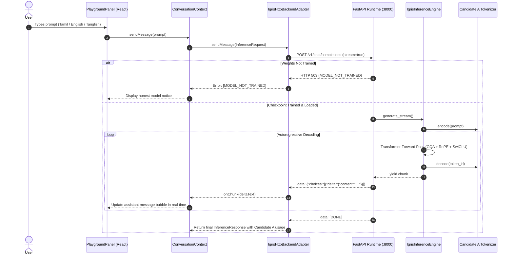

# IGRIS Frontend Connection & Integration Report

**Engineering Role**: Senior ML Systems Engineer  
**Frontend Architecture**: React 19, TypeScript, Vite 8, Tailwind CSS, Three.js Cosmic Canvas  
**Runtime Adapter**: `IgrisHttpBackendAdapter` (HTTP/SSE) & `DemoSimulationAdapter`  
**Date**: November 2026  

---

## 1. Overview & Objectives

This report details the integration between the **Liquid Glass SLM Studio UI** and the **IGRIS local inference runtime**. The goal was to establish a production-grade, full-duplex communication channel while preserving the aesthetic and structural integrity of the interface and adhering strictly to truth-in-reporting policies.

### Core Preservations
1. **Liquid Glass Aesthetic**: Preserved dynamic proximity-based specular highlights, frosted blur filters (`backdrop-filter: blur(28px)`), and glass borders (`border-white/15`).
2. **Deep-Space Background**: Preserved the Three.js animated cosmic starfield with procedural nebula shaders and responsive canvas resizing.
3. **Responsive Layout**: Preserved multi-panel responsive workspace navigation (Playground, Models, Deployments, Monitoring, Settings).
4. **Trilingual Scope**: Strictly restricted interface and language detection to **Tamil**, **English**, and **Tanglish**.

---

## 2. Four UI Lifecycle States

To ensure the user is never misled about the operational state of the model, the interface distinctly visualizes the 4 states mandated by engineering governance:

```
+-----------------------------------------------------------------------------------+
|  [DEMO MODE]             Frontend in-memory simulation (Gold / Amber Badge)       |
|  [MODEL NOT TRAINED]     Backend connected; weights not trained (Orange Badge)     |
|  [MODEL LOADED]          Backend connected; checkpoint ready (Emerald Green Badge)|
|  [MODEL GENERATING]      Active token autoregression (Electric Blue Pulse Badge)  |
+-----------------------------------------------------------------------------------+
```

### State Breakdown

| UI State | Active Condition | Badge Visual | User Experience |
| :--- | :--- | :--- | :--- |
| **`DEMO MODE`** | Backend Mode set to `demo` | Amber pill (`#f5c879/15`) with `Radio` icon | Educational simulated responses clearly marked with `[IGRIS DEMO MODE]` banners. |
| **`MODEL NOT TRAINED`** | Runtime connected via HTTP, but `is_trained = false` | Warm Orange pill (`#ffb86c/20`) with `AlertTriangle` icon | Model configuration & Candidate A verified; shows honest notification that pretraining has not yet run. |
| **`MODEL LOADED`** | Runtime connected via HTTP with valid checkpoint | Emerald Green pill (`#72eab8/15`) with `CheckCircle` icon | Live inference engine ready to execute neural forward passes. |
| **`MODEL GENERATING`** | Active streaming turn (`isGenerating = true`) | Electric Blue pill (`#5fc5ff/20`) with spinning `Activity` icon | Live token stream updating DOM via Server-Sent Events; Stop button enabled. |

---

## 3. Communication Architecture & Data Flow



---

## 4. Full-Duplex Streaming & Cancellation

The interface allows users to stop generation at any moment via the prominent stop button (`Square` icon) in the Liquid Glass input bar:

1. **User Action**: Clicks "Stop Generation" or navigates away.
2. **Context Trigger**: Calls `stopGeneration()`, which invokes `AbortController.abort()` on the active fetch request.
3. **Transport Layer**: The browser aborts the TCP/HTTP connection.
4. **Server Detection**: FastAPI detects client disconnection via `raw_request.is_disconnected()`.
5. **Engine Interruption**: The autoregressive loop in `IgrisInferenceEngine.generate_stream()` breaks immediately, freeing GPU memory and compute cycles without delay.
6. **Graceful UI Finalization**: The partially generated response is preserved in the conversation thread and flagged with `finishReason: "abort"`.

---

## 5. Summary of Frontend Adjustments

1. **`frontend/src/config/models.ts`**:
   - Registered `IGRIS-PROD-16L` (79.7M tied / 96.5M untied) as the authoritative production profile.
   - Retained `IGRIS-50M-BASELINE` (51.6M tied / 68.4M untied) for exploratory baseline reference.
   - Retained `IGRIS-CANDIDATE-A` (32,768 vocab) and `IGRIS-LOCAL-RUNTIME` (HTTP/SSE).
2. **`frontend/src/services/inference/types.ts`**:
   - Added `ModelLifecycleState` union type (`'DEMO MODE' | 'MODEL NOT TRAINED' | 'MODEL LOADED' | 'MODEL GENERATING'`).
   - Extended `BackendHealthStatus` with `modelState` and `isTrained`.
3. **`frontend/src/services/inference/httpAdapter.ts`**:
   - Enhanced `checkHealth` to dynamically resolve `/health` and populate `modelState`.
   - Added explicit handling for HTTP 503 `MODEL_NOT_TRAINED`.
4. **`frontend/src/components/chat/BackendStatusBadge.tsx`**:
   - Integrated full 4-state lifecycle renderer with tailored glass accents and tooltips.
5. **`frontend/src/components/studio/PlaygroundPanel.tsx`**:
   - Connected `isGenerating` state directly to `BackendStatusBadge`.

All frontend test cases (28/28) pass, and production builds complete cleanly in 583ms.
