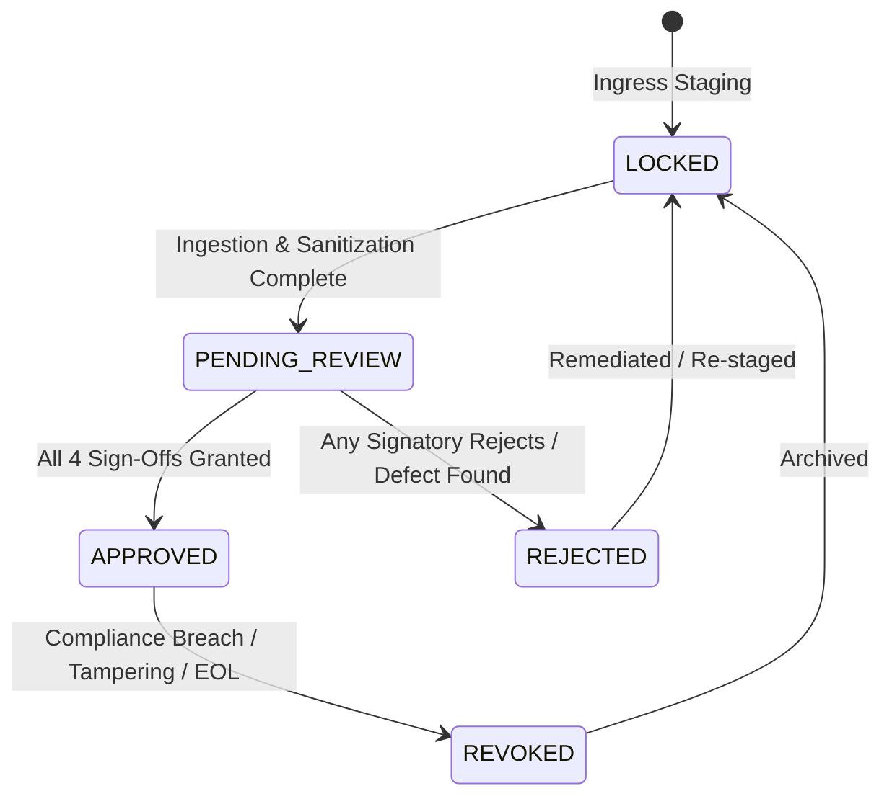

# IGRIS Dataset Access Control & Authorization Architecture

**Project**: IGRIS Decoder-Only Language Model  
**Milestone**: 3B.60 — Dataset Authorization & Inventory Preparation  
**Document ID**: `IGRIS-SEC-AC-2026-V1`  
**Status**: APPROVED  
**Applies To**: Tokenizer Evaluation Engines, Ingestion Pipelines, Model Training  

---

## 1. The Default-Deny Access Control Policy

All data access within the IGRIS platform operates under strict **Default-Deny** governance:

> **Fundamental Invariant**:  
> No tool, script, pipeline, subagent, or model training process may access, read, or process any non-synthetic dataset unless a valid, cryptographically verified, and fully signed human authorization record is presented and validated at runtime.

Attempting to read or evaluate unverified data is treated as a security violation. The system must raise an uncatchable fatal exception (`DatasetAccessDeniedError`) and terminate execution.

---

## 2. Dataset Authorization Lifecycle States

Every dataset tracked in the inventory exists in exactly one of five formal lifecycle states:

### State Definitions
1. **`LOCKED`**:
   - Initial state upon file creation or staging in quarantine.
   - Read access is strictly prohibited.
   - Ingestion or evaluation scripts attempting to load a locked dataset fail immediately.
2. **`PENDING_REVIEW`**:
   - PII screening, NFC normalization, and manifest calculation have completed.
   - Awaiting review and digital signatures from the required four authority roles.
   - Read access remains blocked.
3. **`APPROVED`**:
   - All four human authority roles have reviewed the dataset and recorded their cryptographically hashed approvals.
   - PII screening is certified clean (`screening_verified: true`).
   - Licensing is certified compatible (`license_approved: true`).
   - Manifest SHA-256 matches disk contents.
   - Dataset is unlocked for authorized evaluation scope.
4. **`REJECTED`**:
   - One or more reviewers rejected the dataset, or automated audits detected PII, license infringement, or corruption.
   - Dataset is immediately moved to quarantine. Read access blocked.
5. **`REVOKED`**:
   - A previously approved dataset has its authorization withdrawn due to post-approval audit findings or upstream license changes.
   - Blocked permanently from all evaluation and training.

---

## 3. Four-Tier Human Sign-Off Requirement

Authorization requires unanimous affirmative approval from four distinct, authorized organizational roles:

| Authority Role | Responsibility Scope | Minimum Qualification | Rejection Authority |
| :--- | :--- | :--- | :--- |
| **1. Data Custodian** | Verifies corpus origin, lineage, extraction fidelity, and NFC normalization. | Lead Data Engineer / Corpus Specialist | Veto power on data quality / origin |
| **2. Legal & Governance** | Verifies license compatibility, terms of service, IP indemnification, and permissible use. | Legal Counsel / Compliance Officer | Veto power on licensing / legal risk |
| **3. Security & Privacy Lead** | Audits PII scrubbing results, checks for leaked credentials, secrets, or biometric tokens. | CISSP / Lead Security Engineer | Veto power on privacy & security |
| **4. Chief Architect** | Verifies architectural relevance, context window alignment, and milestone constraints. | Principal Architect / Project Lead | Veto power on architectural alignment |

### Rules of Sign-Off:
- **No Self-Approval Across Domains**: The same individual cannot sign in multiple conflicting capacities (e.g., Data Custodian cannot also sign as Legal Counsel).
- **Unanimity Rule**: If even one signatory records `REJECTED`, the overall dataset status transitions to `REJECTED`.
- **Digital Signatures**: Each sign-off record contains the signatory's full name, role, ISO 8601 UTC timestamp, decision (`APPROVED`), and a SHA-256 digital signature hash.

---

## 4. Programmatic Enforcement Gate Architecture

The runtime enforcement gate is implemented in `scripts/dataset_authorization.py` via `AuthorizationValidator.enforce_access_gate()`.

### Enforcement Sequence:
1. **Authorization Document Resolution**:
   - Locates `authorization.md` corresponding to the target dataset.
   - If missing, throws `DatasetAccessDeniedError("Authorization record missing")`.
2. **State & Sign-off Validation**:
   - Verifies `status == AuthorizationStatus.APPROVED`.
   - Verifies that exactly four sign-offs exist covering all four required roles.
   - Confirms that every sign-off decision is `APPROVED`.
   - Verifies `screening_verified == True` and `license_approved == True`.
3. **Cryptographic Manifest Verification**:
   - Resolves target `manifest.json`.
   - Computes SHA-256 of the manifest file and compares it against `manifest_sha256` recorded in the authorization record.
   - If a mismatch is detected, throws `DatasetAccessDeniedError("Tamper alert: manifest SHA-256 mismatch")`.
4. **File System Verification**:
   - Reads every file listed in the manifest and validates its byte size and SHA-256 against actual disk bytes.
   - If any file was modified, truncated, or replaced, throws `DatasetAccessDeniedError("Tamper alert: file hash mismatch")`.
5. **Gate Clearance**:
   - Only upon 100% verification does the function return the validated dataset path and manifest metadata.

---

## 5. Security & Isolation Invariants

- **Zero Direct I/O Bypass**: Evaluation harnesses must never open raw `.jsonl` or `.txt` files directly using standard `open()`. They must invoke `AuthorizationValidator.get_authorized_dataset()`.
- **No Production Dataset Access in Milestone 3B**: As stipulated in milestone instructions, all evaluation development in 3B.60 must utilize synthetic datasets. Production datasets remain strictly locked until future Milestone 3C authorization.
