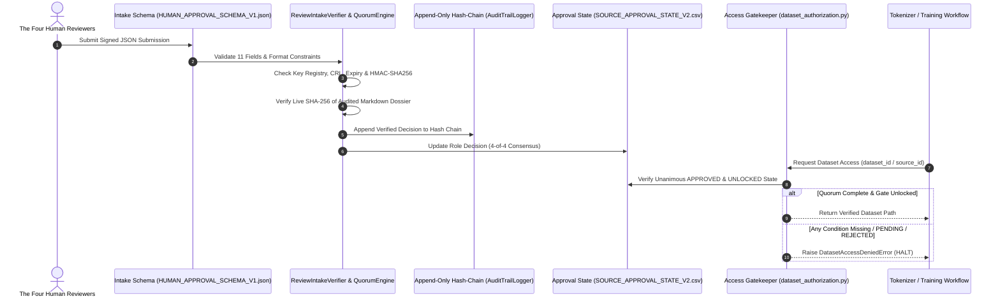
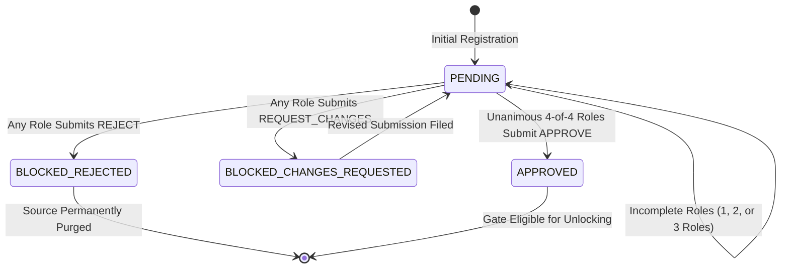

# IGRIS Dataset Authorization & Governance Specification V2

**Document ID**: `IGRIS-SPEC-AUTH-V2`  
**Classification**: SYSTEM SPECIFICATION & ARCHITECTURE  
**Status**: APPROVED & CODIFIED  
**Version**: 2.0.0  
**Effective Date**: 2026-11-17  
**Gate Status**: LOCKED (Default-Deny Enforced)  

---

## 1. Overview & Architectural Principles

The IGRIS Dataset Authorization and Governance Framework provides a verifiable, tamper-evident, fail-closed access-control mechanism governing dataset acquisition, tokenizer training, fertility evaluation, and model alignment.

### Core Architectural Axioms:
1. **Default-Deny (Fail-Closed)**: No dataset, directory, or archive may be read, decompressed, or ingested without a fully validated, unexpired, multi-signed authorization record. Any missing field, signature failure, or state inconsistency immediately denies access.
2. **Independence Axiom (Gate Decoupling)**: Permissions across pipeline stages are strictly decoupled. Authorizing a dataset for tokenizer fertility evaluation confers zero authority for vocabulary training, pre-training, or supervised fine-tuning.
3. **Four-Role Quorum Mandate**: Authorization requires unanimous 4-of-4 sign-off from designated human authority roles:
   - `DATA_CUSTODIAN`
   - `LEGAL_GOVERNANCE`
   - `SECURITY_PRIVACY`
   - `CHIEF_ARCHITECT`
4. **Anti-Fabrication**: Technical verification never substitutes for human sign-off. Synthetic signatures are restricted exclusively to isolated test suites. All production registers remain locked until authentic human reviews are cryptographically intake-verified.
5. **Tamper-Evident Provenance**: All human review decisions and state transitions are appended to a SHA-256 hash-chained audit trail.

---

## 2. Dual-Layer Defense Architecture

The framework operates via two decoupled enforcement layers:



---

## 3. Data Structures & Schema Definitions

### 3.1 Formal Human Review Intake Schema (`HUMAN_APPROVAL_SCHEMA_V1.json`)
The intake submission schema enforces 11 required fields with zero allowed additional properties:

| Field | Type | Pattern / Enum | Description |
| :--- | :--- | :--- | :--- |
| `submission_id` | `string` | `^SUB-[A-Z0-9]{8,16}$` | Unique identifier (e.g. `SUB-CUST20261117`) |
| `reviewer_identity` | `string` | 3 to 128 chars | Corporate email/identity of reviewer |
| `role` | `string` | `DATA_CUSTODIAN`, `LEGAL_GOVERNANCE`, `SECURITY_PRIVACY`, `CHIEF_ARCHITECT` | Codified governance role |
| `public_key_id` | `string` | `^KEY-[A-Z0-9_\-]{6,32}$` | Registered key ID |
| `source_ids_reviewed` | `array` | 1 to 32 items (`^SRC-[A-Z]{2}-[0-9]{2}$`) | Specific source IDs evaluated |
| `decision` | `string` | `APPROVE`, `REJECT`, `REQUEST_CHANGES` | Formal governance verdict |
| `evidence_references` | `array` | Objects (`reference_type`, `reference_uri`, `sha256`) | Cryptographic references audited |
| `document_sha256` | `string` | 64 hex characters | Bitwise SHA-256 of audited markdown on disk |
| `timestamp` | `string` | ISO-8601 date-time | Time of submission |
| `expiry_date` | `string` | ISO-8601 date-time | Approval expiration timestamp |
| `digital_signature` | `string` | 64 to 128 hex characters | HMAC-SHA256 over canonical payload |
| `notes` | `string` | Optional (max 1024 chars) | Reviewer reservations or conditions |

### 3.2 Canonical JSON Serialization Standard (RFC 8785)
To ensure identical cryptographic digests regardless of operating system, Python version, or dictionary insertion order:
1. The field `digital_signature` is excluded from the signature payload.
2. Dictionary keys are sorted alphabetically at all nesting levels.
3. Whitespace separators are strictly compact: `separators=(',', ':')`.
4. Unicode characters are encoded directly in UTF-8 without ASCII escaping (`ensure_ascii=False`).

```python
def canonical_json_bytes(data: Dict[str, Any]) -> bytes:
    payload = {k: v for k, v in data.items() if k != "digital_signature"}
    raw_str = json.dumps(payload, sort_keys=True, separators=(",", ":"), ensure_ascii=False)
    return raw_str.encode("utf-8")
```

### 3.3 Constant-Time Cryptographic Signature Verification
Signatures are computed using HMAC-SHA256 and compared using constant-time equality checks to eliminate timing attacks:

```python
def verify_signature(payload_bytes: bytes, signature: str, secret_key: str) -> bool:
    expected = hmac.new(secret_key.encode("utf-8"), payload_bytes, hashlib.sha256).hexdigest()
    return hmac.compare_digest(expected.lower(), signature.lower())
```

---

## 4. Quorum Consensus State Engine

For any candidate dataset source, the `QuorumEngine` evaluates all valid, unexpired submissions:



### State Resolution Rules:
- **`APPROVED`**: Granted if and only if `DATA_CUSTODIAN`, `LEGAL_GOVERNANCE`, `SECURITY_PRIVACY`, and `CHIEF_ARCHITECT` have all submitted `APPROVE` decisions with valid signatures.
- **`BLOCKED_REJECTED`**: Triggered immediately if any role submits `REJECT`. Absolute veto power; blocks all pipeline gates.
- **`BLOCKED_CHANGES_REQUESTED`**: Triggered if any role requests amendments. Gate remains locked pending revision.
- **`PENDING`**: Default state when fewer than 4 unique roles have signed.

---

## 5. Append-Only Hash-Chained Audit Trail Specification

All governance transitions are recorded in `governance_audit_trail.jsonl`.

### Record Schema:
```json
{
  "audit_id": 1,
  "timestamp": "2026-11-17T12:00:00Z",
  "source_id": "SRC-TM-01",
  "gate_name": "tokenizer_vocab_training",
  "previous_state": "LOCKED",
  "new_state": "PENDING_REVIEW",
  "reviewer_identity": "custodian@igris-governance.org",
  "role": "DATA_CUSTODIAN",
  "evidence_hash": "c3ab8ff13720e8ad9047dd39466b3c8974e592c2fa383d4a3960714caef0c4f2",
  "reason_for_decision": "Initial ingress documentation verified",
  "parent_audit_hash": "0000000000000000000000000000000000000000000000000000000000000000",
  "record_hash": "e3b0c44298fc1c149afbf4c8996fb92427ae41e4649b934ca495991b7852b855"
}
```

### Verification Invariant:
1. `record[0].parent_audit_hash == "0" * 64` (Genesis Hash).
2. For all $i > 0$: `record[i].parent_audit_hash == record[i-1].record_hash`.
3. For all $i$: `record[i].record_hash == SHA256(canonical_json(record[i] - {record_hash}))`.

---

## 6. Programmatic Access Control API

Pipelines must enforce access control exclusively through `AuthorizationValidator`:

### Safe Entry Point:
```python
from dataset_authorization import AuthorizationValidator, DatasetAccessDeniedError

try:
    data_dir = AuthorizationValidator.get_authorized_dataset_path(
        dataset_id="DS-PROD-TM-001",
        auth_record_path="artifacts/auth/DS-PROD-TM-001_auth.md",
        manifest_path="data/tamil/manifest.json",
        target_dir="data/tamil/corpus",
        inventory_csv_path="DATASET_APPROVAL_REGISTER.csv",
    )
    # Access authorized data directory
except DatasetAccessDeniedError as ex:
    # Fail-closed execution halt
    logger.error("Dataset authorization gate denied access: %s", ex)
    raise SystemExit(1)
```

### Enforced Checks:
1. File existence on disk.
2. JSON parsing and schema validation.
3. Dataset ID matching.
4. `status == AuthorizationStatus.APPROVED`.
5. `screening_verified == True`.
6. `license_approved == True`.
7. Presence and approval of all 4 `REQUIRED_ROLES`.
8. Valid 64-hex digital signature for every sign-off.
9. Expiration validation (`now <= expiry_date`).
10. Dual SHA-256 manifest integrity verification.

---

## 7. Versioning & Governance Maintenance

- **Specification Version**: 2.0.0
- **Governing Standard**: IGRIS Architectural Charter & Dataset Governance Framework
- **Review Cycle**: Mandatory re-audit upon any modification to schemas, catalogs, or verification code.
