# IGRIS Dataset Security Validation Report V2

**Project**: IGRIS Multilingual Decoder-Only Transformer  
**Active Patch**: `C:\IGRIS\igris_3b52_production_tokenizer_patch\igris_3b52_patch`  
**Classification**: SECURITY VALIDATION REPORT  
**Status**: APPROVED & PASSING  
**Audit Date**: 2026-11-17  
**Gatekeeper Status**: LOCKED (Fail-Closed Default Active)  

---

## 1. Executive Summary

This report documents the security validation of the IGRIS dataset authorization and governance framework for Milestone 3C.10+.

The framework was subjected to rigorous positive, negative, and adversarial edge-case testing using synthetic test fixtures exclusively. In accordance with strict project security constraints:
1. **Zero Production Access**: No production datasets were accessed, decompressed, or ingested.
2. **Zero Fabrication**: No production cryptographic keys or human sign-offs were fabricated.
3. **Fail-Closed Enforced**: Every simulated failure mode resulted in immediate denial of access (`DatasetAccessDeniedError` or `QuorumState.BLOCKED_*` / `PENDING`).
4. **Candidate Immutability**: Candidate A and Candidate B tokenizers remain completely untouched and invariant.

---

## 2. Threat Modeling & Attack Vector Analysis

The governance framework was audited against ten distinct threat vectors:

```mermaid
flowchart TD
    subgraph Attack Vectors
        A1["1. Unapproved Ingestion Attempt"]
        A2["2. Missing Role Sign-off (Incomplete Quorum)"]
        A3["3. Payload Tampering Post-Signature"]
        A4["4. Signature Bit Flipping"]
        A5["5. Role Spoofing / Key Binding Violation"]
        A6["6. Revoked Key Usage"]
        A7["7. Expired Approval / Stale Credentials"]
        A8["8. Document Tampering (Dossier Alteration)"]
        A9["9. Audit Trail Log Tampering"]
        A10["10. Pipeline Scope Creep (Eval to Training)"]
    end

    subgraph Security Controls
        C1["Default-Deny Gatekeeper (dataset_authorization.py)"]
        C2["QuorumEngine 4-of-4 Consensus Requirement"]
        C3["RFC 8785 Canonical JSON + HMAC-SHA256"]
        C4["Constant-Time hmac.compare_digest"]
        C5["KeyRegistry Role Binding Validation"]
        C6["Certificate Revocation List (CRL)"]
        C7["Temporal Expiration Checks (UTC)"]
        C8["Live SHA-256 Document Verification on Disk"]
        C9["Append-Only Hash-Chained JSONL Ledger"]
        C10["Decoupled Gate Matrix (Independence Axiom)"]
    end

    A1 --> C1
    A2 --> C2
    A3 --> C3
    A4 --> C4
    A5 --> C5
    A6 --> C6
    A7 --> C7
    A8 --> C8
    A9 --> C9
    A10 --> C10
```



---

## 3. Detailed Security Controls & Failure Mode Testing

### Threat 1: Unapproved Ingestion Attempt
- **Attack Scenario**: A user or automated script attempts to access a dataset directory or run training/evaluation without an approved authorization record.
- **Enforced Control**: `AuthorizationValidator.enforce_access_gate()` checks whether the authorization record exists and whether its status is `APPROVED`.
- **Test Result**: `DatasetAccessDeniedError` raised immediately. Zero data directories returned.

### Threat 2: Missing Role Sign-off (Incomplete Quorum)
- **Attack Scenario**: An attacker crafts an authorization record with only 3 of the 4 required authority roles (e.g. omitting `CHIEF_ARCHITECT`).
- **Enforced Control**: Both `AuthorizationValidator` and `QuorumEngine` require unanimous 4-of-4 representation (`DATA_CUSTODIAN`, `LEGAL_GOVERNANCE`, `SECURITY_PRIVACY`, `CHIEF_ARCHITECT`).
- **Test Result**: `QuorumState.PENDING` retained; `AuthorizationValidator` raises `DatasetAccessDeniedError: Missing required human sign-offs`.

### Threat 3: Post-Signature Payload Tampering
- **Attack Scenario**: An attacker takes a valid signed submission and mutates the `decision` from `REJECT` to `APPROVE`, or alters `source_ids_reviewed`.
- **Enforced Control**: `canonical_json_bytes()` serializes the dictionary according to RFC 8785 (keys sorted alphabetically, compact whitespace, UTF-8). Any field alteration changes the computed canonical byte sequence.
- **Test Result**: Verification fails: `Cryptographic signature verification failed: signature does not match canonical payload`.

### Threat 4: Signature Bit Flipping & Non-Hex Strings
- **Attack Scenario**: Modifying signature hex characters or supplying non-hex / malformed strings.
- **Enforced Control**: Regex validation `^[0-9a-fA-F]{64,128}$` followed by constant-time verification using `hmac.compare_digest()`.
- **Test Result**: Verification rejected. Zero side-channel timing leakage.

### Threat 5: Role Spoofing / Key-to-Role Binding Violation
- **Attack Scenario**: An authorized Chief Architect uses their valid private signing key to sign a review submission as `LEGAL_GOVERNANCE`.
- **Enforced Control**: `KeyRegistry.is_valid_key()` verifies that `key.role == declared_role`.
- **Test Result**: Verification rejected: `Key 'KEY-CHIEF_ARCHITECT-001' is bound to role 'CHIEF_ARCHITECT', cannot sign as 'LEGAL_GOVERNANCE'`.

### Threat 6: Revoked Key Usage
- **Attack Scenario**: A compromised or decommissioned reviewer key is used to sign a submission.
- **Enforced Control**: `KeyRegistry.revoke_key()` marks keys in the CRL. `is_valid_key()` verifies `not key.is_revoked`.
- **Test Result**: Verification rejected: `Key has been revoked: Credential compromised in test drill`.

### Threat 7: Expired Approval / Stale Credentials
- **Attack Scenario**: An intake submission or authorization record signed in the past is replayed after its `expiry_date`.
- **Enforced Control**: UTC timestamp comparison against reference time (`now > expiry_date`).
- **Test Result**: Verification rejected: `Approval submission expired on <date>`.

### Threat 8: Document Tampering on Disk
- **Attack Scenario**: A reviewer signs a human review markdown file, but an attacker subsequently modifies the file on disk (e.g. altering license risk assessments).
- **Enforced Control**: `ReviewIntakeVerifier.verify_submission()` reads the file on disk, computes its SHA-256 digest, and compares it against `submission.document_sha256`.
- **Test Result**: Verification rejected: `Document SHA256 mismatch: on disk='...', submission claims='...'`.

### Threat 9: Audit Trail Log Tampering
- **Attack Scenario**: An attacker directly edits an entry in the append-only `governance_audit_trail.jsonl` log to forge an approval event.
- **Enforced Control**: `AuditTrailLogger.verify_chain_integrity()` recalculates SHA-256 hashes of each JSON record and verifies that each entry's `parent_audit_hash` matches the preceding record's digest.
- **Test Result**: Tamper detected immediately: `Tampered record at audit_id 1: computed '...' != recorded '...'`.

### Threat 10: Pipeline Scope Creep (Evaluation to Training Leakage)
- **Attack Scenario**: A dataset approved solely for tokenizer evaluation (e.g. `SRC-CV-04` Anthropic HH-RLHF) is fed into vocabulary training or supervised fine-tuning.
- **Enforced Control**: Decoupled gate permissions in `PIPELINE_AUTHORIZATION_MATRIX_V2.csv`. Authorizing one gate confers zero permission on other gates (Independence Axiom).
- **Test Result**: `supervised_fine_tuning` remains 100% `NOT AUTHORIZED`. Tokenizer vocab training remains `INELIGIBLE_REJECTED` or blocked.

---

## 4. Test Suite Execution Results

All automated security tests executed with 100% pass rates:

```
============================= test session starts =============================
platform win32 -- Python 3.11.9, pytest-9.2.0, pluggy-1.7.0
rootdir: C:\IGRIS\igris_3b52_production_tokenizer_patch\igris_3b52_patch
collected 21 items

tests/test_dataset_governance_framework.py::test_unanimous_four_of_four_approval_reaches_approved PASSED [  4%]
tests/test_dataset_governance_framework.py::test_single_rejection_vetoes_to_blocked_rejected PASSED [  9%]
tests/test_dataset_governance_framework.py::test_request_changes_blocks_approval PASSED [ 14%]
tests/test_dataset_governance_framework.py::test_incomplete_quorum_remains_pending PASSED [ 19%]
tests/test_dataset_governance_framework.py::test_duplicate_role_submission_does_not_satisfy_quorum PASSED [ 23%]
tests/test_dataset_governance_framework.py::test_canonical_json_serialization_determinism PASSED [ 28%]
tests/test_dataset_governance_framework.py::test_signature_tamper_detection_in_payload PASSED [ 33%]
tests/test_dataset_governance_framework.py::test_signature_tamper_detection_in_signature_bytes PASSED [ 38%]
tests/test_dataset_governance_framework.py::test_key_role_binding_violation_rejected PASSED [ 42%]
tests/test_dataset_governance_framework.py::test_revoked_key_rejected PASSED [ 47%]
tests/test_dataset_governance_framework.py::test_expired_submission_rejected PASSED [ 52%]
tests/test_dataset_governance_framework.py::test_document_hash_verification_on_disk PASSED [ 57%]
tests/test_dataset_governance_framework.py::test_audit_trail_append_and_chain_verification PASSED [ 61%]
tests/test_dataset_governance_framework.py::test_audit_trail_tamper_detection_in_prior_record PASSED [ 66%]
tests/test_dataset_governance_framework.py::test_gatekeeper_denies_unapproved_dataset_records PASSED [ 71%]
tests/test_dataset_governance_framework.py::test_gatekeeper_denies_missing_role_signoff PASSED [ 76%]
tests/test_dataset_governance_framework.py::test_gatekeeper_denies_expired_authorization PASSED [ 80%]
tests/test_dataset_governance_framework.py::test_all_32_sources_aligned_across_v2_and_v3_registers PASSED [ 85%]
tests/test_dataset_governance_framework.py::test_source_approval_state_v2_all_pending_and_locked PASSED [ 90%]
tests/test_dataset_governance_framework.py::test_pipeline_matrix_sft_alignment_safety_not_authorized PASSED [ 95%]
tests/test_dataset_governance_framework.py::test_candidate_a_and_b_hashes_invariant PASSED [100%]

============================= 21 passed in 0.12s ==============================
```

**Full Regression Test Suite**: `297 passed in 4.63s`  
**Acceptance Test Suite**: `162 passed in 1.48s`  
**Candidate A Hash**: `ac7e18b13973450b43bfff18609a833e4ef0e642b8dc5803e39ab1e81ba4c561` (Invariant)  
**Candidate B Hash**: `d3a3431e07c87ecce863647202ddc9b47b964718adbae7bf2bb2459223b94888` (Invariant)  

---

## 5. Security Verdict & Production Gate State

The dataset authorization and governance framework is **SECURE, VERIFIED, AND FAIL-CLOSED**.

> [!CAUTION]
> **Production Access Lockdown**: Despite successful validation of the security mechanisms, the production access gate remains **LOCKED**. No dataset acquisition or pipeline training is permitted until genuine, cryptographically verified human approvals are submitted by all four designated roles.
