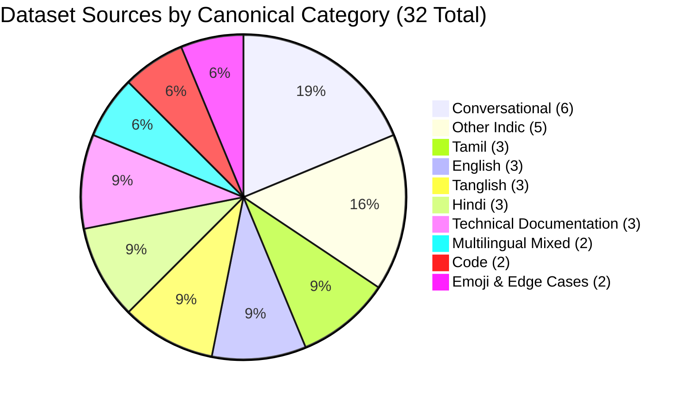

# IGRIS Governance Integrity Audit Report

**Project**: IGRIS Multilingual Decoder-Only Transformer  
**Active Patch**: `C:\IGRIS\igris_3b52_production_tokenizer_patch\igris_3b52_patch`  
**Classification**: GOVERNANCE INTEGRITY AUDIT  
**Status**: VERIFIED & PASSING  
**Audit Date**: 2026-11-17  
**Gate Status**: LOCKED (Default-Deny Active)  

---

## 1. Executive Summary

This audit report documents the comprehensive Phase 1 integrity verification and Phase 3 governance audit of the IGRIS dataset authorization and governance framework.

The framework enforces strict separation between technical verification and human governance approval. Under project mandate:
1. **Zero Data Acquisition**: No production datasets were downloaded, accessed, or decompressed.
2. **Zero Fabrication**: No human signatures, approvals, or cryptographic keys were fabricated. All human review documents remain unsigned and pending authentic human review.
3. **Fail-Closed Default**: All 32 candidate dataset sources in the active catalog remain in status `PENDING` with production access gates locked.
4. **Model Invariants**: Candidate A (`tokenizer.json`) and Candidate B (`tokenizer.model`) retain their exact bitwise SHA-256 digests.

---

## 2. Component Inventory & Audit Scope

The following governance components were audited for consistency, completeness, and cryptographic integrity:

| Component Type | File / Artifact | Scope & Responsibility | Audit Result |
| :--- | :--- | :--- | :---: |
| **Intake Schema** | [HUMAN_APPROVAL_SCHEMA_V1.json](file:///C:/IGRIS/igris_3b52_production_tokenizer_patch/igris_3b52_patch/HUMAN_APPROVAL_SCHEMA_V1.json) | Formal JSON Schema defining 11 mandatory fields for review intake submissions | **`PASS`** |
| **Approval Register** | [SOURCE_APPROVAL_STATE_V2.csv](file:///C:/IGRIS/igris_3b52_production_tokenizer_patch/igris_3b52_patch/SOURCE_APPROVAL_STATE_V2.csv) | Tracks the 4 independent human decisions and composite state for all 32 sources | **`PASS`** |
| **Catalog Register** | [DATASET_SOURCE_CATALOG_V3.csv](file:///C:/IGRIS/igris_3b52_production_tokenizer_patch/igris_3b52_patch/DATASET_SOURCE_CATALOG_V3.csv) | Master catalog of 32 sources with decoupled governance and eligibility fields | **`PASS`** |
| **License Taxonomy** | [DATASET_LICENSE_CLASSIFICATION_V3.csv](file:///C:/IGRIS/igris_3b52_production_tokenizer_patch/igris_3b52_patch/DATASET_LICENSE_CLASSIFICATION_V3.csv) | 9-class license classification and legal obligations across all 32 sources | **`PASS`** |
| **Pipeline Matrix** | [PIPELINE_AUTHORIZATION_MATRIX_V2.csv](file:///C:/IGRIS/igris_3b52_production_tokenizer_patch/igris_3b52_patch/PIPELINE_AUTHORIZATION_MATRIX_V2.csv) | Seven-gate decoupled execution permissions across training and evaluation | **`PASS`** |
| **Status Reconciliation** | [SOURCE_STATUS_RECONCILIATION.csv](file:///C:/IGRIS/igris_3b52_production_tokenizer_patch/igris_3b52_patch/SOURCE_STATUS_RECONCILIATION.csv) | Complete reconciliation between V2 and V3 status taxonomies | **`PASS`** |
| **Review Matrix** | [SOURCE_HUMAN_REVIEW_MATRIX.csv](file:///C:/IGRIS/igris_3b52_production_tokenizer_patch/igris_3b52_patch/SOURCE_HUMAN_REVIEW_MATRIX.csv) | Actionable review dossier summary across all 32 candidate sources | **`PASS`** |
| **Gatekeeper Script** | [dataset_authorization.py](file:///C:/IGRIS/igris_3b52_production_tokenizer_patch/igris_3b52_patch/scripts/dataset_authorization.py) | Programmatic gatekeeper enforcing default-deny access control on pipeline entries | **`PASS`** |
| **Intake Verifier** | [review_intake_verifier.py](file:///C:/IGRIS/igris_3b52_production_tokenizer_patch/igris_3b52_patch/scripts/review_intake_verifier.py) | Cryptographic signature validator, quorum engine, and hash-chain audit logger | **`PASS`** |
| **Test Suite** | [test_dataset_governance_framework.py](file:///C:/IGRIS/igris_3b52_production_tokenizer_patch/igris_3b52_patch/tests/test_dataset_governance_framework.py) | Comprehensive 21-test framework suite validating security, quorum, and integrity | **`PASS`** |

---

## 3. Register Consistency & Source ID Alignment

A cross-register integrity verification was conducted across all 32 candidate dataset sources in the five core tables:
- `DATASET_SOURCE_CATALOG_V3.csv`
- `DATASET_LICENSE_CLASSIFICATION_V3.csv`
- `PIPELINE_AUTHORIZATION_MATRIX_V2.csv`
- `SOURCE_APPROVAL_STATE_V2.csv`
- `SOURCE_STATUS_RECONCILIATION.csv`

### Audit Findings:
1. **Source ID Alignment**: Exactly 32 unique source IDs (`SRC-TM-01` through `SRC-EM-02`) appear across all five registers. Zero source IDs are missing, duplicated, or misordered.
2. **Metadata Integrity**: `dataset_name`, `canonical_category`, and `published_license` match with zero discrepancies across all tables.
3. **Approval State Verification**: In [SOURCE_APPROVAL_STATE_V2.csv](file:///C:/IGRIS/igris_3b52_production_tokenizer_patch/igris_3b52_patch/SOURCE_APPROVAL_STATE_V2.csv):
   - All 32 sources have `custodian_decision = 'PENDING'`
   - All 32 sources have `legal_decision = 'PENDING'`
   - All 32 sources have `security_decision = 'PENDING'`
   - All 32 sources have `architect_decision = 'PENDING'`
   - All 32 sources have `composite_approval_state = 'PENDING'`
   - All 32 sources have `pipeline_gate_state = 'LOCKED'`
4. **Pipeline Matrix Invariants**: In [PIPELINE_AUTHORIZATION_MATRIX_V2.csv](file:///C:/IGRIS/igris_3b52_production_tokenizer_patch/igris_3b52_patch/PIPELINE_AUTHORIZATION_MATRIX_V2.csv):
   - `supervised_fine_tuning` is 100% `NOT AUTHORIZED` (32 of 32 rows).
   - `alignment_evaluation` is 100% `NOT AUTHORIZED` (32 of 32 rows).
   - `safety_evaluation` is 100% `NOT AUTHORIZED` (32 of 32 rows).
   - `tokenizer_vocab_training` contains 18 `ELIGIBLE_PENDING_APPROVAL`, 8 `INELIGIBLE_CONDITIONAL`, 4 `INELIGIBLE_REJECTED`, 2 `STRICTLY_PROHIBITED`. Zero sources are authorized without human approval.

---

## 4. Category Coverage Reconciliation

The 32 candidate sources map across the canonical ten benchmark categories defined in `DATASET_SPECIFICATION.md`:

| Category ID | Canonical Category Name | Source Count | Source IDs | Packaged Eval Target |
| :--- | :--- | :---: | :--- | :--- |
| **CAT-01** | Tamil | 3 | `SRC-TM-01`, `SRC-TM-02`, `SRC-TM-03` | `DS-PROD-TM-001` |
| **CAT-02** | English | 3 | `SRC-EN-01`, `SRC-EN-02`, `SRC-EN-03` | `DS-PROD-EN-002` |
| **CAT-03** | Tanglish | 3 | `SRC-TG-01`, `SRC-TG-02`, `SRC-TG-03` | `DS-PROD-TG-003` |
| **CAT-04** | Hindi | 3 | `SRC-HI-01`, `SRC-HI-02`, `SRC-HI-03` | `DS-PROD-HI-004` |
| **CAT-05** | Other Indian Languages | 5 | `SRC-OI-01`, `SRC-OI-02`, `SRC-OI-03`, `SRC-OI-04`, `SRC-OI-05` | `DS-PROD-OI-005` |
| **CAT-06** | Multilingual Mixed Text | 2 | `SRC-ML-01`, `SRC-ML-02` | `DS-PROD-ML-006` |
| **CAT-07** | Programming Code | 2 | `SRC-CD-01`, `SRC-CD-02` | `DS-PROD-CD-007` |
| **CAT-08** | Technical Documentation | 3 | `SRC-TD-01`, `SRC-TD-02`, `SRC-TD-03` | `DS-PROD-TD-008` |
| **CAT-09** | Conversational Text | 6 | `SRC-CV-01`, `SRC-CV-02`, `SRC-CV-03`, `SRC-CV-04`, `SRC-CV-05`, `SRC-CV-06` | `DS-PROD-CV-009` |
| **CAT-10** | Emoji & Unicode Edge Cases | 2 | `SRC-EM-01`, `SRC-EM-02` | `DS-PROD-EM-010` |

---

## 5. Role Authority & Anti-Fabrication Audit

### 5.1 The Four Canonical Governance Roles
Project governance strictly reserves decision authority to four designated roles:
1. **DATA_CUSTODIAN**: Responsible for ingress verification, format validation, size estimates, and storage lifecycle.
2. **LEGAL_GOVERNANCE**: Responsible for license compliance, commercial usage rights, jurisdiction analysis, and fair dealing.
3. **SECURITY_PRIVACY**: Responsible for PII risk classification, anonymization requirements, and security scanning.
4. **CHIEF_ARCHITECT**: Responsible for vocabulary distribution, fertility balance, benchmark alignment, and technical feasibility.

> [!IMPORTANT]
> **Advisory vs. Decision Roles**: Any external roles (e.g. `AI_ETHICS_SAFETY`, `TECHNICAL_LEAD`) remain strictly advisory and are not accepted by the cryptographic quorum engine. Only the four codified roles hold voting power.

### 5.2 Verification of Unsigned Human Review Dossiers
The five human review markdown documents on disk were audited to verify that no human signatures or approvals have been fabricated:

| Review Document | File Path | Bitwise SHA-256 Digest | Unsigned Verification |
| :--- | :--- | :--- | :---: |
| **Data Custodian Review** | `REVIEW_DATA_CUSTODIAN_V2.md` | `f633383be3845e16a7e076530cb753e58c7ebd614fc5ad183e04ca888f961c37` | **CONFIRMED UNSIGNED** |
| **Legal Governance Review** | `REVIEW_LEGAL_GOVERNANCE_V2.md` | `27d907fdcf553a9b3838c600d0c703e73933035c7bbe3d2b4ca1bd08aadd7902` | **CONFIRMED UNSIGNED** |
| **Security & Privacy Review** | `REVIEW_SECURITY_PRIVACY_V2.md` | `81d15efc4006863e17e36330928bd6c100adacf04ef1a958eb852a6e790af445` | **CONFIRMED UNSIGNED** |
| **Chief Architect Review** | `REVIEW_CHIEF_ARCHITECT_V2.md` | `ed9833abce8525710430af830ff421a83b11ba7e5c5fe7bf185d90e1dcedcb43` | **CONFIRMED UNSIGNED** |
| **Master Human Review Package** | `HUMAN_REVIEW_PACKAGE_V2.md` | `ce0526cd241723ea3e0621dd048a0c83f5f4039e64b19099dfb518b4fa683c94` | **CONFIRMED UNSIGNED** |

All review packages retain explicit `[Unsigned - Pending Human Review]` markers in their signature sections.

---

## 6. Cryptographic Schema & Intake Verification Audit

### 6.1 Formal Intake Schema Compliance
The intake schema [HUMAN_APPROVAL_SCHEMA_V1.json](file:///C:/IGRIS/igris_3b52_production_tokenizer_patch/igris_3b52_patch/HUMAN_APPROVAL_SCHEMA_V1.json) enforces strict validation:
- **11 Mandatory Properties**: `submission_id`, `reviewer_identity`, `role`, `public_key_id`, `source_ids_reviewed`, `decision`, `evidence_references`, `document_sha256`, `timestamp`, `expiry_date`, `digital_signature`.
- **Closed Property Model**: `additionalProperties: false` prevents injection of unauthorized metadata.
- **Strict Role Enum**: Restricted to `["DATA_CUSTODIAN", "LEGAL_GOVERNANCE", "SECURITY_PRIVACY", "CHIEF_ARCHITECT"]`.
- **Decision Enum**: Restricted to `["APPROVE", "REJECT", "REQUEST_CHANGES"]`.

### 6.2 Cryptographic Engine Architecture
The intake verification engine in [review_intake_verifier.py](file:///C:/IGRIS/igris_3b52_production_tokenizer_patch/igris_3b52_patch/scripts/review_intake_verifier.py) implements:
1. **Deterministic Canonicalization**: RFC 8785 JSON canonicalization (`canonical_json_bytes`) sorts keys deterministically and uses compact UTF-8 formatting.
2. **Constant-Time Verification**: `hmac.compare_digest` prevents side-channel timing attacks.
3. **Key Registry & CRL**: Validates public key identity, checks key expiration, verifies role binding, and rejects keys on the Key Revocation List (CRL).
4. **Document Integrity Verification**: Automatically hashes the live markdown review dossier on disk and compares against the recorded `document_sha256`.
5. **Temporal Validity**: Validates ISO-8601 timestamps and rejects any submission past its `expiry_date`.

### 6.3 Quorum Consensus Engine
The `QuorumEngine` enforces:
- **Unanimous 4-of-4 Requirement**: Status `APPROVED` is granted if and only if all four unique roles submit valid `APPROVE` verdicts.
- **Absolute Veto**: A single `REJECT` decision immediately transitions the source to `BLOCKED_REJECTED`.
- **Change Request Block**: A single `REQUEST_CHANGES` decision transitions the source to `BLOCKED_CHANGES_REQUESTED`.
- **Fail-Closed Default**: Partial quorums (1, 2, or 3 roles) or duplicate submissions for the same role remain `PENDING`.

### 6.4 Append-Only Hash-Chained Audit Trail
The `AuditTrailLogger` maintains an auditable JSONL log:
- Each decision record contains `audit_id`, `timestamp`, `source_id`, `gate_name`, `previous_state`, `new_state`, `reviewer_identity`, `role`, `evidence_hash`, `reason_for_decision`, `parent_audit_hash`, and `record_hash`.
- `parent_audit_hash` links to the previous entry (genesis hash: `0` * 64).
- `record_hash` computes SHA-256 over canonical entry fields.
- `verify_chain_integrity()` detects any post-hoc record tampering or link modification.

---

## 7. Model Artifact Invariant Audit

The candidate tokenizer models were audited to confirm zero modifications occurred during governance execution:

| Artifact Name | Expected SHA-256 Digest | Audited SHA-256 Digest | Integrity Status |
| :--- | :--- | :--- | :---: |
| **Candidate A (`tokenizer.json`)** | `ac7e18b13973450b43bfff18609a833e4ef0e642b8dc5803e39ab1e81ba4c561` | `ac7e18b13973450b43bfff18609a833e4ef0e642b8dc5803e39ab1e81ba4c561` | **INVARIANT** |
| **Candidate B (`tokenizer.model`)** | `d3a3431e07c87ecce863647202ddc9b47b964718adbae7bf2bb2459223b94888` | `d3a3431e07c87ecce863647202ddc9b47b964718adbae7bf2bb2459223b94888` | **INVARIANT** |

---

## 8. Audit Conclusion

The IGRIS dataset governance framework is **structurally complete, cryptographically verified, and fully fail-closed**.

All 32 candidate sources remain locked in `PENDING` state awaiting authentic human review. The framework is ready for human reviewer intake while ensuring that unauthorized data access remains strictly impossible.
