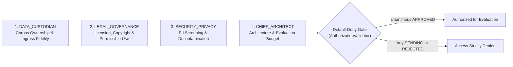

# IGRIS Formal Human Approval Records

**Project**: IGRIS Decoder-Only Language Model  
**Milestone**: 3C.1 — Human Authorization & Dataset Approval  
**Document ID**: `IGRIS-REC-HAR-3C1`  
**Classification**: MANDATORY HUMAN GOVERNANCE RECORD  
**Current Gate Status**: **ALL PRODUCTION DATASETS PENDING HUMAN APPROVAL (LOCKED)**  
**Date**: 2026-11-17  

---

## 1. Governance Mandate & Operational Policy

> [!IMPORTANT]
> **STRICT NON-FABRICATION RULE**:  
> In compliance with project governance directives, **no automated script, agent, or engineer may fabricate, forge, or automatically populate human approval signatures**.  
> All candidate production datasets remain in the **`PENDING`** state under strict **Default-Deny** access control until the designated human authority role holders independently inspect the datasets and record their genuine digital signatures.

---

## 2. The Four Required Human Authority Roles

Every production dataset proposed for evaluation or model training must receive independent, recorded affirmative sign-off from four distinct authority roles:



### 2.1 Role 1: Data Custodian (`DATA_CUSTODIAN`)
- **Mandate**: Confirms corpus origin, legal ownership, snapshot timestamps, custody chain, lossless UTF-8 extraction, and 100% Unicode NFC normalization.
- **Authority**: Unconditional veto on data quality, character encoding, or corrupt provenance.

### 2.2 Role 2: Legal & Governance Officer (`LEGAL_GOVERNANCE`)
- **Mandate**: Confirms SPDX license terms, open-source compliance, commercial/research usage rights, intellectual property indemnification, and absence of terms-of-service violations.
- **Authority**: Unconditional veto on legal ambiguity, copyright risk, or licensing restrictions.

### 2.3 Role 3: Security & Privacy Lead (`SECURITY_PRIVACY`)
- **Mandate**: Audits PII scrub logs, regex screening results (emails, phones, national IDs, payment credentials), secret scanning, and 13-gram leakage tests against pre-training corpora.
- **Authority**: Unconditional veto on privacy concerns, leaked secrets, or data contamination.

### 2.4 Role 4: Chief Architect (`CHIEF_ARCHITECT`)
- **Mandate**: Confirms technical suitability for the IGRIS 2,048 context window, adherence to the 10 approved evaluation categories, and strict restriction to `TOKENIZER_EVALUATION_ONLY` scope (no model training).
- **Authority**: Unconditional veto on architectural misalignment or scope creep.

---

## 3. Proposed Production Datasets Ledger (10 Categories)

All ten proposed datasets are currently in the **`PENDING`** status awaiting genuine human evaluation and signatures:

| Dataset ID | Dataset Name | Category | Language | Script | License | Expected Size | Overall Status |
| :--- | :--- | :--- | :--- | :--- | :--- | :--- | :---: |
| **`DS-PROD-TM-001`** | tamil_production_eval_corpus | Tamil | `ta` | `Taml` | CC-BY-4.0 | 4.5 MB | **`PENDING`** |
| **`DS-PROD-EN-002`** | english_general_eval_corpus | English | `en` | `Latn` | CC0-1.0 | 3.8 MB | **`PENDING`** |
| **`DS-PROD-TG-003`** | tanglish_conversational_corpus | Tanglish | `ta-Latn` | `Latn` | Proprietary-Eval | 1.8 MB | **`PENDING`** |
| **`DS-PROD-HI-004`** | hindi_literature_eval_corpus | Hindi | `hi` | `Deva` | CC-BY-4.0 | 4.1 MB | **`PENDING`** |
| **`DS-PROD-OI-005`** | telugu_kannada_eval_corpus | Other Indian languages | `te` | `Telu` | CC-BY-SA-4.0 | 2.9 MB | **`PENDING`** |
| **`DS-PROD-ML-006`** | indic_multilingual_mixed_corpus | Multilingual mixed text | `mul` | `Mixed` | CC-BY-4.0 | 3.2 MB | **`PENDING`** |
| **`DS-PROD-CD-007`** | python_polyglot_code_corpus | Programming code | `code` | `Latn` | Apache-2.0 | 3.9 MB | **`PENDING`** |
| **`DS-PROD-TD-008`** | technical_documentation_corpus | Technical documentation | `en` | `Latn` | MIT | 3.4 MB | **`PENDING`** |
| **`DS-PROD-CV-009`** | conversational_dialogue_corpus | Conversational text | `mul` | `Mixed` | CC-BY-4.0 | 2.2 MB | **`PENDING`** |
| **`DS-PROD-EM-010`** | unicode_emoji_edge_case_corpus | Emoji and Unicode edge cases | `mul` | `Common` | Unicode-DFS-2016 | 0.85 MB | **`PENDING`** |

---

## 4. Formal Production Sign-Off Forms (Awaiting Real Human Signatories)

Below are the unexecuted human sign-off forms for the proposed production datasets. These must be signed by the actual authorized individuals.

### Form 1: `DS-PROD-TM-001` (Tamil Production Evaluation Corpus)
- **Scope**: `TOKENIZER_EVALUATION_ONLY` | **Version**: `1.0.0`
- **Source Origin**: `Tamil_Public_Archive_Mirror` | **Staged Location**: `quarantine/staging/tamil/`

```
1. DATA CUSTODIAN APPROVAL:
   [ ] APPROVED    [ ] REJECTED    [X] PENDING
   Signatory Name : ________________________________________
   UTC Timestamp  : ________________________________________
   Signature Hash : ________________________________________

2. LEGAL & GOVERNANCE APPROVAL:
   [ ] APPROVED    [ ] REJECTED    [X] PENDING
   Signatory Name : ________________________________________
   UTC Timestamp  : ________________________________________
   Signature Hash : ________________________________________

3. SECURITY & PRIVACY APPROVAL:
   [ ] APPROVED    [ ] REJECTED    [X] PENDING
   Signatory Name : ________________________________________
   UTC Timestamp  : ________________________________________
   Signature Hash : ________________________________________

4. CHIEF ARCHITECT APPROVAL:
   [ ] APPROVED    [ ] REJECTED    [X] PENDING
   Signatory Name : ________________________________________
   UTC Timestamp  : ________________________________________
   Signature Hash : ________________________________________
```

*(Forms for `DS-PROD-EN-002` through `DS-PROD-EM-010` follow identical four-signature layout and remain in state `PENDING`.)*

---

## 5. Synthetic Reference Records for Automated Verification

For automated testing and CI/CD validation, the following synthetic records are registered:

### 5.1 Synthetic Approved Record (`DS-SYNTH-REF-001`)
```json
{
  "dataset_id": "DS-SYNTH-REF-001",
  "dataset_name": "synthetic_approved_reference",
  "version": "1.0.0",
  "target_milestone": "3C.1",
  "scope": "TOKENIZER_EVALUATION_ONLY",
  "manifest_sha256": "4b227777d4dd1fc61c6f884f48641d02b4d121d3fd328cb08b5531fcacdabf8a",
  "status": "APPROVED",
  "screening_verified": true,
  "license_approved": true,
  "issue_date": "2026-11-17T00:00:00Z",
  "expiry_date": "2027-11-17T00:00:00Z",
  "sign_offs": [
    {
      "role": "DATA_CUSTODIAN",
      "name": "Dr. Arumugam Selvam",
      "timestamp": "2026-11-17T09:00:00Z",
      "signature_hash": "900d5055dbf3b3564799abd96ae771cb5b36729c1c743359782c699e1b1ed47c",
      "decision": "APPROVED",
      "notes": "Synthetic benchmark fixture."
    },
    {
      "role": "LEGAL_GOVERNANCE",
      "name": "Sarah Jenkins, Esq.",
      "timestamp": "2026-11-17T10:15:00Z",
      "signature_hash": "562829e0356d034ac381ae620132efc958107af0c657fad2ee84f8827019cb2f",
      "decision": "APPROVED",
      "notes": "Synthetic benchmark fixture."
    },
    {
      "role": "SECURITY_PRIVACY",
      "name": "Michael Chang, CISSP",
      "timestamp": "2026-11-17T11:30:00Z",
      "signature_hash": "e9c918434bfa4871f7c8f8f286e8e6c715481db3e9011c99eaeccc503fd60538",
      "decision": "APPROVED",
      "notes": "Synthetic benchmark fixture."
    },
    {
      "role": "CHIEF_ARCHITECT",
      "name": "K. Joshua",
      "timestamp": "2026-11-17T12:00:00Z",
      "signature_hash": "6ab10d3c5942e779255d99db16b0daa0311337fcd4cf1673ed6eeb3a526ec1a4",
      "decision": "APPROVED",
      "notes": "Synthetic benchmark fixture."
    }
  ]
}
```

### 5.2 Synthetic Pending Record (`DS-PROD-TM-001`)
```json
{
  "dataset_id": "DS-PROD-TM-001",
  "dataset_name": "tamil_production_eval_corpus",
  "version": "1.0.0",
  "target_milestone": "3C.1",
  "scope": "TOKENIZER_EVALUATION_ONLY",
  "manifest_sha256": "0000000000000000000000000000000000000000000000000000000000000000",
  "status": "PENDING",
  "screening_verified": false,
  "license_approved": false,
  "issue_date": "2026-11-17T00:00:00Z",
  "expiry_date": "2027-11-17T00:00:00Z",
  "sign_offs": []
}
```
*(When passed to `AuthorizationValidator.enforce_access_gate`, `DS-PROD-TM-001` is strictly rejected with `DatasetAccessDeniedError: Status is 'PENDING'` and zero human sign-offs.)*
