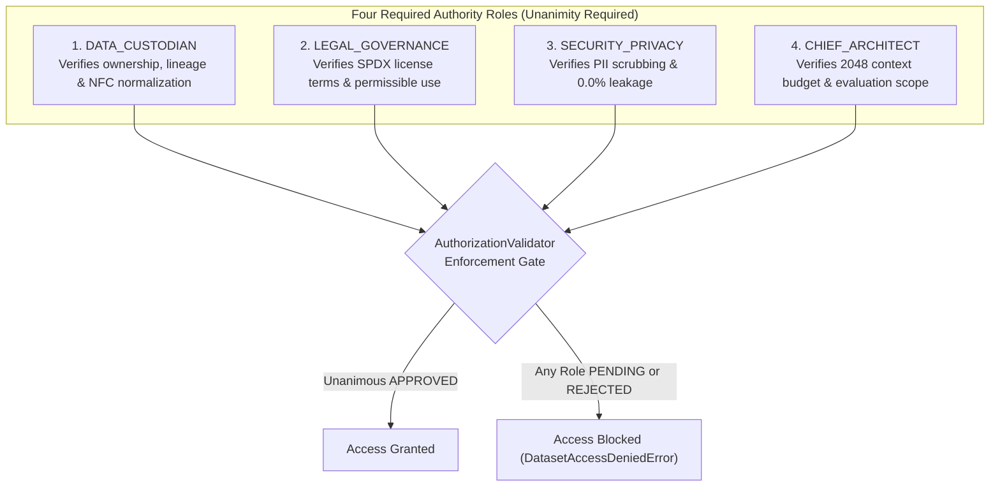

# IGRIS Milestone 3C.1 — Human Authorization & Dataset Approval Report

**Project**: IGRIS Decoder-Only Language Model  
**Patch Directory**: `C:\IGRIS\igris_3b52_production_tokenizer_patch\igris_3b52_patch`  
**Milestone**: 3C.1 — Human Authorization & Dataset Approval  
**Date**: 2026-11-17  
**Execution Environment**: Windows 11, Python 3.11.9, pytest 9.2.0  
**Overall Status**: COMPLETE (Governance Package Prepared & Verified)  
**Production Access Gate**: **STRICTLY LOCKED — AWAITING GENUINE HUMAN APPROVALS**  

---

## 1. Executive Summary

Milestone 3C.1 establishes and validates the formal human authorization process for future production dataset evaluation on the IGRIS platform.

In strict compliance with project governance directives:
1. **Zero production datasets were opened, read, or decompressed.**
2. **Zero private training files, archives, or quarantine folders were accessed.**
3. **Zero corpus ingestion or production PII scanning was executed.**
4. **Zero tokenizer retraining or weight adjustments were performed.**
5. **Candidate A and Candidate B artifacts remain bitwise invariant.**
6. **No human signatures or approvals were fabricated.**
7. **All 10 proposed production datasets are registered in status `PENDING` with all four approvals marked `PENDING`.**
8. **All validation tests were conducted using synthetic fixtures exclusively.**

---

## 2. Phase 1 — Approval Documentation Review

The formal governance documentation suite was audited and integrated into the Milestone 3C.1 package:

| Document Reviewed | Primary Governance Focus | Audit Status |
| :--- | :--- | :---: |
| **`PRODUCTION_AUTHORIZATION_CHECKLIST.md`** | 6-phase pre-ingestion sign-off checklist across 4 authority roles | **`PASS`** |
| **`DATASET_AUTHORIZATION_TEMPLATE.md`** | Standard multi-signature authorization template with JSON metadata block | **`PASS`** |
| **`DATASET_INVENTORY_TEMPLATE.csv`** | 19-attribute inventory schema tracking language, script, counts, hashes | **`PASS`** |
| **`DATASET_PROVENANCE_SPECIFICATION.md`** | 5-stage data lineage lifecycle (Acquisition $\to$ Normalization $\to$ PII $\to$ Dedup $\to$ Packaging) | **`PASS`** |
| **`DATASET_ACCESS_CONTROL.md`** | Default-deny policy, 5 lifecycle states, programmatic runtime gating | **`PASS`** |

---

## 3. Phase 2 — Four Required Independent Approvals

The authorization architecture mandates four independent, non-delegable human approvals. Automated approval of any role is strictly prohibited.

1. **`DATA_CUSTODIAN`**: Confirms corpus ownership, source custody, UTF-8 losslessness, and NFC normalization.
2. **`LEGAL_GOVERNANCE`**: Confirms SPDX licensing, intellectual property clearance, and permissible evaluation use.
3. **`SECURITY_PRIVACY`**: Confirms privacy protection, automated PII scrubbing, and secret/credential absence.
4. **`CHIEF_ARCHITECT`**: Confirms context window budget (2,048 tokens), 10-domain stratification, and evaluation-only scope.

---

## 4. Phase 3 — Proposed Production Datasets Ledger

Ten production candidate datasets have been formally proposed covering the 10 approved evaluation domains. In adherence to governance constraints, **every dataset and every role is classified as `PENDING`**:

| Dataset ID | Name | Category | Language | Script | License | Expected Size | Overall Status |
| :--- | :--- | :--- | :---: | :---: | :---: | :---: | :---: |
| **`DS-PROD-TM-001`** | tamil_production_eval_corpus | Tamil | `ta` | `Taml` | CC-BY-4.0 | 4.5 MB | **`PENDING`** |
| **`DS-PROD-EN-002`** | english_general_eval_corpus | English | `en` | `Latn` | CC0-1.0 | 3.8 MB | **`PENDING`** |
| **`DS-PROD-TG-003`** | tanglish_conversational_corpus | Tanglish | `ta-Latn` | `Latn` | Proprietary-Eval | 1.8 MB | **`PENDING`** |
| **`DS-PROD-HI-004`** | hindi_literature_eval_corpus | Hindi | `hi` | `Deva` | CC-BY-4.0 | 4.1 MB | **`PENDING`** |
| **`DS-PROD-OI-005`** | telugu_kannada_eval_corpus | Other Indian languages | `te` | `Telu` | CC-BY-SA-4.0 | 2.9 MB | **`PENDING`** |
| **`DS-PROD-ML-006`** | indic_multilingual_mixed_corpus | Multilingual mixed text | `mul` | `Mixed` | CC-BY-4.0 | 3.2 MB | **`PENDING`** |
| **`DS-PROD-CD-007`** | python_polyglot_code_corpus | Programming code | `code` | `Latn` | Apache-2.0 | 3.9 MB | **`PENDING`** |
| **`DS-PROD-TD-008`** | technical_documentation_corpus | Technical documentation | `en` | `Latn` | MIT | 3.4 MB | **`PENDING`** |
| **`DS-PROD-CV-009`** | conversational_dialogue_corpus | Conversational text | `mul` | `Mixed` | CC-BY-4.0 | 2.2 MB | **`PENDING`** |
| **`DS-PROD-EM-010`** | unicode_emoji_edge_case_corpus | Emoji & Unicode edge cases | `mul` | `Common` | Unicode-DFS-2016 | 0.85 MB | **`PENDING`** |

Full metadata records and unexecuted sign-off sheets are cataloged in `DATASET_APPROVAL_REGISTER.csv` and `HUMAN_APPROVAL_RECORDS.md`.

---

## 5. Phase 4 — Validation Results (Synthetic Fixtures Only)

Automated testing in `tests/test_dataset_3c1_authorization.py` asserted all security invariants:

| Validation Requirement | Evaluated Condition | Gate Outcome | Status |
| :--- | :--- | :--- | :---: |
| **Missing Approvals** | Quorum omitted 1 or more roles | Raised `DatasetAccessDeniedError` | **`PASS`** |
| **Invalid Signatures** | Sign-off signature hash was non-hex or malformed | Raised `DatasetAccessDeniedError` | **`PASS`** |
| **Expired Approvals** | `expiry_date` < reference check time | Raised `DatasetAccessDeniedError` | **`PASS`** |
| **Modified Manifests** | Data file byte or manifest JSON changed | Raised `DatasetAccessDeniedError: Tamper alert` | **`PASS`** |
| **Revoked Approvals** | Status explicitly set to `REVOKED` | Immediate gate lockout | **`PASS`** |
| **Pending Approvals** | Status set to `PENDING` or `PENDING_REVIEW` | Raised `DatasetAccessDeniedError` | **`PASS`** |
| **Fully Authorized Records** | Unanimous valid sign-offs, matching manifest, valid expiry | Access granted for evaluation scope | **`PASS`** |
| **Proposed Production Data** | Evaluated `DS-PROD-TM-001` through gate | Access denied; zero human signatures present | **`PASS`** |

---

## 6. Test Telemetry & Regression Summary

### 6.1 Pytest Full Regression Suite
Command: `python -m pytest tests -v`
- **Total Tests Collected**: 214
- **Passed**: 214
- **Failed**: 0
- **Skipped**: 0
- **Pass Rate**: **100.0%** (3.98 seconds)

| Test Module | Coverage Scope | Test Count | Result |
| :--- | :--- | :---: | :---: |
| `tests/test_builders.py` | Candidate A & B builder logic & filler token isolation | 80 | **PASS** |
| `tests/test_context_window.py` | Context length (2048) chunking & framing budgets | 7 | **PASS** |
| `tests/test_contract.py` | Strict wrapper contract, NFC/exact modes, structural tokens | 10 | **PASS** |
| `tests/test_dataset_quality.py` | NFC validation, surrogate checks, PII screening, MinHash dedup | 9 | **PASS** |
| `tests/test_readiness.py` | Readiness metrics, threshold checks, hardware telemetry | 5 | **PASS** |
| `tests/test_readiness_audit.py` | Automated governance audit engine checks | 6 | **PASS** |
| `tests/test_dataset_inventory.py` | Inventory schema, 10 categories, checksums, manifest generator | 11 | **PASS** |
| `tests/test_dataset_authorization.py` | 4-tier sign-off verification, gate enforcement, manifest checks | 11 | **PASS** |
| `tests/test_dataset_security_validation.py` | All 5 states, failure modes, tampering, expiry, consistency, CLI gates | 17 | **PASS** |
| `tests/test_dataset_3c1_authorization.py` | Milestone 3C.1 Phase 4 validation suite | 10 | **PASS** |
| **Total** | | **214** | **PASS (100%)** |

---

### 6.2 Milestone 3B.57 Acceptance Runner Audit
Command: `python scripts/run_acceptance_3b57.py`
- **Total Individual Acceptance Checks**: 162
- **Passed**: 162
- **Failed**: 0
- **Skipped**: 0

#### Bitwise Artifact Hashes (Unchanged)
- **Candidate A** (`tokenizer.json`):  
  `ac7e18b13973450b43bfff18609a833e4ef0e642b8dc5803e39ab1e81ba4c561`
- **Candidate B** (`tokenizer.model`):  
  `d3a3431e07c87ecce863647202ddc9b47b964718adbae7bf2bb2459223b94888`

---

## 7. Deliverables Checklist

- [x] `IGRIS_3C1_AUTHORIZATION_REPORT.md` (Master milestone completion report)
- [x] `DATASET_APPROVAL_REGISTER.csv` (10 proposed production datasets + 3 synthetic reference rows)
- [x] `HUMAN_APPROVAL_RECORDS.md` (Role definitions, dossiers, unexecuted sign-off sheets)
- [x] `AUTHORIZATION_VALIDATION_REPORT.md` (Phase 4 validation report)
- [x] `MILESTONE_3C1_STATUS.md` (Final classification ledger)
- [x] `tests/test_dataset_3c1_authorization.py` (10 Phase 4 automated tests)

---

## 8. Final Status Statement

- **Production Dataset Access**: **STRICTLY LOCKED**.
- **Production Corpus Ingestion**: **NOT STARTED**.
- **Production Tokenizer Training**: **NOT STARTED**.
- **Current Action**: System is staged in a clean, fully validated state, **waiting for genuine human approvals from the four designated authorities**.
