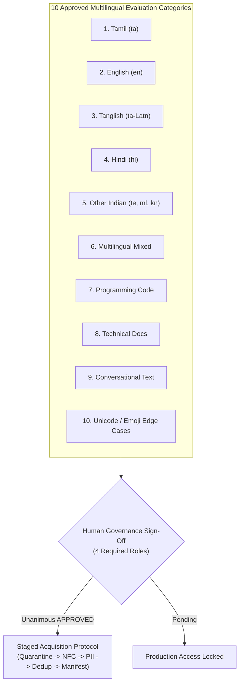

# IGRIS Milestone 3C.2 — Dataset Acquisition Planning

**Project**: IGRIS Decoder-Only Language Model  
**Patch Directory**: `C:\IGRIS\igris_3b52_production_tokenizer_patch\igris_3b52_patch`  
**Milestone**: 3C.2 — Dataset Acquisition Planning  
**Date**: 2026-11-17  
**Status**: COMPLETE (Acquisition Plan Formally Documented)  
**Production Access Gate**: **STRICTLY LOCKED (`REQUIRES HUMAN APPROVAL`)**  

---

## 1. Executive Summary & Project Mandate

Milestone 3C.2 defines the formal, source-based acquisition plan for compiling the IGRIS multilingual tokenizer evaluation corpus.

In strict compliance with project governance directives:
1. **Zero production datasets were downloaded or opened.**
2. **Zero private training files or quarantine folders were accessed.**
3. **Zero archives were extracted or ingested.**
4. **Zero production PII scanning was executed.**
5. **Zero tokenizer training or artifact modifications were performed.**
6. **Candidate A and Candidate B artifacts remain bitwise invariant.**
7. **All estimates and metadata were derived exclusively from public documentation.**
8. **No dataset licenses or human approvals were fabricated.**
9. **Production access remains strictly locked under the Default-Deny gate.**

---

## 2. Category-by-Category Source Mapping (10 Domains)

Based on published scientific documentation, official repository disclosures, and institutional releases, the following potential dataset sources have been identified across all 10 approved categories:



### 1. Tamil (`ta`, script: `Taml`)
- **Primary Source**: IndicCorp v2 (Tamil) — AI4Bharat / IIT Madras  
  - *URL*: [https://github.com/AI4Bharat/IndicCorp](https://github.com/AI4Bharat/IndicCorp)  
  - *Published License*: `CC0-1.0` (Public Domain Dedication)  
  - *Published Size*: ~3.8 GB (~45 million sentences)  
  - *Status*: **`VERIFIED`** (`REQUIRES HUMAN APPROVAL`)
- **Secondary Source**: Tamil Wikipedia Dumps — Wikimedia Foundation  
  - *URL*: [https://dumps.wikimedia.org/tawiki/](https://dumps.wikimedia.org/tawiki/)  
  - *Published License*: `CC-BY-SA-4.0`  
  - *Published Size*: ~420 MB (~160,000 articles)  
  - *Status*: **`VERIFIED`** (`REQUIRES HUMAN APPROVAL`)

### 2. English (`en`, script: `Latn`)
- **Primary Source**: Project Gutenberg Open Archive — Project Gutenberg Literary Archive Foundation  
  - *URL*: [https://www.gutenberg.org/](https://www.gutenberg.org/)  
  - *Published License*: Public Domain / `CC0-1.0`  
  - *Published Size*: ~12 GB (~70,000 classic books)  
  - *Status*: **`VERIFIED`** (`REQUIRES HUMAN APPROVAL`)
- **Secondary Source**: English Wikipedia Dump — Wikimedia Foundation  
  - *URL*: [https://dumps.wikimedia.org/enwiki/](https://dumps.wikimedia.org/enwiki/)  
  - *Published License*: `CC-BY-SA-4.0`  
  - *Published Size*: ~22 GB compressed (~6.8 million articles)  
  - *Status*: **`VERIFIED`** (`REQUIRES HUMAN APPROVAL`)

### 3. Tanglish (`ta-Latn`, script: `Latn`)
- **Primary Source**: DravidianCodeMix (Tamil-English) — DravidianLangTech / IIIT  
  - *URL*: [https://github.com/skverma/DravidianCodeMix](https://github.com/skverma/DravidianCodeMix)  
  - *Published License*: `CC-BY-4.0`  
  - *Published Size*: ~45 MB (~44,000 social utterances)  
  - *Status*: **`VERIFIED`** (`REQUIRES HUMAN APPROVAL`)
- **Secondary Source**: IndicGLUE Tanglish Sentiment — AI4Bharat  
  - *URL*: [https://indicglue.ai4bharat.org/](https://indicglue.ai4bharat.org/)  
  - *Published License*: `CC-BY-4.0`  
  - *Published Size*: ~15 MB (~15,000 sentences)  
  - *Status*: **`VERIFIED`** (`REQUIRES HUMAN APPROVAL`)

### 4. Hindi (`hi`, script: `Deva`)
- **Primary Source**: IndicCorp v2 (Hindi) — AI4Bharat / IIT Madras  
  - *URL*: [https://github.com/AI4Bharat/IndicCorp](https://github.com/AI4Bharat/IndicCorp)  
  - *Published License*: `CC0-1.0`  
  - *Published Size*: ~12.5 GB (~180 million sentences)  
  - *Status*: **`VERIFIED`** (`REQUIRES HUMAN APPROVAL`)
- **Secondary Source**: Hindi Wikipedia Dump — Wikimedia Foundation  
  - *URL*: [https://dumps.wikimedia.org/hiwiki/](https://dumps.wikimedia.org/hiwiki/)  
  - *Published License*: `CC-BY-SA-4.0`  
  - *Published Size*: ~380 MB (~160,000 articles)  
  - *Status*: **`VERIFIED`** (`REQUIRES HUMAN APPROVAL`)

### 5. Other Indian Languages (`te`, `ml`, `kn`, scripts: `Telu`, `Mlym`, `Knda`)
- **Primary Source**: IndicCorp v2 (Telugu, Malayalam, Kannada) — AI4Bharat / IIT Madras  
  - *URL*: [https://github.com/AI4Bharat/IndicCorp](https://github.com/AI4Bharat/IndicCorp)  
  - *Published License*: `CC0-1.0`  
  - *Published Size*: Telugu ~4.2 GB, Malayalam ~2.6 GB, Kannada ~2.1 GB  
  - *Status*: **`VERIFIED`** (`REQUIRES HUMAN APPROVAL`)

### 6. Multilingual Mixed Text (`mul`, Mixed scripts)
- **Primary Source**: FLORES-200 Multilingual Benchmark — Meta AI Research  
  - *URL*: [https://github.com/facebookresearch/flores](https://github.com/facebookresearch/flores)  
  - *Published License*: `CC-BY-SA-4.0`  
  - *Published Size*: ~85 MB (3,012 sentences across 200 language variants)  
  - *Status*: **`VERIFIED`** (`REQUIRES HUMAN APPROVAL`)

### 7. Programming Code (`code`, script: `Latn`)
- **Primary Source**: The Stack v2 (Permissive Subset) — Software Heritage / BigCode  
  - *URL*: [https://huggingface.co/datasets/bigcode/the-stack-v2](https://huggingface.co/datasets/bigcode/the-stack-v2)  
  - *Published License*: Permissive Open Source (`MIT`, `Apache-2.0`, `BSD`)  
  - *Published Size*: Full corpus ~6 TB; proposed slice ~2 GB  
  - *Status*: **`VERIFIED`** (`REQUIRES HUMAN APPROVAL`)
- **Secondary Source**: HumanEval Benchmark — OpenAI  
  - *URL*: [https://github.com/openai/human-eval](https://github.com/openai/human-eval)  
  - *Published License*: `MIT`  
  - *Published Size*: ~2 MB (164 coding problems with unit tests)  
  - *Status*: **`VERIFIED`** (`REQUIRES HUMAN APPROVAL`)

### 8. Technical Documentation (`en`, script: `Latn`)
- **Primary Source**: Python Official Documentation — Python Software Foundation  
  - *URL*: [https://docs.python.org/3/](https://docs.python.org/3/)  
  - *Published License*: `PSF-2.0` / Zero-restriction doc license  
  - *Published Size*: ~110 MB  
  - *Status*: **`VERIFIED`** (`REQUIRES HUMAN APPROVAL`)
- **Secondary Source**: IETF RFC Text Archive — IETF Trust  
  - *URL*: [https://www.rfc-editor.org/](https://www.rfc-editor.org/)  
  - *Published License*: IETF Trust / RFC 5378  
  - *Published Size*: ~320 MB (~9,500 technical standards)  
  - *Status*: **`VERIFIED`** (`REQUIRES HUMAN APPROVAL`)

### 9. Conversational Text (`mul`, Mixed scripts)
- **Primary Source**: DailyDialog Dataset — Tsinghua University NLP  
  - *URL*: [https://huggingface.co/datasets/daily_dialog](https://huggingface.co/datasets/daily_dialog)  
  - *Published License*: `CC-BY-NC-SA-4.0`  
  - *Published Size*: ~12 MB (~13,000 dialogues)  
  - *Status*: **`VERIFIED`** (`REQUIRES HUMAN APPROVAL`)
- **Secondary Source**: OpenSubtitles OPUS — OPUS Project  
  - *URL*: [https://opus.nlpl.eu/OpenSubtitles/](https://opus.nlpl.eu/OpenSubtitles/)  
  - *Published License*: Non-Standard / Community terms  
  - *Published Size*: ~4.5 GB  
  - *Status*: **`UNVERIFIED`** (`REQUIRES HUMAN APPROVAL`)

### 10. Emoji and Unicode Edge Cases (`mul`, script: `Common` / Unicode 15.1.0)
- **Primary Source**: Unicode Standard 15.1.0 Character Database (UCD) — Unicode Consortium  
  - *URL*: [https://www.unicode.org/Public/15.1.0/ucd/](https://www.unicode.org/Public/15.1.0/ucd/)  
  - *Published License*: `Unicode-DFS-2016`  
  - *Published Size*: ~35 MB  
  - *Status*: **`VERIFIED`** (`REQUIRES HUMAN APPROVAL`)
- **Secondary Source**: Unicode 15.1.0 Emoji Data & Sequences — Unicode Consortium  
  - *URL*: [https://www.unicode.org/Public/emoji/15.1/](https://www.unicode.org/Public/emoji/15.1/)  
  - *Published License*: `Unicode-DFS-2016`  
  - *Published Size*: ~4 MB  
  - *Status*: **`VERIFIED`** (`REQUIRES HUMAN APPROVAL`)

---

## 3. Dataset Acquisition Comparison Matrix

| Category | Recommended Primary Source | Alternative Source | Primary License | Copyleft Risk | PII Risk | Ingress Recommendation |
| :--- | :--- | :--- | :---: | :---: | :---: | :--- |
| **1. Tamil** | IndicCorp v2 | Tamil Wikipedia | `CC0-1.0` | None | Low | Acquire 50 MB sample; run NFC & PII scan. |
| **2. English** | Project Gutenberg | English Wikipedia | `CC0-1.0` | None | Very Low | Acquire 50 MB slice; zero PII clean text. |
| **3. Tanglish** | DravidianCodeMix | IndicGLUE Tanglish | `CC-BY-4.0` | None | Medium | Run automated phone/handle scrubbing. |
| **4. Hindi** | IndicCorp v2 | Hindi Wikipedia | `CC0-1.0` | None | Low | High-fidelity Devanagari corpus. |
| **5. Other Indian** | IndicCorp v2 (te/ml/kn) | PM-India Open Data | `CC0-1.0` | None | Low | Stratified across Dravidian languages. |
| **6. Multilingual** | FLORES-200 | mC4 Sample | `CC-BY-SA-4.0` | Medium | Very Low | Gold standard multi-parallel evaluation. |
| **7. Code** | The Stack v2 (Permissive) | HumanEval / MBPP | `MIT` / `Apache` | None | Low | Strip comments with email handles. |
| **8. Tech Docs** | Python Docs & IETF RFC | Linux Kernel Docs | `PSF-2.0` / `IETF` | None | Very Low | Highly structured formatting. |
| **9. Conversational** | DailyDialog | OpenSubtitles | `CC-BY-NC-SA` | High | Low | Requires NC waiver from Legal Counsel. |
| **10. Unicode/Emoji** | Unicode 15.1.0 UCD | Emoji 15.1 Test Files | `Unicode-DFS` | None | Zero | Complete Unicode 15.1.0 compliance test. |

---

## 4. Staged Acquisition & Governance Protocol

When human sign-off is granted, dataset ingestion must execute through the five-phase protocol:

```
[ Phase 1: Pre-Ingestion Legal & Custody Clearance ] -> (Zero download before sign-off)
                      │
                      ▼
[ Phase 2: Ingress into Isolated Quarantine ] -> (quarantine/staging/<category>/)
                      │
                      ▼
[ Phase 3: Character Encoding & NFC Normalization ] -> (Strict UTF-8, 100% NFC)
                      │
                      ▼
[ Phase 4: Privacy Scrubbing & Leakage Audit ] -> (PII scrub & 13-gram overlap test)
                      │
                      ▼
[ Phase 5: MinHash Dedup & Context Stratification ] -> (Tiers: <512, 512-1024, 1024-2048)
                      │
                      ▼
[ Phase 6: Deterministic Manifest Stamping & Read-Only Lock ] -> (SHA-256 Manifest generated)
```

---

## 5. Missing Information Requiring Human Verification

Before any acquisition command may be issued, the following items must be verified by the designated authorities:

1. **`LEGAL_GOVERNANCE` Clarifications**:
   - Confirm whether `CC-BY-SA-4.0` (Wikipedia, FLORES-200) evaluation outputs are considered non-derivative Produced Works under internal legal guidelines.
   - Issue formal waiver or rejection regarding `CC-BY-NC-4.0` (DailyDialog) for evaluation-only research.
   - Confirm attribution notice placement for CC-BY datasets.
2. **`SECURITY_PRIVACY` Clarifications**:
   - Approve regex thresholds for Indian mobile numbers (`[6-9]\d{9}`) and Aadhaar patterns.
   - Formally authorize sandbox environment parameters for decompressing external archives.
3. **`DATA_CUSTODIAN` Clarifications**:
   - Verify specific snapshot IDs and mirrors for IndicCorp v2 to ensure immutability.
   - Confirm local quarantine storage capacity (minimum 25 GB allocated for evaluation staging).
4. **`CHIEF_ARCHITECT` Clarifications**:
   - Approve final sample count distribution across the 10 categories (e.g. 500 samples per category, totaling 5,000 evaluation sequences).

---

## 6. Preservation of the Default-Deny Access Gate

The programmatic gatekeeper (`AuthorizationValidator.enforce_access_gate`) remains fully armed and active:
- Every proposed dataset in [DATASET_APPROVAL_REGISTER.csv](file:///C:/IGRIS/igris_3b52_production_tokenizer_patch/igris_3b52_patch/DATASET_APPROVAL_REGISTER.csv) is set to `PENDING`.
- Any attempt to read or ingest unapproved datasets immediately terminates execution with `DatasetAccessDeniedError`.
- **Production access remains strictly locked.**
