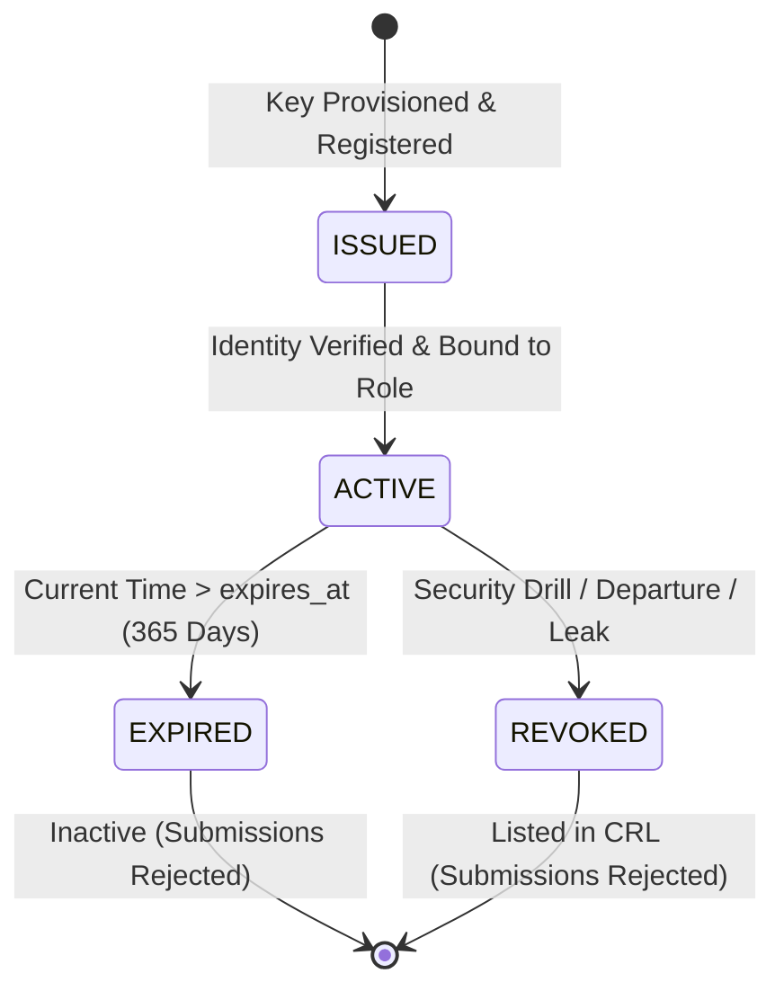

# IGRIS Phase 7: Human Reviewer Provisioning & Key Management Protocol

**Document ID**: `IGRIS-PROV-REV-V1`  
**Classification**: SECURITY & GOVERNANCE PROVISIONING SPECIFICATION  
**Status**: APPROVED & CODIFIED  
**Governing Standard**: IGRIS Cryptographic Governance & Separation of Duties Protocol  
**Audit Date**: 2026-11-17  
**Production Ingress Status**: **`LOCKED`** (Default-Deny Enforced)  

---

## 1. Scope & Objective

This document defines the formal provisioning protocol for the four human governance roles required to authorize datasets for the IGRIS multilingual tokenizer and language model pipelines.

Under strict project governance rules:
- **No Automated Impersonation**: Automated agents, CI/CD runners, and developers must never generate keys or signatures pretending to represent actual human reviewers.
- **Physical Separation of Duties**: The four governance roles must be held by **four distinct physical individuals**. No single person may hold or sign for more than one authority role.

---

## 2. The Four Governance Authority Roles & Boundaries

```mermaid
graph TD
    subgraph Separation of Duties (4 Distinct Physical Reviewers)
        C["DATA_CUSTODIAN<br/>Ingress, Hashes, Format, Normalization"]
        L["LEGAL_GOVERNANCE<br/>Licenses, Copyleft, Jurisdictions, Rights"]
        S["SECURITY_PRIVACY<br/>PII Classification, Anonymization, CRL"]
        A["CHIEF_ARCHITECT<br/>Vocabulary, Fertility, Quality, Alignment"]
    end

    C ---|Zero Dual-Role Overlap| L
    L ---|Zero Dual-Role Overlap| S
    S ---|Zero Dual-Role Overlap| A
```

### 2.1 Role 1: `DATA_CUSTODIAN`
- **Mandate**: Custodial authenticity, transport integrity, and storage lifecycle.
- **Authorization Boundaries**:
  - Verification of upstream source repository URLs and publisher authenticity.
  - Pre-validation of candidate archive SHA-256 hashes prior to quarantine staging.
  - UTF-8 lossless validation (rejection of replacement character `\uFFFD`).
  - Unicode 15.1.0 NFC canonical normalization verification.
  - Project Gutenberg header, footer, and trademark de-branding.
  - Isolated quarantine staging execution.
- **Explicit Limitations**: May not rule on copyright law, fair dealing, or model architecture.

### 2.2 Role 2: `LEGAL_GOVERNANCE`
- **Mandate**: Statutory copyright compliance, IP licensing, and jurisdiction analysis.
- **Authorization Boundaries**:
  - Verification of official license deeds and permissions across the 9 license classes.
  - Statutory compliance with Section 22 of the Indian Copyright Act, 1957 (Life + 60 rule; authors dying $\le 1965$).
  - International compliance with UK/EU Life + 70 rules (authors dying $\le 1955$).
  - Section 52 fair dealing boundary determination for web-scraped corpora.
  - ShareAlike (CC-BY-SA 4.0) adaptation boundary rulings for model weights.
  - Mandatory rejection of Non-Commercial (`NC`) licenses.
- **Explicit Limitations**: May not alter technical fertility thresholds or PII screening regexes.

### 2.3 Role 3: `SECURITY_PRIVACY`
- **Mandate**: Data sanitization, PII risk mitigation, and cryptographic credential integrity.
- **Authorization Boundaries**:
  - PII risk level classification (Low, Medium, High).
  - Regex-based and heuristic screening protocol authorization.
  - Anonymization and pseudonymization validation.
  - Cryptographic key registry administration and CRL revocation enforcement.
  - Audit trail hash-chain integrity verification.
- **Explicit Limitations**: May not override legal license rulings or custodial format requirements.

### 2.4 Role 4: `CHIEF_ARCHITECT`
- **Mandate**: Vocabulary balance, model quality, and architectural safety.
- **Authorization Boundaries**:
  - Tokenizer fertility distribution across the 10 canonical categories.
  - Structural token pinning and byte-fallback allocation (IDs 0–11 and 0x00–0xFF).
  - 0% synthetic text policy enforcement for tokenizer vocabulary training.
  - Strict isolation of preference pairs (`SRC-CV-04` Anthropic HH-RLHF) to alignment evaluation only.
  - Invariant preservation of Candidate A and Candidate B tokenizers.
- **Explicit Limitations**: May not bypass legal or security rejections.

---

## 3. Reviewer Identity Verification Requirements

Prior to key issuance, each reviewer must complete organizational identity verification:
1. **Verified Corporate Identity**: Must possess an active corporate email (`@igris-governance.org` or authorized institutional domain).
2. **Employee / Credential Verification**: Verified corporate employee identifier recorded in the governance identity roster.
3. **Organizational Appointment**: Formal appointment letter from the IGRIS Steering Committee authorizing the individual to act as the primary or alternate for that specific role.
4. **Identity Binding**: The public key certificate issued to the reviewer must include the reviewer's corporate email, role name, and employee ID in the subject distinguished name (DN).

---

## 4. Cryptographic Key Provisioning & Protection Procedures

### 4.1 Key Specifications
- **Algorithm**: Ed25519 or HMAC-SHA256 (256-bit entropy minimum).
- **Key Identifier**: Formatted as `KEY-[ROLE]-[SERIAL]` matching regex `^KEY-[A-Z0-9_\-]{6,32}$` (e.g. `KEY-LEGAL_GOVERNANCE-202611A`).
- **Validity Period**: Strictly limited to a maximum of **365 calendar days** from issuance.

### 4.2 Private Key Storage & Protection
- **Hardware Binding**: Private signing keys must reside in a Hardware Security Module (HSM), FIPS 140-2 Level 3 cryptographic token, or operating system secure enclave (TPM 2.0 / Apple Secure Enclave).
- **Prohibition of Repository Storage**: Under no circumstances may private signing keys, secrets, or passphrases be committed to git repositories, shared file systems, or test configurations.
- **Access Control**: Signing operations must require multi-factor authentication (MFA) or biometric challenge.

### 4.3 Public Key Registration
1. The human reviewer generates their key pair within their secure enclave.
2. The public key is submitted to the Security & Privacy officer alongside identity proof.
3. The Security & Privacy officer verifies identity and registers the public key in `KeyRegistry`:
   ```python
   registry.register_key(
       KeyRecord(
           key_id="KEY-LEGAL_GOVERNANCE-202611A",
           role=SignOffRole.LEGAL_GOVERNANCE,
           secret_key="<SECURE_VERIFICATION_SECRET>",
           created_at="2026-11-17T00:00:00Z",
           expires_at="2027-11-17T00:00:00Z",
       )
   )
   ```
4. A registration event is committed to the immutable hash-chained audit log.

---

## 5. Key Revocation & Expiration Lifecycle



### 5.1 Certificate Revocation List (CRL) Protocol
If a reviewer departs the organization, changes roles, or suspects key compromise:
1. An emergency revocation request is filed with the Security & Privacy authority.
2. The key is revoked in `KeyRegistry`:
   ```python
   registry.revoke_key(
       key_id="KEY-LEGAL_GOVERNANCE-202611A",
       reason="Reviewer transition / credential decommissioning"
   )
   ```
3. The intake verification engine immediately rejects any future submission bearing the revoked `public_key_id`.
4. The revocation reason and timestamp are logged to the append-only audit trail.

---

## 6. Reviewer Hand-Off Checklist

Before initiating authentic human review:
- [ ] Roster of four physical reviewers appointed by Steering Committee.
- [ ] Identity verification completed for all four candidates.
- [ ] Four distinct key pairs generated in hardware secure enclaves.
- [ ] Public keys registered in `KeyRegistry` with 365-day expiration timestamps.
- [ ] Review dossiers delivered to reviewers with instructions.
- [ ] Anti-fabrication audit re-confirmed (all dossiers unsigned, production gate locked).
