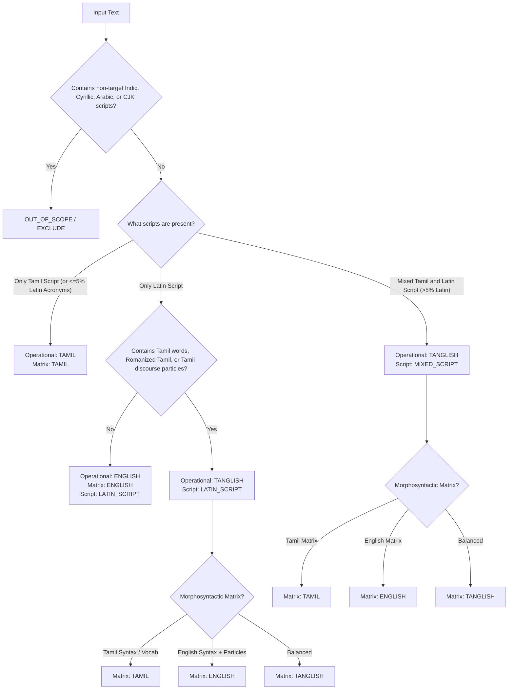

# IGRIS Language Taxonomy Specification v1.0
## Formal Classification Standards for Tamil, English, and Tanglish

**Document Identifier:** `IGRIS-SPEC-LANG-TAXONOMY-V1`  
**Operating Model:** `SOLO_DEVELOPER_OWNER_REVIEW`  
**Accountable Decision-Maker:** Sole Project Owner  
**Effective Date:** 2026-11-20  
**Status:** APPROVED & FROZEN  

---

## 1. Scope & Purpose

This specification governs all dataset acquisition, synthetic data generation, preprocessing, tokenization evaluation, and pretraining dataset labeling for the IGRIS Multilingual Decoder-Only Transformer project.

The only approved languages are:
1. **Tamil (`ta` / `TAMIL`)**
2. **English (`en` / `ENGLISH`)**
3. **Tanglish (`ta-Latn` / `TANGLISH`)**

All other languages, dialects, and scripts are strictly **`OUT_OF_SCOPE`**.

---

## 2. Multidimensional Annotation Model

Every text unit in the IGRIS corpus must be classified along four orthogonal dimensions:

```
+----------------------------------------------------------------------------------------------------+
| DIMENSION 1: OPERATIONAL TARGET LABEL (`operational_language_label`)                               |
|   Permitted Values: TAMIL, ENGLISH, TANGLISH, UNKNOWN                                              |
|   Function: Canonical high-level class for tokenizer evaluation, training splits, and perplexity.   |
+----------------------------------------------------------------------------------------------------+
| DIMENSION 2: GRAMMATICAL MATRIX LANGUAGE (`linguistic_matrix_language`)                            |
|   Permitted Values: TAMIL, ENGLISH, TANGLISH, UNKNOWN                                              |
|   Function: The dominant morphosyntactic frame providing system morphemes and constituent order.   |
+----------------------------------------------------------------------------------------------------+
| DIMENSION 3: ORTHOGRAPHIC SCRIPT FORM (`script_form`)                                              |
|   Permitted Values: TAMIL_SCRIPT, LATIN_SCRIPT, MIXED_SCRIPT, OTHER_OR_UNKNOWN                     |
|   Function: The surface character encodings present in the token sequence.                         |
+----------------------------------------------------------------------------------------------------+
| DIMENSION 4: CODE-MIXING ATTRIBUTES (Binary Flags)                                                 |
|   - contains_english_vocabulary (YES / NO)                                                         |
|   - contains_tamil_vocabulary (YES / NO)                                                           |
|   - contains_code_switching (YES / NO)                                                             |
|   - contains_tamil_discourse_markers (YES / NO)                                                    |
|   - romanized_tamil_present (YES / NO)                                                             |
+----------------------------------------------------------------------------------------------------+
```

---

## 3. Category Definitions

### 3.1 Tamil (`TAMIL`)
- **Operational Label:** `TAMIL`
- **Definition:** Monolingual Tamil text expressed predominantly in Tamil Unicode script (`U+0B80`–`U+0BFF`).
- **Permitted Minor Inclusions:** Isolated universal acronyms (e.g. `ZWJ`, `ZWNJ`, `CPU`, `RAM`) constituting $< 5\%$ of total characters.
- **Matrix Language:** Always `TAMIL`.
- **Script Form:** `TAMIL_SCRIPT` (or `MIXED_SCRIPT` if isolated Latin acronyms exist).

### 3.2 English (`ENGLISH`)
- **Operational Label:** `ENGLISH`
- **Definition:** Monolingual English text expressed in Latin script (`U+0041`–`U+007A`).
- **Permitted Minor Inclusions:** None. Zero Tamil lexical or discourse particle presence.
- **Matrix Language:** Always `ENGLISH`.
- **Script Form:** Always `LATIN_SCRIPT`.

### 3.3 Tanglish (`TANGLISH`)
- **Operational Label:** `TANGLISH`
- **Definition:** Any text exhibiting Tamil-English language contact, code-switching, borrowing, or Romanization.
- **Sub-Types:**
  1. **Tamil-Script Code-Mixing:** Tamil matrix syntax and script containing English technical loanwords or phrases.
  2. **Romanized Tamil:** Tamil phonology and vocabulary expressed in Latin script.
  3. **English Matrix with Tamil Discourse Particles:** English grammatical sentences containing Tamil conversational markers (`da`, `pa`, `machan`, `seri`, `aiyo`, `dei`, `thambi`).
  4. **Bidirectional Intra-Sentential Code-Switching:** Alternating clauses and phrases across Tamil and English.
- **Matrix Language:** Determined by the dominant morphosyntactic frame (`TAMIL`, `ENGLISH`, or `TANGLISH` if balanced).
- **Script Form:** `MIXED_SCRIPT` or `LATIN_SCRIPT`.

---

## 4. Classification Decision Rubric



---

## 5. Governance & Immutability Rules

1. **No Silent Reclassification:** Operational dataset labels must not be changed retroactively without formal version increments and owner sign-off.
2. **Matrix Disentanglement:** Matrix language analysis must never be used to strip records from the operational `TANGLISH` category.
3. **Traceability:** Every classified record must preserve stable IDs, original provenance, and multidimensional annotations.
