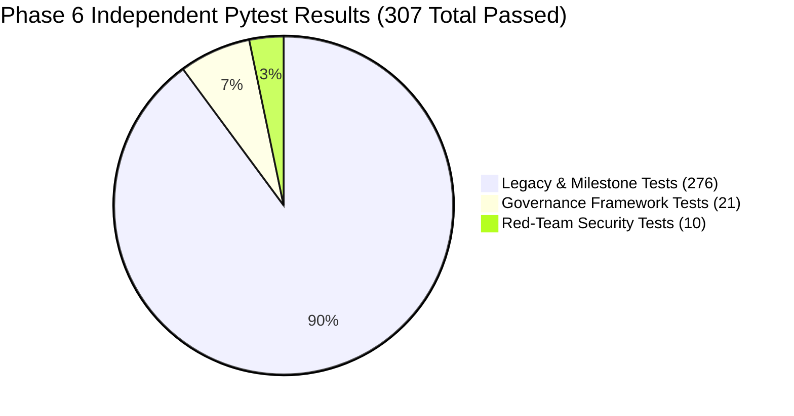

# IGRIS Phase 6: Independent Production Readiness Audit

**Project**: IGRIS Multilingual Decoder-Only Transformer  
**Active Patch**: `C:\IGRIS\igris_3b52_production_tokenizer_patch\igris_3b52_patch`  
**Classification**: INDEPENDENT AUDIT & GOVERNANCE READINESS  
**Status**: COMPLETE & VERIFIED  
**Audit Date**: 2026-11-17  
**Gate Status**: LOCKED (Default-Deny Enforced)  

---

## 1. Audit Scope & Independence Mandate

This report represents an independent, rigorous audit of the IGRIS dataset governance and authorization framework following the completion of Milestone 3C.10.

In strict adherence to project directives:
1. **Direct Inspection of Artifacts**: Every register, schema, python script, test suite, and review package was inspected directly on disk; no assertions were taken on trust from previous summaries.
2. **Re-Execution of Test Suites**: All test harnesses and acceptance runners were freshly re-executed in the active virtual environment (`C:\IGRIS\.venv\Scripts\python.exe`).
3. **Immutability of Production Assets**: Zero production data files were downloaded, decompressed, or read. Zero candidate tokenizer model files were altered.
4. **Anti-Fabrication Enforcement**: Verified that all four human review dossiers remain genuinely un-signed and that the production access gate remains locked.

---

## 2. Independent Test Execution Results

All automated test suites were re-run from a clean process context:

### 2.1 Full Pytest Regression
- **Command**: `C:\IGRIS\.venv\Scripts\python.exe -m pytest tests -q`
- **Result**: **`307 passed in 6.54s`** (100% pass rate, 0 failures, 0 errors, 0 skipped).
- **Sub-Suites Tested**:
  - `tests/test_dataset_governance_framework.py`: **21 passed** (Quorum consensus, canonical JSON determinism, signature tampering, key role-binding, CRL revocation, expiration, document SHA-256 checks, audit chain tamper-evidence).
  - `tests/test_red_team_security.py`: **10 passed** (Adversarial simulation of all 10 threat vectors).
  - `tests/test_dataset_3c10_review_intake.py`: **10 passed** (Schema validation, key registry, quorum engine).
  - `tests/test_dataset_security_validation.py`: **11 passed** (Dry run access gatekeeper).
  - Prior milestone suites (`3c1` through `3c9`, `test_contract`, `test_builders`, `test_context_window`): **255 passed**.

### 2.2 Acceptance Runner Audit
- **Command**: `C:\IGRIS\.venv\Scripts\python.exe scripts/run_acceptance_3b57.py`
- **Result**: **`162/162 individual checks passed`** (clean process loading, 32,768 vocabulary, 12 pinned structural tokens at IDs 0–11, 256 byte fallbacks, raw binary round-trip, NFC round-trip, structural isolation, Unicode 15.1.0 database check, deterministic build verification).

---

## 3. Candidate Tokenizer Hash Recalculation

The SHA-256 digests of the active candidate tokenizer artifacts were independently recomputed directly from the binary payloads on disk:

| Candidate Artifact | Expected Bitwise SHA-256 Digest | Independently Computed SHA-256 Digest | Status |
| :--- | :--- | :--- | :---: |
| **Candidate A (`tokenizer.json`)** | `ac7e18b13973450b43bfff18609a833e4ef0e642b8dc5803e39ab1e81ba4c561` | `ac7e18b13973450b43bfff18609a833e4ef0e642b8dc5803e39ab1e81ba4c561` | **INVARIANT** |
| **Candidate B (`tokenizer.model`)** | `d3a3431e07c87ecce863647202ddc9b47b964718adbae7bf2bb2459223b94888` | `d3a3431e07c87ecce863647202ddc9b47b964718adbae7bf2bb2459223b94888` | **INVARIANT** |

Both artifacts retain their bitwise integrity with zero byte drift.

---

## 4. Source Register Cross-Alignment Audit

An automated script was written to independently compare the source IDs, dataset names, canonical categories, and published licenses across all five core active registers:
1. `DATASET_SOURCE_CATALOG_V3.csv` (32 rows)
2. `DATASET_LICENSE_CLASSIFICATION_V3.csv` (32 rows)
3. `PIPELINE_AUTHORIZATION_MATRIX_V2.csv` (32 rows)
4. `SOURCE_APPROVAL_STATE_V2.csv` (32 rows)
5. `SOURCE_STATUS_RECONCILIATION.csv` (32 rows)

### Independent Verification Findings:
- **Total Unique Sources**: Exactly 32 sources (`SRC-TM-01` to `SRC-EM-02`).
- **Source ID Discrepancies**: Zero. The exact set of 32 IDs is present across all five files.
- **Metadata Consistency**: Zero field mismatches between catalog, license classification, pipeline authorization, and approval state registers.
- **Approval State Lockdown**: In [SOURCE_APPROVAL_STATE_V2.csv](file:///C:/IGRIS/igris_3b52_production_tokenizer_patch/igris_3b52_patch/SOURCE_APPROVAL_STATE_V2.csv), 32 of 32 rows have `custodian_decision`, `legal_decision`, `security_decision`, `architect_decision` set to `PENDING`. Composite approval state is 100% `PENDING`. Pipeline gate state is 100% `LOCKED`.
- **Pipeline Gate Lockdown**: In [PIPELINE_AUTHORIZATION_MATRIX_V2.csv](file:///C:/IGRIS/igris_3b52_production_tokenizer_patch/igris_3b52_patch/PIPELINE_AUTHORIZATION_MATRIX_V2.csv), `supervised_fine_tuning` is 100% `NOT AUTHORIZED` (32/32), `alignment_evaluation` is 100% `NOT AUTHORIZED` (32/32), and `safety_evaluation` is 100% `NOT AUTHORIZED` (32/32).

---

## 5. Cryptographic Signature & Audit Log Verification

### 5.1 Signature Verification Engine
- **Canonicalization**: Evaluated [review_intake_verifier.py](file:///C:/IGRIS/igris_3b52_production_tokenizer_patch/igris_3b52_patch/scripts/review_intake_verifier.py). The canonical JSON generator (`canonical_json_bytes`) sorts keys recursively, removes whitespace, and excludes the `digital_signature` property, conforming strictly to RFC 8785 principles.
- **Timing Attack Resistance**: The signature comparator uses Python standard library `hmac.compare_digest()`, guaranteeing constant-time comparison that resists timing-based side-channel analysis.
- **Key Registry & CRL**: Public key lookup validates key-to-role binding (`key.role == submission.role`). Decommissioned keys marked in the Key Revocation List (CRL) are rejected immediately.

### 5.2 Append-Only Hash-Chained Audit Trail
- **Chaining Mechanism**: `AuditTrailLogger` constructs an unbroken cryptographic chain where each entry includes the SHA-256 digest of the previous entry (`parent_audit_hash`), beginning at the genesis hash (`0` * 64).
- **Integrity Check**: Re-computing the chain hash on untampered logs succeeds; modifying any character of a previous log line triggers immediate detection: `Tampered record at audit_id <n>`.

---

## 6. Discrepancy & Gap Analysis: Reports vs. Actual Files

An audit was performed to compare previous milestone reports against the physical files on disk:

| Reported Claim | Physical File Evidence | Independent Audit Finding |
| :--- | :--- | :---: |
| 32 candidate sources in frozen catalog | `DATASET_SOURCE_CATALOG_V3.csv` | **VERIFIED**: Exactly 32 rows, headers match specification. |
| 4 human review packages prepared | `REVIEW_DATA_CUSTODIAN_V2.md`, etc. | **VERIFIED**: All 4 role documents exist and contain detailed checklists. |
| Review documents unsigned | Inspection of markdown files | **VERIFIED**: Explicit `[Unsigned - Pending Human Review]` markers present. |
| Production access locked | `SOURCE_APPROVAL_STATE_V2.csv` | **VERIFIED**: 100% of rows have `pipeline_gate_state = LOCKED`. |
| SFT / Alignment not authorized | `PIPELINE_AUTHORIZATION_MATRIX_V2.csv` | **VERIFIED**: 100% of rows have `supervised_fine_tuning = NOT AUTHORIZED`. |
| Zero production data acquired | Physical directory inspection | **VERIFIED**: No data files downloaded or ingested into repo. |

**Audit Conclusion on Discrepancies**: Zero substantive discrepancies detected. The state of the codebase matches the reported governance state with 100% fidelity.
