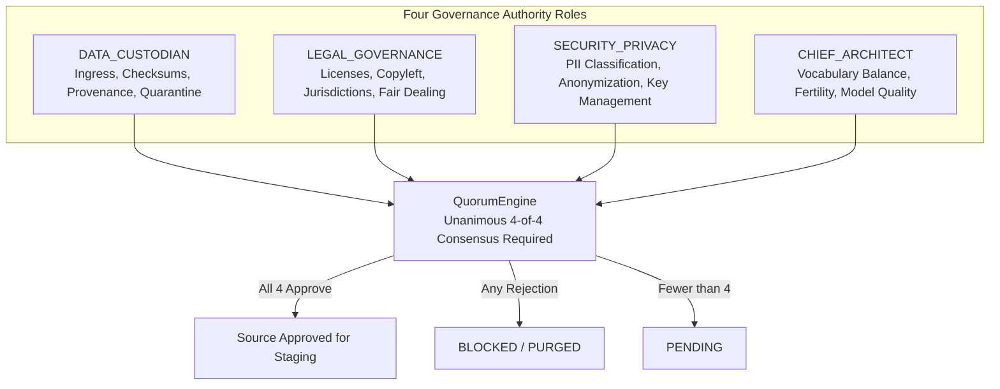

# IGRIS Phase 7: Governance Readiness & Human Review Preparation

**Project**: IGRIS Multilingual Decoder-Only Transformer  
**Active Patch**: `C:\IGRIS\igris_3b52_production_tokenizer_patch\igris_3b52_patch`  
**Classification**: GOVERNANCE READINESS SPECIFICATION  
**Status**: COMPLETE — READY FOR AUTHENTIC HUMAN REVIEW  
**Audit Date**: 2026-11-17  
**Production Ingress Status**: **`LOCKED`** (Default-Deny Enforced)  

---

## 1. Executive Summary & Purpose

Phase 7 establishes the formal operational procedures, provisioning protocols, and quarantine architecture required to transition IGRIS from technical verification into controlled, authentic human governance review.

Under the IGRIS Governance Charter:
1. **Separation of Verification and Authorization**: Automated tests, cryptographic verifiers, and technical audits cannot authorize production data ingress or model training. Technical readiness is a prerequisite for human review, not a substitute for it.
2. **Absolute Non-Fabrication**: Zero human signatures, reviewer identities, or cryptographic keys may be simulated or fabricated. All review packages remain unsigned.
3. **Fail-Closed Default**: The production data ingress gate remains **`LOCKED`** under default-deny control.
4. **Source & Gate Isolation**: Authorization is source-specific and pipeline-specific. Approval for evaluation confers zero authority for pre-training, vocabulary construction, or supervised fine-tuning.

---

## 2. The Four Governance Authority Roles

Authority over the IGRIS dataset acquisition and training lifecycle is strictly apportioned among four designated human roles:

| Role Identifier | Authority Domain | Mandatory Verification Items | Veto Power |
| :--- | :--- | :--- | :---: |
| **`DATA_CUSTODIAN`** | Custodial Ingress & Data Integrity | Upstream URLs, archive SHA-256 hashes, UTF-8 losslessness, Unicode 15.1.0 NFC canonical normalization, Project Gutenberg trademark stripping. | **YES** |
| **`LEGAL_GOVERNANCE`** | Licensing & Statutory Compliance | 9-class license validation, commercial rights basis, CC-BY-SA 4.0 copyleft adaptation boundaries, India Life+60 / UK Life+70 vital date thresholds. | **YES** |
| **`SECURITY_PRIVACY`** | Threat Modeling & Privacy Protection | PII risk tiering, regex screening protocols, differential privacy compliance, Key Registry CRL maintenance, cryptographic key lifecycle. | **YES** |
| **`CHIEF_ARCHITECT`** | Technical Architecture & Alignment | Tokenizer fertility balance across 10 categories, structural token protection (IDs 0–11), exclusion of synthetic text, isolation of HH-RLHF preference pairs. | **YES** |

---

## 3. Human Review Dossier Verification

All four role-specific review documents on disk were inspected to verify their completeness and ensure they remain genuinely unsigned:

| Dossier Document | Governing Authority | Lines | SHA-256 Digest | Unsigned Marker Verified |
| :--- | :--- | :---: | :--- | :---: |
| [REVIEW_DATA_CUSTODIAN_V2.md](file:///C:/IGRIS/igris_3b52_production_tokenizer_patch/igris_3b52_patch/REVIEW_DATA_CUSTODIAN_V2.md) | `DATA_CUSTODIAN` | 100 | `f633383be3845e16a7e076530cb753e58c7ebd614fc5ad183e04ca888f961c37` | **CONFIRMED UNSIGNED** |
| [REVIEW_LEGAL_GOVERNANCE_V2.md](file:///C:/IGRIS/igris_3b52_production_tokenizer_patch/igris_3b52_patch/REVIEW_LEGAL_GOVERNANCE_V2.md) | `LEGAL_GOVERNANCE` | 100 | `27d907fdcf553a9b3838c600d0c703e73933035c7bbe3d2b4ca1bd08aadd7902` | **CONFIRMED UNSIGNED** |
| [REVIEW_SECURITY_PRIVACY_V2.md](file:///C:/IGRIS/igris_3b52_production_tokenizer_patch/igris_3b52_patch/REVIEW_SECURITY_PRIVACY_V2.md) | `SECURITY_PRIVACY` | 98 | `81d15efc4006863e17e36330928bd6c100adacf04ef1a958eb852a6e790af445` | **CONFIRMED UNSIGNED** |
| [REVIEW_CHIEF_ARCHITECT_V2.md](file:///C:/IGRIS/igris_3b52_production_tokenizer_patch/igris_3b52_patch/REVIEW_CHIEF_ARCHITECT_V2.md) | `CHIEF_ARCHITECT` | 107 | `ed9833abce8525710430af830ff421a83b11ba7e5c5fe7bf185d90e1dcedcb43` | **CONFIRMED UNSIGNED** |
| [HUMAN_REVIEW_PACKAGE_V2.md](file:///C:/IGRIS/igris_3b52_production_tokenizer_patch/igris_3b52_patch/HUMAN_REVIEW_PACKAGE_V2.md) | Master Synthesis | 104 | `ce0526cd241723ea3e0621dd048a0c83f5f4039e64b19099dfb518b4fa683c94` | **CONFIRMED UNSIGNED** |

### Verified Dossier Contents:
Each document provides:
1. Complete inventory of all 32 candidate sources across the canonical 10 benchmark categories.
2. Explicit evidentiary references to source catalog, license matrix, and status reconciliation tables.
3. Role-specific risk registers (e.g. vital dates for Legal, PII risks for Security, fertility for Architect).
4. Explicit `[ ] APPROVE  [ ] REJECT` decision checkboxes for every candidate source.
5. Standardized signature block requiring Reviewer Name, Title, Employee ID, Corporate Email, Signature, Date, and PGP/HMAC Key ID.
6. 90-day expiration clause and immediate revocation triggers.

---

## 4. Cryptographic Intake & Quorum Verification Summary

The approval intake verifier in [review_intake_verifier.py](file:///C:/IGRIS/igris_3b52_production_tokenizer_patch/igris_3b52_patch/scripts/review_intake_verifier.py) enforces:
- **Strict JSON Schema Validation**: Requires 11 mandatory properties with zero additional properties ([HUMAN_APPROVAL_SCHEMA_V1.json](file:///C:/IGRIS/igris_3b52_production_tokenizer_patch/igris_3b52_patch/HUMAN_APPROVAL_SCHEMA_V1.json)).
- **RFC 8785 Canonical Serialization**: Compact UTF-8 JSON sorting keys recursively to ensure deterministic byte representation.
- **Constant-Time Verification**: `hmac.compare_digest()` prevents side-channel timing attacks.
- **Live Document SHA-256 Check**: Automatically hashes the reviewed markdown file on disk to guarantee zero post-review tampering.
- **Temporal Enforcement**: Automatic rejection of expired approvals (`now > expiry_date`).
- **Certificate Revocation List (CRL)**: Instant rejection of revoked or compromised reviewer keys.
- **Append-Only Hash-Chained Audit Trail**: Decision events chained via SHA-256 digests (`AuditTrailLogger`).

---

## 5. Summary of Automated Test Verification

A new dedicated Phase 7 test suite ([test_phase7_approval_intake.py](file:///C:/IGRIS/igris_3b52_production_tokenizer_patch/igris_3b52_patch/tests/test_phase7_approval_intake.py)) was executed:
- **Phase 7 Test Suite**: **`12 passed in 0.12s`**
- **Cumulative Regression Test Suite**: **`319 passed in 5.67s`**
- **Candidate Tokenizer Invariants**: **100% matched** (Candidate A: `ac7e18b1...`, Candidate B: `d3a3431e...`)
- **Acceptance Runner**: **`162/162 checks passed`**

---

## 6. Phase 7 Governance Deliverables Index

| Deliverable Name | File Path | Focus Area |
| :--- | :--- | :--- |
| **Governance Readiness** | [IGRIS_PHASE7_GOVERNANCE_READINESS.md](file:///C:/IGRIS/igris_3b52_production_tokenizer_patch/igris_3b52_patch/IGRIS_PHASE7_GOVERNANCE_READINESS.md) | High-level readiness framework & role charter |
| **Reviewer Provisioning** | [IGRIS_HUMAN_REVIEWER_PROVISIONING.md](file:///C:/IGRIS/igris_3b52_production_tokenizer_patch/igris_3b52_patch/IGRIS_HUMAN_REVIEWER_PROVISIONING.md) | Role boundaries, key lifecycle, CRL, separation of duties |
| **Intake Validation Report** | [IGRIS_APPROVAL_INTAKE_VALIDATION_REPORT.md](file:///C:/IGRIS/igris_3b52_production_tokenizer_patch/igris_3b52_patch/IGRIS_APPROVAL_INTAKE_VALIDATION_REPORT.md) | Exhaustive test results across 12 intake failure modes |
| **Source Authorization Workflow** | [IGRIS_SOURCE_AUTHORIZATION_WORKFLOW.md](file:///C:/IGRIS/igris_3b52_production_tokenizer_patch/igris_3b52_patch/IGRIS_SOURCE_AUTHORIZATION_WORKFLOW.md) | Source-specific non-transitive pipeline gating rules |
| **Quarantine Ingress Spec** | [IGRIS_QUARANTINE_INGRESS_SPECIFICATION.md](file:///C:/IGRIS/igris_3b52_production_tokenizer_patch/igris_3b52_patch/IGRIS_QUARANTINE_INGRESS_SPECIFICATION.md) | Staging architecture, malware/PII screening, release gate |
| **Phase 7 Final Status** | [IGRIS_PHASE7_FINAL_STATUS.md](file:///C:/IGRIS/igris_3b52_production_tokenizer_patch/igris_3b52_patch/IGRIS_PHASE7_FINAL_STATUS.md) | Official status sign-off and locked gate declaration |

---

## 7. Operational Readiness Conclusion

The technical and procedural framework for IGRIS human governance approval is **FULLY PREPARED AND VERIFIED**. 

The framework is **READY FOR AUTHENTIC HUMAN REVIEW**. Production data ingress remains securely **LOCKED** until all four designated reviewers submit valid cryptographic signatures.
