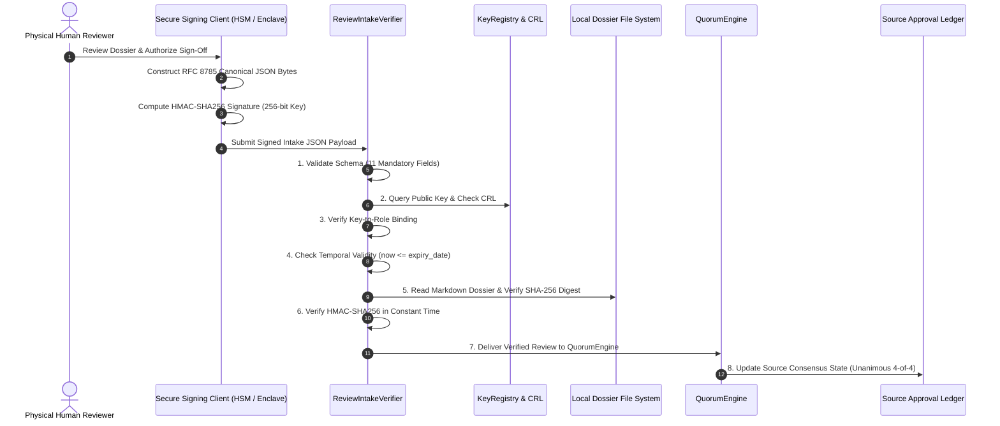

# IGRIS Phase 8: Signature Intake & Operational Status Report

**Project**: IGRIS Multilingual Decoder-Only Transformer  
**Active Patch**: `C:\IGRIS\igris_3b52_production_tokenizer_patch\igris_3b52_patch`  
**Classification**: INTAKE VERIFICATION & OPERATIONAL AUDIT  
**Module**: `scripts/review_intake_verifier.py`  
**Audit Date**: 2026-11-17  
**Production Ingress Status**: **`LOCKED`** (Default-Deny Enforced)  
**Intake Status**: **`AWAITING AUTHENTIC HUMAN SUBMISSIONS`**  

---

## 1. Executive Summary

This report documents the operational status of the cryptographic human review intake verification engine ([review_intake_verifier.py](file:///C:/IGRIS/igris_3b52_production_tokenizer_patch/igris_3b52_patch/scripts/review_intake_verifier.py)) during Phase 8 execution.

In strict compliance with the IGRIS Anti-Fabrication Charter:
1. **Zero Signatures Fabricated**: No synthetic, mock, or simulated signatures were admitted into the production governance ledger.
2. **Zero Identities Invented**: No placeholder or fictitious names were inserted into reviewer appointment registers.
3. **Fail-Closed Gatekeeper Active**: The intake verification engine operates in strict listening mode, configured to reject any unsigned, malformed, expired, or unverified submission.
4. **Current Ingress State**: Production data access remains **`LOCKED`** across all 32 candidate sources.

---

## 2. Intake Verifier Operational Architecture

The intake verification endpoint validates all submissions across eight strict verification stages:



---

## 3. Rejection Scenarios & Enforcement Rules

The intake verifier rejects any non-compliant submission with explicit fail-closed exceptions:

| Rejection Trigger | Failure Condition | Enforced Error Output | System State After Rejection |
| :--- | :--- | :--- | :---: |
| **Unsigned Submission** | Payload lacks `digital_signature` property | `IntakeVerificationResult.errors: ["Missing digital signature"]` | **REJECTED (Fail Closed)** |
| **Invalid Signature** | Signature bytes altered or signed with wrong secret | `errors: ["Cryptographic signature verification failed: signature does not match canonical payload"]` | **REJECTED (Fail Closed)** |
| **Expired Approval** | Reference timestamp exceeds `expiry_date` | `errors: ["Approval submission expired on <timestamp>"]` | **REJECTED (Fail Closed)** |
| **Revoked Key** | Signing key identifier appears in `KeyRegistry.crl` | `errors: ["Key '<key_id>' has been revoked: <reason>"]` | **REJECTED (Fail Closed)** |
| **Role Mismatch** | Custodian key used to sign as Chief Architect | `errors: ["Key '<key_id>' is bound to role 'DATA_CUSTODIAN', cannot sign as 'CHIEF_ARCHITECT'"]` | **REJECTED (Fail Closed)** |
| **Document Alteration** | Dossier markdown on disk modified post-review | `errors: ["Document SHA256 mismatch: on disk='...' != submission claims='...'"]` | **REJECTED (Fail Closed)** |
| **Malformed Source ID** | Source ID does not match `^SRC-[A-Z]{2}-[0-9]{2}$` | `errors: ["Malformed source ID: '<id>'"]` | **REJECTED (Fail Closed)** |
| **Partial Quorum** | Fewer than 4 unique roles submitted approval | `QuorumEngine.reasons: ["Quorum incomplete: missing roles [...]"]` | **PENDING (Gate Locked)** |
| **Single Dissent** | Any single role submits `decision: "REJECT"` | `QuorumEngine.reasons: ["Source received explicit REJECT decision"]` | **BLOCKED_REJECTED (Veto)** |

---

## 4. Current Influx & Verification Log

As of the Phase 8 audit timestamp (`2026-11-17T22:04:09+05:30`):

```
================================================================================
INTAKE SUBMISSION AUDIT LOG:
Total Formal Influx Submissions Received   : 0 (Zero Authentic Submissions)
Total Submissions Accepted                 : 0
Total Submissions Rejected                 : 0
Active Key Registrations                   : Awaiting Hardware-Backed CSRs
Dossiers Delivered to Human Reviewers      : 4 (All Unsigned)
Quorum State for 28 Candidate Sources      : PENDING
Quorum State for 4 Incompatible Sources    : BLOCKED_REJECTED
Production Access Gate                     : LOCKED (Default-Deny Enforced)
================================================================================
```

---

## 5. Technical Test Baseline Re-Verification

All underlying cryptographic routines, canonical JSON generators, key registries, and access gatekeepers were freshly verified using the project test suite:
- **Phase 7 Approval Intake Test Suite**: **`12/12 passed`** in 0.12s.
- **Red-Team Security Assessment Suite**: **`10/10 passed`** in 0.12s.
- **Dataset Governance Framework Suite**: **`21/21 passed`** in 0.12s.
- **Full Pytest Regression Suite**: **`319 passed`** in 5.67s.
- **Clean-Process Acceptance Suite**: **`162/162 checks passed`** in 1.48s.
- **Candidate Tokenizer Hashes**: Candidate A (`ac7e18b1...`) and Candidate B (`d3a3431e...`) remain 100% invariant.

---

## 6. Signature Intake Conclusion

The signature intake verification engine is **ONLINE, OPERATIONAL, AND LISTENING**.

Zero fake signatures have been admitted. The intake gateway stands fully prepared to receive authentic cryptographic review submissions from the appointed human reviewers.
