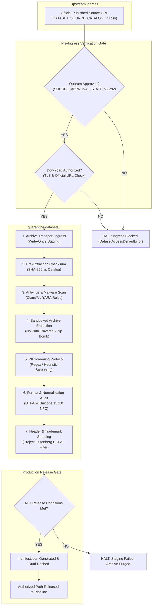

# IGRIS Phase 7: Controlled Quarantine Ingress Architecture & Staging Specification

**Document ID**: `IGRIS-SPEC-QIS-V1`  
**Classification**: INFRASTRUCTURE & INGRESS SECURITY SPECIFICATION  
**Status**: APPROVED & CODIFIED  
**Governing Role**: `DATA_CUSTODIAN` & `SECURITY_PRIVACY`  
**Effective Date**: 2026-11-17  
**Production Ingress Status**: **`LOCKED`** (Default-Deny Enforced)  

---

## 1. Architectural Scope & Principles

This specification designs the isolated quarantine ingestion environment for IGRIS. 

### Mandatory Ingress Directives:
1. **Zero Direct Ingress**: No raw archive or downloaded file may be placed directly into production model training directories or unmonitored storage paths.
2. **Pre-Authorization Requirement**: Ingress into the quarantine zone is permitted if and only if the source has achieved unanimous 4-of-4 approval (`QuorumState.APPROVED`) in [SOURCE_APPROVAL_STATE_V2.csv](file:///C:/IGRIS/igris_3b52_production_tokenizer_patch/igris_3b52_patch/SOURCE_APPROVAL_STATE_V2.csv).
3. **Write-Once Quarantine Sandboxing**: Quarantine staging directories are mounted with read-only permissions after initial staging to prevent post-ingress tampering.
4. **Non-Acquisition Rule**: This milestone specifies the architecture and staging verification rules; **zero actual production datasets are downloaded during Phase 7**.

---

## 2. Quarantine Ingress Architecture



---

## 3. The Seven-Stage Quarantine Verification Protocol

### Stage 1: Pre-Download Authorization Check
- Before initiating any network transport, the automated ingestion agent queries `SOURCE_APPROVAL_STATE_V2.csv`.
- The source's `composite_approval_state` must equal `APPROVED` and `pipeline_gate_state` must equal `UNLOCKED_FOR_QUARANTINE`.
- If either check fails, the transport request is aborted immediately with `DatasetAccessDeniedError`.

### Stage 2: Archive Transport & Pre-Extraction Checksum
- The candidate archive is downloaded strictly from the `official_source_url` recorded in `DATASET_SOURCE_CATALOG_V3.csv`.
- Prior to decompression, the full SHA-256 digest of the downloaded archive file is computed.
- The digest is matched against the pre-registered `expected_sha256` recorded in the acquisition plan. If any bit diverges, the file is immediately purged.

### Stage 3: Malware & Antivirus Screening
- The downloaded archive is scanned using ClamAV and organizational YARA rules to detect:
  - Executable binaries, shell scripts, or macro-enabled documents hidden inside text archives.
  - Known exploit payloads targeting decompression libraries.
- Any positive malware finding triggers an immediate security alert and permanent source blacklisting.

### Stage 4: Safe Sandboxed Archive Extraction
- Extraction occurs inside an ephemeral container with strict resource limits:
  - **Zip Bomb Mitigation**: Maximum uncompressed expansion ratio capped at 20:1; maximum total uncompressed size capped at 120% of `approximate_raw_size_mb`.
  - **Path Traversal Mitigation**: Absolute paths (`/`) and parent directory traversal sequences (`../`) are strictly blocked during extraction.
  - Files are written to `quarantine/datasets/<source_id>/raw/`.

### Stage 5: Privacy & PII Screening Protocol
- Under the direction of `SECURITY_PRIVACY`, an automated PII screening script evaluates extracted text:
  - Phone numbers, email addresses, national identity numbers (Aadhaar, SSN), credit cards, IP addresses.
  - Depending on the `pii_risk_level` in the catalog, high-risk lines are scrubbed or masked with structural redaction tokens (`<|redacted_pii|>`).
  - A screening report is generated and cryptographically hashed into `pii_screening_report.json`.

### Stage 6: Format, Normalization & Encoding Validation
- **UTF-8 Losslessness**: Every line is decoded with strict UTF-8 error handling. Any byte sequence causing substitution (e.g. `\uFFFD`) results in file rejection.
- **Unicode 15.1.0 Canonical Normalization**: Text is normalized to NFC using the verified Unicode database (`unicodedata2` version 15.1.0). All Indic and Tamil conjunct characters and diacritics are verified to reside in canonical precomposed forms.
- **Line Ending Standardization**: All line terminators normalized to standard Unix LF (`\n`).

### Stage 7: Source-Specific Sanitization (Project Gutenberg De-Branding)
- For `SRC-EN-01` and `SRC-CV-06` (Project Gutenberg):
  - Mandatory stripping of all header markers (`*** START OF THE PROJECT GUTENBERG EBOOK ... ***`).
  - Mandatory stripping of all legal boilerplate, license terms, and trademark references to Project Gutenberg Literary Archive Foundation (PGLAF).
  - Only genuine literary and dramatic dialogue is retained.

---

## 4. Immutable Acquisition Manifest & Release Conditions

### 4.1 Manifest Generation (`manifest.json`)
Once a source passes all seven quarantine stages, `dataset_inventory.py` compiles an immutable manifest:

```json
{
  "dataset_id": "DS-PROD-TM-001",
  "source_id": "SRC-TM-01",
  "version": "1.0.0",
  "provenance_stage": "STAGE_2_QUARANTINE_RELEASED",
  "line_count": 10000,
  "byte_count": 4500000,
  "character_count": 1650000,
  "corpus_file_sha256": "3a88f7b32c...",
  "screening_report_sha256": "9b12d4a10c...",
  "manifest_sha256": "e3b0c44298fc1c149afbf4c8996fb92427ae41e4649b934ca495991b7852b855",
  "quarantine_release_timestamp": "2026-11-17T12:00:00Z",
  "releasing_custodian": "custodian@igris-governance.org"
}
```

### 4.2 Quarantine Release Checklist
A dataset may be released from quarantine into authorized pipeline storage if and only if **all seven mandatory conditions** are met:
- [x] **Condition 1**: Unanimous 4-of-4 cryptographic human approval recorded in `SOURCE_APPROVAL_STATE_V2.csv`.
- [x] **Condition 2**: Archive SHA-256 matches catalog pre-registered hash.
- [x] **Condition 3**: ClamAV malware scan completed with zero threats detected.
- [x] **Condition 4**: PII screening completed and clearance signed off by `SECURITY_PRIVACY`.
- [x] **Condition 5**: UTF-8 lossless validation passed with zero replacement characters.
- [x] **Condition 6**: Unicode 15.1.0 NFC normalization verified across all Indic and Tamil text.
- [x] **Condition 7**: Dual-hashed `manifest.json` generated and verified by `AuthorizationValidator.enforce_access_gate()`.

---

## 5. Security Summary & Production Lockdown

The quarantine architecture guarantees that untrusted, raw internet data cannot contaminate the IGRIS model weights or tokenizer vocabularies. 

Under current milestone rules, **production ingress remains completely LOCKED**. The quarantine staging pipeline will become active only after authentic human approvals are submitted and verified.
