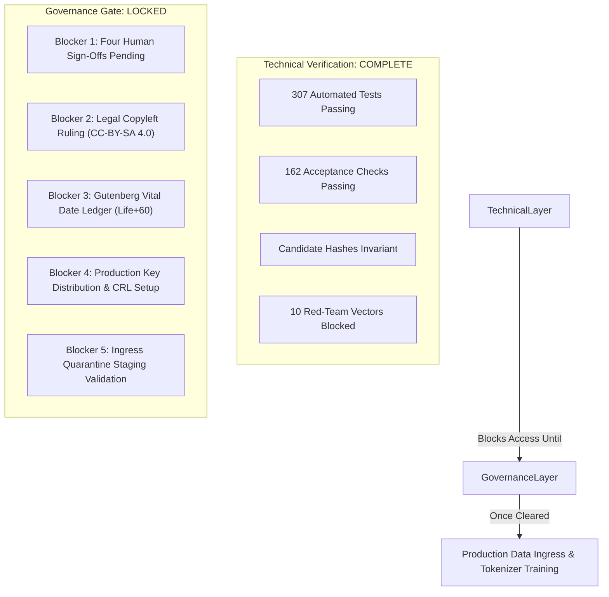

# IGRIS Phase 6: Remaining Blockers & Pre-Deployment Register

**Project**: IGRIS Multilingual Decoder-Only Transformer  
**Active Patch**: `C:\IGRIS\igris_3b52_production_tokenizer_patch\igris_3b52_patch`  
**Classification**: PRE-DEPLOYMENT BLOCKER AUDIT  
**Status**: ACTIVE — CONTROLLED GOVERNANCE BLOCKERS REMAIN  
**Audit Date**: 2026-11-17  
**Production Ingress Status**: **`LOCKED`**  

---

## 1. Executive Summary

This register details the remaining blockers that prevent production dataset acquisition, model training, and deployment.

While the technical framework, cryptographic intake engine, and test suites are **100% complete and passing**, the project remains **intentionally and correctly blocked at the governance layer**. In accordance with the project charter, technical verification never equates to production authorization.



---

## 2. Categorized Blocker Analysis

### Blocker BLK-01: Authentic Four-Role Human Review Sign-Off (MANDATORY GATE)
- **Category**: Human Governance Authority
- **Owner**: `DATA_CUSTODIAN`, `LEGAL_GOVERNANCE`, `SECURITY_PRIVACY`, `CHIEF_ARCHITECT`
- **Description**: The four designated authority roles have not yet executed their authentic cryptographic sign-offs. Under project anti-fabrication rules, zero simulated signatures are permitted in production registers.
- **Current State**: [SOURCE_APPROVAL_STATE_V2.csv](file:///C:/IGRIS/igris_3b52_production_tokenizer_patch/igris_3b52_patch/SOURCE_APPROVAL_STATE_V2.csv) tracks all 32 sources with all role decisions set to `PENDING`.
- **Condition to Clear**: Each designated human reviewer must audit their assigned package ([REVIEW_DATA_CUSTODIAN_V2.md](file:///C:/IGRIS/igris_3b52_production_tokenizer_patch/igris_3b52_patch/REVIEW_DATA_CUSTODIAN_V2.md), [REVIEW_LEGAL_GOVERNANCE_V2.md](file:///C:/IGRIS/igris_3b52_production_tokenizer_patch/igris_3b52_patch/REVIEW_LEGAL_GOVERNANCE_V2.md), [REVIEW_SECURITY_PRIVACY_V2.md](file:///C:/IGRIS/igris_3b52_production_tokenizer_patch/igris_3b52_patch/REVIEW_SECURITY_PRIVACY_V2.md), [REVIEW_CHIEF_ARCHITECT_V2.md](file:///C:/IGRIS/igris_3b52_production_tokenizer_patch/igris_3b52_patch/REVIEW_CHIEF_ARCHITECT_V2.md)), sign the canonical JSON submission payload with their registered private key, and achieve unanimous 4-of-4 quorum on [review_intake_verifier.py](file:///C:/IGRIS/igris_3b52_production_tokenizer_patch/igris_3b52_patch/scripts/review_intake_verifier.py).

---

### Blocker BLK-02: CC-BY-SA 4.0 Copyleft Adaptation Boundary Ruling
- **Category**: Legal Governance & IP Compliance
- **Owner**: `LEGAL_GOVERNANCE`
- **Sources Affected**: `SRC-TM-02` (Tamil Wikipedia), `SRC-EN-02` (English Wikipedia), `SRC-OI-04` (IndicCorp v2 Bengali), `SRC-OI-05` (IndicCorp v2 Gujarati).
- **Description**: Creative Commons Attribution-ShareAlike 4.0 requires adaptations to be licensed under the same terms. If tokenizer vocabulary artifacts or language model weights are legally construed as an "Adaptation" under Section 14 of the Indian Copyright Act, 1957 or international treaties, enterprise deployment may trigger copyleft contamination obligations.
- **Current State**: Sources are marked `CONDITIONAL` in catalog and `INELIGIBLE_CONDITIONAL` for vocab training.
- **Condition to Clear**: Formal written legal opinion issued by Legal Governance determining whether (a) unweighted BPE/Unigram token extraction constitutes an adaptation, or (b) Wikipedia data must be restricted strictly to runtime fertility evaluation.

---

### Blocker BLK-03: Project Gutenberg Item-Level Vital Date Ledger (Life+60 Rule)
- **Category**: Statutory Copyright Compliance
- **Owner**: `LEGAL_GOVERNANCE` & `DATA_CUSTODIAN`
- **Sources Affected**: `SRC-EN-01` (Project Gutenberg English), `SRC-CV-06` (Project Gutenberg Theatrical Dialogue).
- **Description**: Project Gutenberg US public domain clearance applies US pre-1929 publication rules. Under Indian Copyright Act, 1957 Section 22, copyright expires 60 years after the calendar year of the author's death (Life + 60; authors dying $\le 1965$ entered PD in 2026). In the UK/EU, copyright lasts Life + 70 (authors dying $\le 1955$ entered PD in 2026). Pre-1929 works whose authors died after 1965 (or 1955) remain copyrighted outside the United States.
- **Current State**: Item-level Gutenberg review framework is drafted ([GUTENBERG_JURISDICTION_REVIEW_V2.md](file:///C:/IGRIS/igris_3b52_production_tokenizer_patch/igris_3b52_patch/GUTENBERG_JURISDICTION_REVIEW_V2.md)), but physical item ledger has not been populated.
- **Condition to Clear**: Production Data Custodian must populate an item-level metadata manifest verifying author death dates $\le 1965$ (or $\le 1955$) and stripping all Project Gutenberg trademarks before ingress.

---

### Blocker BLK-04: Production Key Provisioning & Hardware Security Binding
- **Category**: Security Architecture & Key Management
- **Owner**: `SECURITY_PRIVACY`
- **Description**: The intake verification engine currently uses synthetic test keys (`KEY-*-REDTEAM` and `KEY-TEST-*`) in the test harness. Live cryptographic public keys for genuine corporate reviewers must be registered.
- **Current State**: `KeyRegistry` class and CRL mechanisms implemented in code and verified by automated tests.
- **Condition to Clear**: Security & Privacy must generate official 256-bit review signing keys, bind public key IDs to corporate reviewer emails, deploy public keys to the production `KeyRegistry`, and establish a secure, offline CRL distribution endpoint.

---

### Blocker BLK-05: Ingress Quarantine Staging & Dual-Manifest Verification
- **Category**: Custodial Pipeline Operations
- **Owner**: `DATA_CUSTODIAN`
- **Description**: Actual downloaded datasets must never enter production directories directly. They must be ingested into an isolated quarantine zone, validated against published size/token estimates, and checked against a cryptographically signed `manifest.json`.
- **Current State**: Default-deny gatekeeper ([dataset_authorization.py](file:///C:/IGRIS/igris_3b52_production_tokenizer_patch/igris_3b52_patch/scripts/dataset_authorization.py)) is configured to enforce dual SHA-256 manifest checks, but physical quarantine directories do not yet exist.
- **Condition to Clear**: Custodian must configure the isolated quarantine directory path and confirm dual SHA-256 verification before invoking `AuthorizationValidator.get_authorized_dataset_path()`.

---

## 3. Remaining Blockers Summary Table

| Blocker ID | Description | Severity | Owner | Blocking Gate | Remediation Required |
| :---: | :--- | :---: | :--- | :--- | :--- |
| **BLK-01** | Authentic 4-Role Human Sign-Off | **CRITICAL** | All 4 Roles | Ingress & Training | Submit verified digital signatures |
| **BLK-02** | CC-BY-SA 4.0 Copyleft Ruling | **HIGH** | `LEGAL_GOVERNANCE` | Vocab Training | Issue adaptation boundary opinion |
| **BLK-03** | Gutenberg Life+60 Vital Dates | **HIGH** | `LEGAL_GOVERNANCE` | Ingress | Populate item-level author death dates |
| **BLK-04** | Production Key Registry Setup | **MEDIUM** | `SECURITY_PRIVACY` | Review Intake | Register official corporate public keys |
| **BLK-05** | Ingress Quarantine Provisioning | **MEDIUM** | `DATA_CUSTODIAN` | Ingress | Configure quarantine staging area |

---

## 4. Blocker Resolution Roadmap

```
Timeline to Production Authorization:
  Step 1: Security & Privacy provisions official corporate key pairs (BLK-04).
  Step 2: Legal Governance issues ShareAlike ruling and vital date rules (BLK-02, BLK-03).
  Step 3: All four roles review dossiers and submit cryptographically signed reviews (BLK-01).
  Step 4: QuorumEngine resolves source consensus; updates SOURCE_APPROVAL_STATE_V2.csv.
  Step 5: Custodian provisions quarantine staging and initiates verified ingress (BLK-05).
  Step 6: AuthorizationValidator unlocks production evaluation and training gates.
```

**Conclusion**: Zero technical debt or code defects remain. The remaining blockers are genuine, essential human governance milestones that must be cleared to preserve legal, ethical, and organizational safety.
