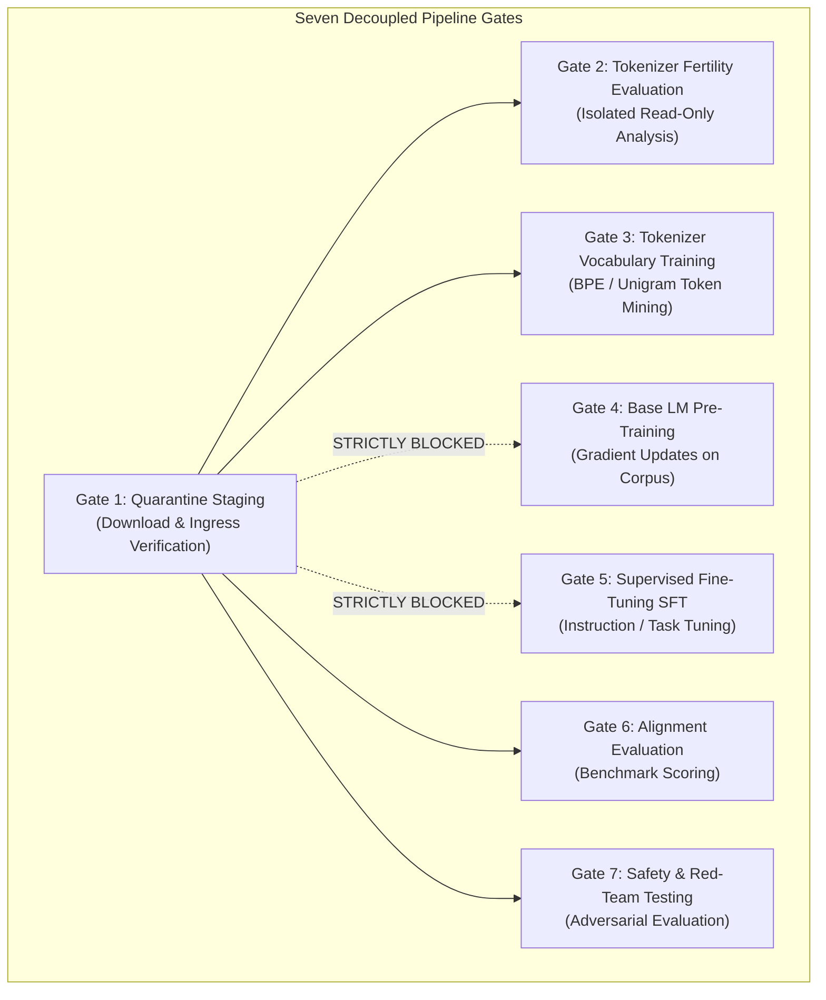
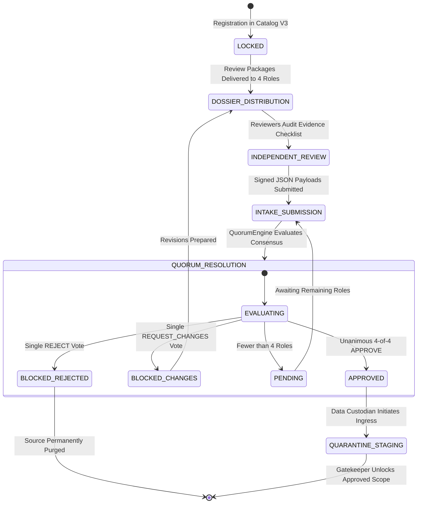

# IGRIS Phase 7: Source-Specific Authorization Workflow & Isolation Specification

**Document ID**: `IGRIS-PROC-SAW-V1`  
**Classification**: GOVERNANCE PROCESS & WORKFLOW SPECIFICATION  
**Status**: APPROVED & CODIFIED  
**Effective Date**: 2026-11-17  
**Production Ingress Status**: **`LOCKED`** (Default-Deny Enforced)  

---

## 1. Core Principles: Source & Pipeline Independence

The IGRIS dataset authorization process is governed by two inviolable principles:

1. **Non-Transitivity of Source Approvals (Source Isolation)**:
   - Every candidate dataset source (`SRC-TM-01` through `SRC-EM-02`) is evaluated and authorized as an independent legal and technical entity.
   - Authorizing Source A (e.g. `SRC-TM-01` IndicCorp v2 Tamil) confers **zero authorization** upon Source B (e.g. `SRC-TM-02` Tamil Wikipedia), even if both sources share the same language, category, or publisher.
2. **The Independence Axiom (Pipeline Scope Isolation)**:
   - Authorization is strictly granular by pipeline operation.
   - A source approved for **tokenizer fertility evaluation** does not become eligible for **tokenizer vocabulary training**, **base pre-training**, **supervised fine-tuning (SFT)**, or **preference alignment**.
   - Each operational gate requires explicit, recorded authorization in the pipeline matrix.

---

## 2. Decoupled Pipeline Gates & Authorization Matrix

The framework enforces seven distinct, decoupled pipeline gates:

### Authorization Boundaries by Gate:
- **Gate 1: Quarantine Staging**: Permits downloading the candidate archive into isolated storage for hash and format validation. Conferred only upon unanimous 4-of-4 quorum.
- **Gate 2: Tokenizer Fertility Evaluation**: Permits passing text through Candidate A and Candidate B to measure fertility ratios (bytes per token, characters per token). Read-only; no gradient updates, no vocabulary modification.
- **Gate 3: Tokenizer Vocabulary Training**: Permits mining subword tokens to build or update vocabularies. Restricted strictly to 100% human-authored text with unencumbered commercial licenses (zero CC-BY-SA, zero synthetic data, zero NC).
- **Gate 4: Base LM Pre-Training**: Unweighted functional training on massive text. Currently **`NOT AUTHORIZED`** for all sources.
- **Gate 5: Supervised Fine-Tuning (SFT)**: High-quality instruction-following tuning. Currently **`NOT AUTHORIZED`** (100% of candidate sources blocked).
- **Gate 6 & 7: Alignment & Safety Evaluation**: Designated benchmarks (e.g. `SRC-CV-04` Anthropic HH-RLHF) permitted strictly for scoring alignment and safety, with rejected completions completely isolated.

---

## 3. End-to-End Source Authorization Workflow

The authorization lifecycle for an individual candidate dataset source proceeds through six sequential stages:

### Stage 1: Registration & Default-Deny Lock
- The dataset source is registered in `DATASET_SOURCE_CATALOG_V3.csv`.
- `SOURCE_APPROVAL_STATE_V2.csv` initializes the source with all role decisions set to `PENDING`, composite state `PENDING`, and pipeline gate `LOCKED`.

### Stage 2: Dossier Distribution
- Role-specific review packages ([REVIEW_DATA_CUSTODIAN_V2.md](file:///C:/IGRIS/igris_3b52_production_tokenizer_patch/igris_3b52_patch/REVIEW_DATA_CUSTODIAN_V2.md), [REVIEW_LEGAL_GOVERNANCE_V2.md](file:///C:/IGRIS/igris_3b52_production_tokenizer_patch/igris_3b52_patch/REVIEW_LEGAL_GOVERNANCE_V2.md), etc.) are delivered to the four designated reviewers.
- Each dossier contains explicit source-by-source checkboxes and instructions.

### Stage 3: Independent Role Review
- Each reviewer audits the evidence independently according to their role mandate.
- No reviewer may consult or influence another reviewer's formal verdict before submission.

### Stage 4: Cryptographic Submission Intake
- Each reviewer constructs a formal JSON submission conforming to `HUMAN_APPROVAL_SCHEMA_V1.json`.
- The submission is signed using the reviewer's hardware-bound private key.
- `ReviewIntakeVerifier.verify_submission()` verifies:
  1. 11 mandatory schema fields.
  2. Public key registration and CRL status.
  3. Role-to-key binding.
  4. Temporal validity (`now <= expiry_date`).
  5. Live document SHA-256 match on disk.
  6. Constant-time HMAC-SHA256 signature verification over RFC 8785 canonical bytes.

### Stage 5: Quorum Resolution
- `QuorumEngine.evaluate_source_consensus(source_id, verified_submissions)` resolves the composite state:
  - If any submission is `REJECT` $\rightarrow$ `QuorumState.BLOCKED_REJECTED`.
  - If any submission is `REQUEST_CHANGES` $\rightarrow$ `QuorumState.BLOCKED_CHANGES_REQUESTED`.
  - If fewer than 4 unique roles have approved $\rightarrow$ `QuorumState.PENDING`.
  - If and only if all 4 unique roles submit `APPROVE` $\rightarrow$ `QuorumState.APPROVED`.

### Stage 6: Audit Logging & Gate Update
- Upon successful quorum resolution:
  1. An audit record is committed to `governance_audit_trail.jsonl` linking to the previous entry's SHA-256 hash.
  2. The source record in `SOURCE_APPROVAL_STATE_V2.csv` is updated with the four individual decisions, composite state `APPROVED`, and pipeline gate `UNLOCKED_FOR_QUARANTINE`.
  3. `AuthorizationValidator.get_authorized_dataset_path()` verifies this record before releasing the verified path to the execution pipeline.

---

## 4. Exception Handling & Revocation Protocol

1. **Discovery of New Legal Claims**: If a copyright dispute arises regarding an approved source, `LEGAL_GOVERNANCE` files a revocation notice. The source immediately transitions to `BLOCKED_REJECTED`, and the gatekeeper revokes pipeline access.
2. **Corrupted Quarantine Staging**: If downloaded archive hashes diverge from published estimates, `DATA_CUSTODIAN` halts ingress, marks the staging failed, and logs an audit exception.
3. **Emergency Lock**: Any single authority role possesses the unilateral power to trigger an emergency gate freeze, immediately setting `pipeline_gate_state = LOCKED` across all candidate sources.
