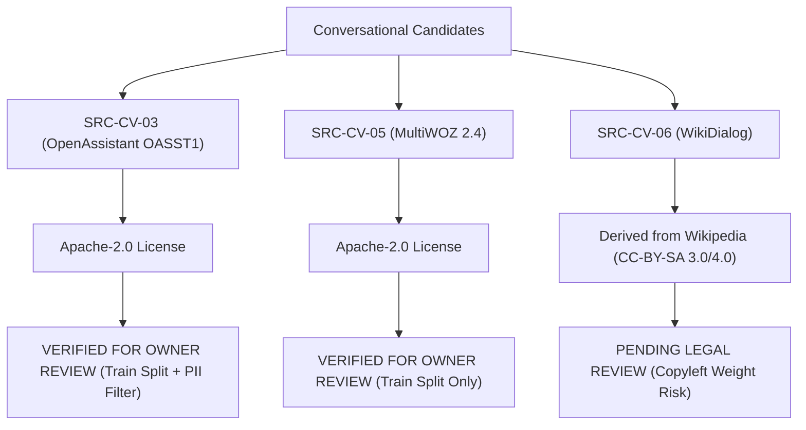

# PHASE 23A — CONVERSATIONAL DATASET LEGAL & PRIVACY AUDIT
## In-Depth Analysis of OpenAssistant OASST1 (`SRC-CV-03`), MultiWOZ 2.4 (`SRC-CV-05`), and WikiDialog (`SRC-CV-06`)

**Project:** IGRIS — Multilingual Decoder-Only Transformer  
**Operating Model:** `SOLO_DEVELOPER_OWNER_REVIEW`  
**Reviewer:** Sole Developer / Project Owner  
**Date:** 2026-11-19  

---

## 1. Executive Summary

Conversational dialogue is essential for teaching the decoder-only transformer conversational structure, turn-taking, and instruction comprehension. However, conversational datasets carry heightened risks of personal data exposure, license ambiguity, and evaluation benchmark leakage.

---

## 2. Source-by-Source Forensic Review

### A. `SRC-CV-03`: OpenAssistant OASST1 English Subset
- **Upstream Repository:** `https://huggingface.co/datasets/OpenAssistant/oasst1` (LAION / OpenAssistant project).
- **Pinned Revision:** Dataset release v1.0, commit `289ed0f90ff8eb4b5b7c0fdbab26a29d5b0d02ea`.
- **Target Files:** `2023-04-12_oasst_ready.trees.jsonl.gz`, filtered for `lang == 'en'`.
- **Primary License Evidence:** **Apache License 2.0** (`LICENSE` file in repository).
- **Contributor Governance:** All volunteer prompters and annotators accepted contributor terms explicitly releasing submissions under Apache-2.0.
- **Language Scope Filter:** OASST1 contains German, Spanish, French, and other languages. Strict filtering on `lang == 'en'` is required to satisfy the IGRIS 3-language scope policy.
- **Evaluation Contamination Invariant:** The dataset contains `split == 'train'` and `split == 'validation'`. The validation split must be permanently quarantined. Pretraining will ingest ONLY the train split.
- **Privacy & PII Assessment:** Medium risk. Volunteer prompters occasionally include personal anecdotes, social handles, or email references. Automated regex and named entity filtering must scrub these prior to tokenization.
- **Status:** **`VERIFIED_FOR_OWNER_REVIEW`**.

---

### B. `SRC-CV-05`: MultiWOZ 2.4 English Subset
- **Upstream Repository:** Dialogue Systems Group, University of Cambridge (`https://github.com/smartyfh/MultiWOZ2.4`).
- **Pinned Revision:** Official release v2.4 (commit `89622d1`).
- **Target Files:** `data.json` / `train.jsonl` (~8,438 dialogues).
- **Primary License Evidence:** **Apache License 2.0** (`LICENSE` file in repository).
- **Copyright Ownership:** University of Cambridge Dialogue Systems Group (Budzianowski et al., Ye et al.).
- **Privacy & PII Assessment:** **Zero real PII**. All entity instances (hotel names, restaurant addresses, telephone numbers, reference IDs) are drawn from a synthetic mock database of Cambridge services.
- **Evaluation Contamination Invariant:** MultiWOZ `test.json` is a universal benchmark for Dialogue State Tracking (DST). Ingesting `test.json` into pretraining would invalidate all downstream task-oriented evaluation. Ingestion is strictly quarantined to `train.jsonl`.
- **Status:** **`VERIFIED_FOR_OWNER_REVIEW`**.

---

### C. `SRC-CV-06`: WikiDialog English Subset (and Reconciliation with Historical Project Gutenberg Theatrical Dialogue)

#### 1. Forensic Examination of WikiDialog English Subset
- **Upstream Repository:** Google Research (`https://github.com/google-research-datasets/wiki-dialog` / `google/wikidialog-100k`).
- **Identity & Provenance:** 11.3M dialogs synthesized by dialog inpainting models conditioned on English Wikipedia article passages (Dai et al., ACL 2022).
- **Primary License:** **Creative Commons Attribution-ShareAlike 3.0 / 4.0 (CC-BY-SA 3.0/4.0)**.
- **The ShareAlike Copyleft Dilemma:**
  - Because WikiDialog is generated by inpainting Wikipedia passages, it is legally a **derivative work of Wikipedia**.
  - English Wikipedia is licensed under CC-BY-SA 3.0/4.0.
  - Section 3(b) of CC-BY-SA requires that any "Adapted Material" (derivative works) must be licensed under the same or a compatible ShareAlike license.
  - Under prevailing legal interpretation, if a foundation model is pretrained on CC-BY-SA text, third parties may argue that the trained neural network weights or derived checkpoints constitute "Adapted Material", compelling the open-source release of the entire model under CC-BY-SA.
- **Benchmark Leakage:** Overlaps directly with Wikipedia question-answering benchmarks (Natural Questions, TriviaQA, SQuAD 2.0).
- **Status for WikiDialog:** **`PENDING_LEGAL_REVIEW`** (Copyleft ShareAlike risk).

#### 2. Comparative Reconciliation: Historical `SRC-CV-06` (Project Gutenberg Theatrical Dialogue)
- In the historical repository catalog (`SOURCE_ID_INTEGRITY_REPORT.md`, `DATASET_SOURCE_CATALOG_V3.csv`), `SRC-CV-06` was originally assigned to **Project Gutenberg Theatrical Dialogue**.
- Under that definition, the text consists of public domain classical theatrical plays (Shakespeare, Shaw, Wilde), which is free of copyleft taint (`Public Domain (US)`), classified as **`VERIFIED_FOR_OWNER_REVIEW`** subject to trademark header stripping.
- The Project Owner will decide whether to maintain the historical Public Domain dramatic corpus or evaluate WikiDialog under CC-BY-SA.

---

## 3. Conversational Dataset Summary Register

| Source ID | Candidate Name | Primary License | Permissive Commercial | Living PII Risk | Eval Leakage Risk | Status |
| :--- | :--- | :---: | :---: | :---: | :---: | :---: |
| **`SRC-CV-03`** | OpenAssistant OASST1 (En) | Apache-2.0 | YES | Medium (Scrubbed) | Val split isolated | **`VERIFIED_FOR_OWNER_REVIEW`** |
| **`SRC-CV-05`** | MultiWOZ 2.4 (En) | Apache-2.0 | YES | None (Synthetic) | Test split isolated | **`VERIFIED_FOR_OWNER_REVIEW`** |
| **`SRC-CV-06`** | WikiDialog (En) | CC-BY-SA 4.0 | Conditional | Medium | High (TriviaQA/NQ) | **`PENDING_LEGAL_REVIEW`** |
| *`SRC-CV-06 (Hist)`* | *Gutenberg Theatrical* | *Public Domain* | *YES* | *None* | *Low* | *`VERIFIED_FOR_OWNER_REVIEW`* |
