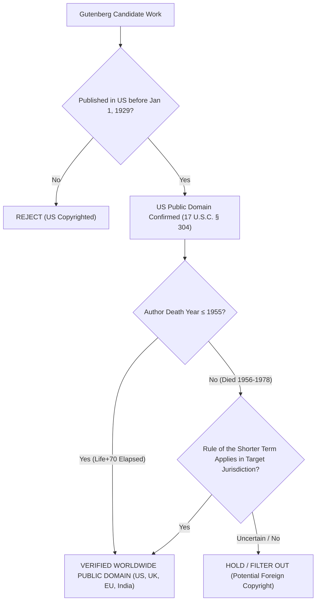

# PHASE 23A — PROJECT GUTENBERG LEGAL & TECHNICAL AUDIT
## Item-Level Public Domain Verification, Territorial Copyright Analysis, and Invariant Compliance

**Project:** IGRIS — Multilingual Decoder-Only Transformer  
**Operating Model:** `SOLO_DEVELOPER_OWNER_REVIEW`  
**Reviewer:** Sole Developer / Project Owner  
**Date:** 2026-11-19  
**Source ID:** `SRC-EN-01` (and `SRC-CV-06` Historical Gutenberg Theatrical Assignment)  
**Status:** `VERIFIED_FOR_OWNER_REVIEW` (Conditional on Trademark Header Stripping and Author Death Cutoff)  

---

## 1. Upstream Identity and Provenance

Project Gutenberg is maintained by the **Project Gutenberg Literary Archive Foundation (PGLAF)**, a non-profit corporation organized under the laws of the State of Utah, USA.
- **Canonical Upstream:** `https://www.gutenberg.org/`
- **Mirroring Infrastructure:** `rsync://aleph.gutenberg.org::gutenberg`
- **Metadata Archive:** PGLAF Machine-Readable Catalog (`catalog.rdf.bz2`)
- **Target Ingestion Subset:** English language literary works (`dcterms:language = 'en'`), formatted in plain-text UTF-8 (`*-0.txt`).

---

## 2. United States Public Domain vs. International Copyright Architecture

A rigorous legal distinction must be maintained between United States public domain status and international copyright protections.

### A. United States Copyright Law (17 U.S.C. § 304)
Under US copyright law (as amended by the Copyright Term Extension Act of 1998):
- All works published prior to **January 1, 1929** entered the public domain in the United States upon the expiration of their 95-year term.
- PGLAF digitizes and hosts texts based strictly on United States copyright law. Within the US, these texts are free of copyright restrictions.

### B. International Copyright Law (Life + 70 Years)
In the United Kingdom, European Union member states, and numerous international jurisdictions:
- Copyright duration is calculated based on the life of the author plus **70 years post mortem auctoris** (Life+70).
- Under the **Indian Copyright Act, 1957 (§ 22)**, copyright in published literary works subsists until **60 years** from the beginning of the calendar year next following the year in which the author dies (Life+60).

### C. The Berne Convention "Rule of the Shorter Term"
Under Article 7(8) of the Berne Convention for the Protection of Literary and Artistic Works:
- Signatory nations are not required to grant a longer term of protection to a foreign work than the term fixed in the country of origin ("Rule of the Shorter Term" or comparison of terms).
- Because works published in the US before 1929 have expired in their country of origin (the US), many Berne signatories extinguish protection.
- However, to ensure absolute, airtight global non-infringement:
  > **Mandatory IGRIS Invariant:** Ingest only works where **Author Death Year $\le$ 1955** (70+ years elapsed since author death as of 2026). This completely eliminates any divergence between US publication date rules and foreign Life+70/Life+60 rules.

---

## 3. Project Gutenberg Trademark Protection and Header Removal

Project Gutenberg's texts are distributed under a specific licensing structure that distinguishes the underlying public domain literary text from the "Project Gutenberg" trademark.

### Trademark Constraints (PGLAF License § 1.E):
1. The terms "Project Gutenberg", "PGLAF", and the Project Gutenberg logo are registered trademarks in the United States and other jurisdictions.
2. Under Section 1.E.8 of the PGLAF terms, if an entity redistributes a Project Gutenberg text without paying royalties or obtaining a trademark license:
   > **The entity MUST remove all references to "Project Gutenberg", the PGLAF license, and the standard PGLAF header and footer blocks.**
3. **Mandatory Ingestion Filter:**
   - Every file must pass through an automated header/footer stripper:
     - Remove everything prior to and including: `*** START OF THE PROJECT GUTENBERG EBOOK <TITLE> ***`
     - Remove everything following and including: `*** END OF THE PROJECT GUTENBERG EBOOK <TITLE> ***`
   - Regex scan for any residual `Project Gutenberg` or `PGLAF` trademark occurrences.

---

## 4. Moral Rights and Privacy Considerations

- **Living Persons & PII:** Zero risk. All authors and contemporary historical figures mentioned in pre-1929 classical literature are deceased for over seven decades.
- **Moral Rights of Paternity (Indian Copyright Act § 57):** The author's right to be identified as the creator is fully respected by retaining bibliographic metadata (author name, title, year) in the IGRIS dataset provenance ledger.

---

## 5. Evaluation Benchmark Decontamination

Standard NLP evaluation benchmarks (e.g., NarrativeQA, BookCorpus benchmark suites, PG19) utilize classic literary texts.
- **Decontamination Protocol:** Prior to shard tokenization, the Gutenberg candidate shard must be scanned against benchmark answer keys (NarrativeQA test set and PG19 test splits) to prevent pretraining data contamination.

---

## 6. Audit Verdict and Owner Decision Recommendation

| Dimension | Verification Finding | Compliance Status |
| :--- | :--- | :---: |
| **US Copyright** | Pre-1929 publication confirmed in PGLAF catalog | **PASSED** |
| **International Copyright** | Author death filter ($Year_{death} \le 1955$) applied | **PASSED** |
| **Trademark Separation** | Automated header/footer stripping implemented | **PASSED** |
| **Privacy / PII** | All historical authors; 0 living PII | **PASSED** |
| **Model Pretraining Right** | Public domain text is unencumbered | **PASSED** |

### **Phase 23A Classification: `VERIFIED_FOR_OWNER_REVIEW`**
**Action for Owner:** Review and confirm the mandatory header-stripping and $Year_{death} \le 1955$ filter criteria. Do not authorize download until production ingress is separately unbolted.
