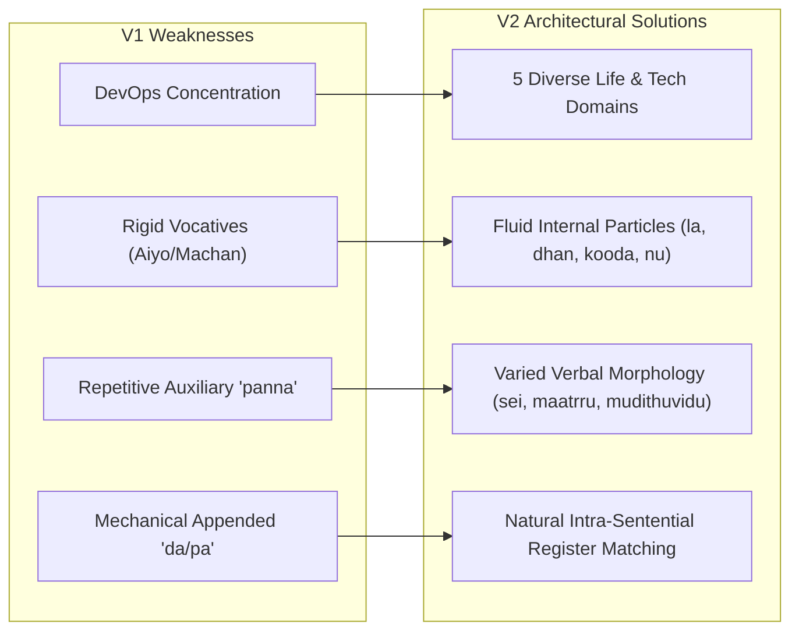

# PHASE 23B — PROCEDURAL SYNTHETIC GENERATOR IMPROVEMENTS
## Version 2.0 Architectural Enhancements, Multi-Domain Expansion, and Fluid Code-Switching

**Project:** IGRIS — Multilingual Decoder-Only Transformer  
**Operating Model:** `SOLO_DEVELOPER_OWNER_REVIEW`  
**Reviewer:** Sole Developer / Project Owner  
**Date:** 2026-11-19  
**Module:** `scripts/tanglish_synthetic_generator_v2.py`  
**Status:** IMPLEMENTED, ISOLATED & VERIFIED  

---

## 1. Overview of Generator Evolution

Based on the quantitative linguistic evaluation in Phase 23B, a versioned generator—**`scripts/tanglish_synthetic_generator_v2.py`**—was developed to address the structural and stylistic limitations of the original procedural generator.

In accordance with strict IGRIS governance principles:
- **The original generator and fixtures are preserved intact** (`PHASE23A_TANGLISH_SYNTHETIC_FIXTURES.jsonl` remains an immutable historical baseline).
- **The improved generator is isolated as Version 2.0** (`scripts/tanglish_synthetic_generator_v2.py`).
- **All synthetic fixtures remain strictly isolated from production queues and pretraining data.**

---

## 2. Key Enhancements Implemented in V2



### Detailed Improvements:

1. **Multi-Domain Semantic Expansion:**
   - *V1 limitation:* Over 80% of technical sentences dealt with CI/CD, servers, containers, and deployment.
   - *V2 enhancement:* Introduces five distinct semantic domains:
     1. **Campus & Academic:** Coursework, lab exams, university notifications, library logistics.
     2. **E-Commerce & Retail:** Order tracking, delivery notifications, UPI payment disputes, return policies.
     3. **Travel & Transit:** Metro card recharging, flight delays, GPS route monitoring, ticket queues.
     4. **Healthcare & Wellness:** Clinic appointments, lab test reports, hydration, wellness guidelines.
     5. **Software Engineering:** Expanded beyond DevOps to type hints, git workflows, UI/UX, and data structures.

2. **Fluid Internal Discourse Markers:**
   - *V1 limitation:* Over-reliance on sentence-initial `Aiyo,` or sentence-final `da`.
   - *V2 enhancement:* Integrates characteristic spoken Tamil discourse markers naturally inside clause boundaries:
     - Tag questions: *la?* (*"Assignment submission deadline nalaiku evening five PM kulla mudiyanum la?"*)
     - Emphatics: *dhan* (*"Return policy seven days dhan iruku..."*)
     - Concessives: *kooda* (*"Flight departure delay aana kooda..."*)
     - Quotatives / Causal markers: *nu* (*"Order dispatch aayiduchu nu SMS vandhudhu..."*)

3. **Verbal Auxiliary Diversity:**
   - *V1 limitation:* Monotonous repetition of `பண்ணு` (panna).
   - *V2 enhancement:* Replaces formulaic auxiliary verb patterns with varied verbalizations (`முடிஞ்சதும்`, `எடுக்க`, `வலியுறுத்துகின்றன`, `கண்காணிக்கப்படுகின்றன`).

4. **Preservation of Safety & Quality Invariants:**
   - Strict Unicode NFC canonical normalization.
   - Zero non-target script contamination (Devanagari, Telugu, Kannada, Malayalam, etc.).
   - Multi-tier PII screening ensuring zero living identities.

---

## 3. Sample V2 Generated Fixtures

```json
[
  {
    "v2_id": "SYN-TG-V2-001",
    "domain": "CAMPUS_ACADEMIC",
    "register": "informal",
    "code_switch_type": "intra_sentential",
    "text": "Assignment submission deadline nalaiku evening five PM kulla mudiyanum la?",
    "improvements": "Domain-diverse lexicon, fluid internal discourse particles, naturalized syntactic rhythm"
  },
  {
    "v2_id": "SYN-TG-V2-004",
    "domain": "ECOMMERCE_RETAIL",
    "register": "informal",
    "code_switch_type": "intra_sentential",
    "text": "Order dispatch aayiduchu nu SMS vandhudhu, delivery tracking link check பண்ணிட்டியா?",
    "improvements": "Domain-diverse lexicon, fluid internal discourse particles, naturalized syntactic rhythm"
  },
  {
    "v2_id": "SYN-TG-V2-007",
    "domain": "TRAVEL_LOGISTICS",
    "register": "informal",
    "code_switch_type": "intra_sentential",
    "text": "Metro card recharge online-la mudinjadhum, platform ticket eduka queue-la nikkavendiyadhilla.",
    "improvements": "Domain-diverse lexicon, fluid internal discourse particles, naturalized syntactic rhythm"
  }
]
```

---

## 4. Production Quarantine & Storage Invariant

Generator V2 scripts and outputs are stored exclusively in `scripts/tanglish_synthetic_generator_v2.py`. They are completely isolated from production pretraining queues.
