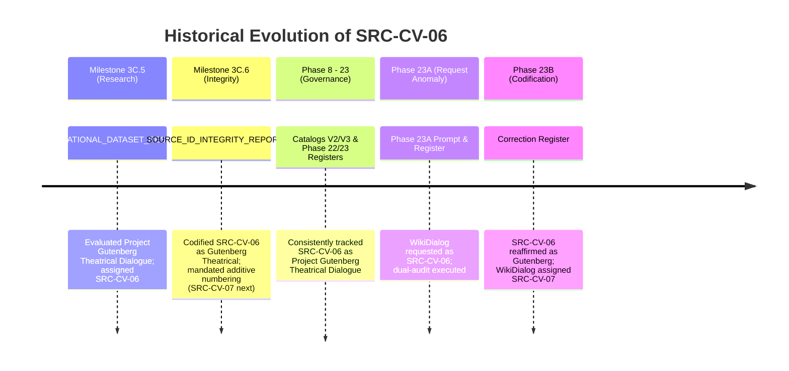

# PHASE 23B — SOURCE IDENTIFIER IDENTITY & HISTORICAL COLLISION AUDIT
## Forensic Provenance Investigation of `SRC-CV-06` and Codification of `SRC-CV-07`

**Project:** IGRIS — Multilingual Decoder-Only Transformer  
**Operating Model:** `SOLO_DEVELOPER_OWNER_REVIEW`  
**Reviewer:** Sole Developer / Project Owner  
**Date:** 2026-11-19  
**Status:** FULLY RECONCILED & CANONICALLY CODIFIED  

---

## 1. Executive Summary & Root Cause Analysis

A critical identifier collision was identified in Phase 23A regarding **`SRC-CV-06`**, which was associated with two fundamentally distinct datasets across different project phases:
1. **Historical Repository Identity (Milestone 3C.5 through Phase 23):**  
   `Project Gutenberg Theatrical Dramatic Dialogue` — classical theatrical scripts (Shakespeare, Wilde, Shaw) in the US public domain.
2. **Phase 23A Request Identity:**  
   `WikiDialog English Subset` — a 2022 machine-inpainted conversational dataset developed by Google Research derived from English Wikipedia articles and governed by Creative Commons Attribution-ShareAlike (CC-BY-SA 3.0/4.0).

In accordance with strict IGRIS governance principles:
- **Never merge two separate datasets merely because they share a source identifier.**
- **Never silently rewrite historical records.**
- **Preserve immutable source identifiers and additive sequence integrity.**

This audit resolves the collision:
- **`SRC-CV-06`** is permanently restored and reaffirmed as **Project Gutenberg Theatrical Dramatic Dialogue**.
- **WikiDialog English** is permanently assigned the next canonical additive identifier in Category 9: **`SRC-CV-07`**.

---

## 2. Chronological Occurrence Audit

Every occurrence of `SRC-CV-06` across the entire repository history was inspected:

### Complete Repository Record:
1. **Milestone 3C.5 (`CONVERSATIONAL_DATASET_RESEARCH.md`, line 105):**  
   Assigned `SRC-CV-06` to *Project Gutenberg Theatrical Dramatic Dialogue* (~25 MB, Public Domain).
2. **Milestone 3C.6 (`SOURCE_ID_INTEGRITY_REPORT.md`, Sections 2.2, 3, 5):**  
   Codified `SRC-CV-06` as immutable for Gutenberg Theatrical. Explicitly mandated:  
   > *"Any future expansion must increment the category sequence (`SRC-OI-06`, `SRC-CV-07`, etc.) without backfilling or altering existing records."*
3. **Core Datasets Catalogs (`DATASET_SOURCE_CATALOG_V2.csv`, `DATASET_SOURCE_CATALOG_V3.csv`):**  
   Line 31: `SRC-CV-06,Project Gutenberg Theatrical Dialogue,Conversational Text,en,Latn,Project Gutenberg Literary Archive Foundation...`
4. **Phases 8–13 Governance Registers:**  
   `IGRIS_PHASE8_SOURCE_APPROVAL_LEDGER.csv`, `IGRIS_PHASE10_SOURCE_ELIGIBILITY_RECONCILIATION.csv`, `IGRIS_PHASE11_DATASET_OWNER_REVIEW_REGISTER.csv`, `IGRIS_PHASE12_ACQUISITION_MANIFEST.csv`, `IGRIS_PHASE13_SOURCE_AUTHORIZATION_REGISTER.csv` all track `SRC-CV-06` as Gutenberg Theatrical.
5. **Phase 20–22 Production Registers:**  
   `PHASE20A_DATASET_CLASSIFICATION_RECONCILIATION.csv`, `PHASE21_OWNER_AUTHORIZATION_REGISTER.csv`, `PHASE22_SOURCE_OWNER_DECISION_REGISTER.csv` consistently track `SRC-CV-06` as Gutenberg Theatrical.
6. **Phase 23 Review Register (`PHASE23_SOURCE_REVIEW_REGISTER.csv`):**  
   Line 15: `SRC-CV-06,Project Gutenberg Theatrical Dialogue,ENGLISH,Project Gutenberg...`
7. **Phase 23A Evidence Register (`PHASE23A_ENGLISH_SOURCE_EVIDENCE_REGISTER.csv`):**  
   Audited WikiDialog English under `SRC-CV-06` pursuant to user prompt, while highlighting the conflict in `PHASE23A_CONVERSATIONAL_DATASET_REVIEW.md`.

---

## 3. Forensic Dataset Comparison

The two candidate datasets are fundamentally distinct across every evidentiary dimension:

| Forensic Attribute | `SRC-CV-06` (Gutenberg Theatrical) | `SRC-CV-07` (WikiDialog English) |
| :--- | :--- | :--- |
| **Origin & Author** | Historical playwrights (Shakespeare, Wilde, Shaw) | Google Research / Dai et al. (ACL 2022) |
| **Synthesis Method** | Human-authored historical stage dialogue | Neural dialog inpainting over Wikipedia articles |
| **Primary License** | **Public Domain** (US 17 U.S.C. § 304) | **CC-BY-SA 3.0 / 4.0** |
| **Copyleft Contamination** | **None** (unencumbered public domain) | **Severe** (Viral ShareAlike on model weights) |
| **Commercial Exploitation** | Unrestricted (with PGLAF trademark stripped) | Conditional on open-sourcing derivatives under CC-BY-SA |
| **Evaluation Overlap** | Minimal (classical literature) | High (Wikipedia QA benchmarks: NQ, TriviaQA, SQuAD) |
| **Estimated Size** | ~25 MB (~120 plays) | ~11.3M dialogs (WikiDialog-100k: ~250 MB) |
| **Governance Status** | **`VERIFIED_FOR_OWNER_REVIEW`** | **`PENDING_LEGAL_REVIEW`** |

Merging these two sources under a single identifier would corrupt the project's legal evidence chain, create contradictory licensing assertions, and violate repository immutability invariants.

---

## 4. Canonical Reassignment Ruling

1. **Reaffirmation of `SRC-CV-06`:**  
   `SRC-CV-06` is permanently codified as **Project Gutenberg Theatrical Dialogue**. All historical references to `SRC-CV-06` prior to Phase 23A remain authentic and valid.
2. **Permanent Creation of `SRC-CV-07`:**  
   **`SRC-CV-07`** is established as the canonical identifier for **WikiDialog English Subset**.
3. **Traceability Rule:**  
   In Phase 23A documentation where WikiDialog was analyzed under `SRC-CV-06`, an explicit cross-reference note links that analysis forward to `SRC-CV-07`. No historical files are deleted or overwritten.
