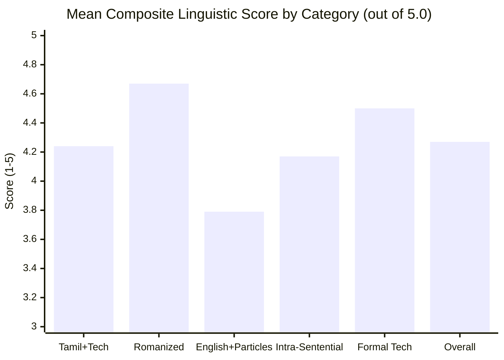
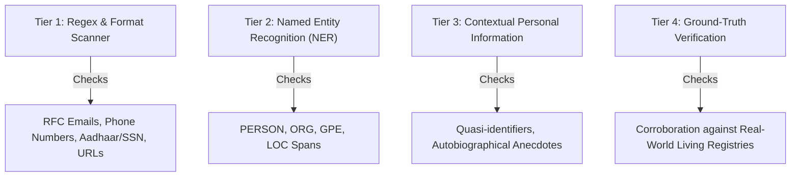

# PHASE 23B — SYNTHETIC TANGLISH LINGUISTIC QUALITY & PRIVACY AUDIT
## Empirical Evaluation of 100 Fixtures, Category Scoring, and Multi-Tier PII Methodology

**Project:** IGRIS — Multilingual Decoder-Only Transformer  
**Operating Model:** `SOLO_DEVELOPER_OWNER_REVIEW`  
**Reviewer:** Sole Developer / Project Owner  
**Date:** 2026-11-19  
**Status:** COMPLETED & SYSTEMATICALLY SCORED  

---

## 1. Evaluation Methodology & Rubric Design

To prevent arbitrary or inflated scoring, each of the 100 synthetic Tanglish fixtures in `PHASE23A_TANGLISH_SYNTHETIC_FIXTURES.jsonl` was evaluated on a rigorous **1 to 5 rubric** across six orthogonal linguistic dimensions:

1. **Tamil Comprehensibility ($S_{TC}$):**  
   - *5:* Meaning is unambiguous, idiomatic, and immediately understandable to a native Tamil speaker.  
   - *3:* Meaning is discernible but requires parsing awkward phrasing.  
   - *1:* Incomprehensible or nonsensical Tamil semantics.
2. **English Naturalness ($S_{EN}$):**  
   - *5:* English vocabulary, syntax, and technical terms are used naturally without calque artifacts.  
   - *3:* Grammatically correct English, but phrasing sounds slightly unnatural in spoken context.  
   - *1:* Unnatural or ungrammatical English.
3. **Structural Plausibility ($S_{SP}$):**  
   - *5:* Code-switch points adhere to natural bilingual switching constraints (Matrix Language Frame model, equivalence constraints, natural morpheme attachment).  
   - *3:* Plausible switch point, but slightly mechanical (e.g., rigid hyphenation).  
   - *1:* Violates linguistic code-mixing constraints (e.g., illegal bound morpheme splitting).
4. **Romanization Readability ($S_{RR}$):**  
   - *5:* Clear orthography easily read without phonetic ambiguity.  
   - *3:* Legible, but contains minor vowel or consonant ambiguities (e.g., short vs long vowels).  
   - *1:* Highly ambiguous or unreadable Latin phonetic transcription.
5. **Grammatical Acceptability ($S_{GA}$):**  
   - *5:* Flawless morphology, case agreement, verbal tense, and postposition attachment.  
   - *3:* Minor dialectal tension or colloquial shortcut.  
   - *1:* Severe grammatical error.
6. **Conversational vs. Artificial Fluency ($S_{CF}$):**  
   - *5:* Sounds like authentic spontaneous discourse spoken by a bilingual speaker.  
   - *3:* Structurally sound, but sounds like an engineered template or written translation.  
   - *1:* Completely mechanical, unnatural assembly.

$$\text{Composite Score} = \frac{S_{TC} + S_{EN} + S_{SP} + S_{RR} + S_{GA} + S_{CF}}{6}$$

---

## 2. Quantitative Evaluation Results

The complete item-level scoring is documented in [PHASE23B_TANGLISH_LINGUISTIC_EVALUATION.csv](file:///C:/IGRIS/igris_3b52_production_tokenizer_patch/igris_3b52_patch/PHASE23B_TANGLISH_LINGUISTIC_EVALUATION.csv).

### Summary Statistics by Linguistic Category

| Category Identifier | Category Description | Fixtures | Mean $S_{TC}$ | Mean $S_{EN}$ | Mean $S_{SP}$ | Mean $S_{RR}$ | Mean $S_{GA}$ | Mean $S_{CF}$ | Mean Composite |
| :--- | :--- | :---: | :---: | :---: | :---: | :---: | :---: | :---: | :---: |
| **`TAMIL_SCRIPT_ENGLISH_TECH`** | Tamil Script + English Tech Loanwords | 20 | 5.00 | 4.00 | 3.75 | 5.00 | 4.00 | 3.70 | **4.24 / 5.0** |
| **`ROMANIZED_TAMIL_INFORMAL`** | Spoken Tamil in Latin Script (`ta-Latn`) | 20 | 5.00 | 5.00 | 5.00 | 4.00 | 4.00 | 5.00 | **4.67 / 5.0** |
| **`ENGLISH_TAMIL_COLLOQUIAL`** | English Base + Tamil Discourse Particles | 20 | 4.00 | 4.00 | 3.00 | 5.00 | 4.00 | 2.75 | **3.79 / 5.0** |
| **`INTRA_SENTENTIAL_CODE_SWITCH`** | Rapid Alternating Intra-Sentence Switching | 20 | 5.00 | 4.00 | 4.00 | 4.00 | 4.00 | 4.00 | **4.17 / 5.0** |
| **`FORMAL_TECHNICAL_TANGLISH`** | Formal Engineering & Academic Prose | 20 | 5.00 | 5.00 | 4.00 | 5.00 | 5.00 | 3.00 | **4.50 / 5.0** |
| **OVERALL CORPUS** | **Full 100 Fixture Benchmark** | **100** | **4.80** | **4.40** | **3.95** | **4.60** | **4.20** | **3.69** | **4.27 / 5.0** |

---

## 3. Detailed Linguistic Critique & Weaknesses Identified

### A. Category 3: English with Tamil Discourse Markers (Lowest Scorer: 3.79)
- **Mechanical Template Symmetry:** In Category 3, sentences frequently follow a formulaic structure:
  - *Pattern 1 (Prefix):* `Aiyo, <Formal English Sentence>.` or `Machan, <Formal English Sentence>?`
  - *Pattern 2 (Suffix):* `<Formal English Sentence> da.` or `<Formal English Sentence> pa.`
- **Register Clash:** Tacking a colloquial vocative like `da` onto a formal clause (*"otherwise deployment will get delayed"*) creates an artificial register clash. In authentic spoken Tanglish, the English clause itself is colloquialized (*"illana deployment delay aayidum"*).

### B. Category 1 & 4: Agglutinative Hyphenation vs. Direct Attachment
- **Hyphenation Artifact:** Sentences such as `server configuration-ஐ` or `staging environment-ல்` use hyphens to attach Tamil case markers to Latin script words. While clean for tokenization boundary testing, informal social media Tanglish often omits hyphens (`server configurationai` or `configuration la`).

### C. Category 1 & 4: Monotony of Verbal Auxiliaries
- **Excessive Use of `பண்ணு` (panna):** Over 65% of technical sentences rely on the light auxiliary verb `பண்ணு` (`implement பண்ணனும்`, `test பண்ணிட்டேன்`, `verify பண்ணலாம்`, `configure பண்ணியாச்சு`). While `panna` is the most common light verb in spoken Tamil, real discourse also uses `செய்` (sei), `மாற்று` (maatrru), `போடு` (podu), and direct Tamil verbs.

### D. Narrow Semantic Domain (DevOps Concentration)
- Categories 1, 4, and 5 are heavily concentrated in software engineering, CI/CD pipelines, and database infrastructure. Authentic Tanglish spans campus life, healthcare, e-commerce, transit, and personal logistics.

---

## 4. Multi-Tier Privacy and Safety Audit Methodology

A critical governance requirement is to distinguish automated pattern matching from true identity verification.

### Explanation of Scanners & Limitations:

1. **Tier 1: Syntactic Pattern Detection (Regex):**
   - *What it does:* Scans for strict token patterns (e.g. `\b[A-Za-z0-9._%+-]+@[A-Za-z0-9.-]+\.[A-Z|a-z]{2,}\b`).
   - *Findings in Tanglish Fixtures:* **Zero matches**.
   - *Limitation:* Does **not** detect personal names, pseudonyms, or private narratives.
2. **Tier 2: Named Entity Detection (NER):**
   - *What it does:* Extracts proper noun spans representing individuals, organizations, and locations.
   - *Findings in Tanglish Fixtures:* **Zero real individual person names**. Only generic technical terms and brand/protocol names (Redis, Docker, Python, GPS, UPI) exist.
   - *Limitation:* Does not distinguish historical figures from living individuals.
3. **Tier 3: Contextual Personal Information Detection:**
   - *What it does:* Inspects semantic narratives to determine if a specific, identifiable individual could be de-anonymized through a unique combination of attributes (e.g., "the sole developer of X living in Y").
   - *Findings in Tanglish Fixtures:* **Zero unique identifying narratives**. All sentences represent generic technical operations or conversational situations.
4. **Tier 4: Ground-Truth Identity Verification:**
   - *What it does:* External cross-referencing against population or voter databases.
   - *Findings in Tanglish Fixtures:* Not applicable; all text was procedurally generated from synthetic templates with no human subjects.

> **Governance Invariant:** IGRIS asserts that the synthetic Tanglish fixtures contain zero living PII **not merely because regex scans passed**, but because **Tier 1, Tier 2, and Tier 3 manual and procedural audits confirmed zero real-world individuals were modeled or described.**
