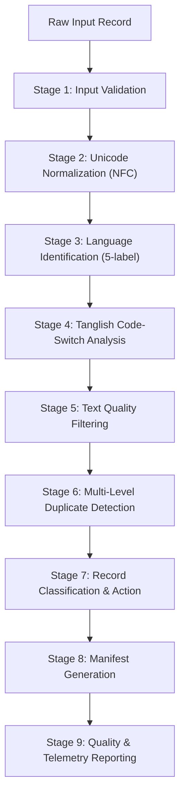

# PHASE 25 — End-to-End Pipeline Architecture

**Project:** IGRIS — Multilingual Decoder-Only Transformer  
**Date:** 2026-11-19 12:27 UTC  
**Status:** VALIDATED ON SYNTHETIC BENCHMARK  
**Pipeline Module:** `scripts/dataset_pipeline_v2.py`  

## 1. Overview and Objectives

Phase 25 integrates all Phase 24 data-engineering components into a unified, non-destructive 9-stage data processing pipeline. The pipeline provides complete auditability, reproducible record provenance, and strict language boundary enforcement (Tamil, English, Tanglish).



## 2. Nine Pipeline Stages

### Stage 1: Input Validation
- Validates record ID structure, non-null values, and string instance verification.
- Rejection code: `INPUT_VALIDATION_FAILURE` if schema is violated.

### Stage 2: Unicode Normalization (`UnicodeProcessorV2`)
- Canonical NFC normalization via `unicodedata.normalize('NFC', text)`.
- Sanitizes dangerous control characters while preserving ZWJ (U+200D) and ZWNJ (U+200C).
- Exhaustive tracking of Tamil combining marks (U+0BBE–U+0BCD), viramas (U+0BCD), and Tamil numerals.
- Flags malformed sequences: double virama, lone vowel signs, and U+FFFD replacement characters.

### Stage 3: Language Identification (`LanguageIdentifierV2`)
- 5-category classification: `TAMIL`, `ENGLISH`, `TANGLISH`, `UNKNOWN`, `OUT_OF_SCOPE`.
- Combines Unicode script ratio analysis with expanded Tanglish lexicon (100+ words), Tamil discourse particle tracking (`da`, `pa`, `aiyo`, `macha`, etc.), and case-suffix detection.
- Script mixing (co-occurrence of Tamil and Latin characters) is definitively tagged as `TANGLISH`.

### Stage 4: Tanglish Code-Switch Analysis (`TanglishAnalyzer`)
- Activated whenever `TANGLISH` or mixed script is detected.
- Extracts character-level script spans, computes code-switch boundary points, detects discourse markers, and assesses structural plausibility.

### Stage 5: Text Quality Filtering (`QualityFilterV2`)
- Applies configurable heuristics producing machine-readable reason codes:
  - `EMPTY_RECORD`, `TOO_SHORT` (<10 chars), `TOO_FEW_WORDS` (<2 words)
  - `REPEATED_CHAR_SPAM` (>5 consecutive identical characters)
  - `URL_HEAVY` (>30% URL character density)
  - `EXCESSIVE_PUNCTUATION` (>40% punctuation characters)
  - `MALFORMED_UNICODE` (contains U+FFFD)
  - `BOILERPLATE_DETECTED` (cookie policy, terms of service, etc.)
  - `NO_ALPHABETIC_CHARS` (numeric/symbol-only text)

### Stage 6: Multi-Level Duplicate Detection (`DuplicateDetectorV2`)
- **Level 1 (Exact):** SHA-256 digest comparison.
- **Level 2 (Normalized):** SHA-256 of lowercase, whitespace-collapsed, NFC-normalized text.
- **Level 3 (Near-Duplicate):** Word 3-gram Jaccard similarity (threshold = 0.80).
- Registered unique hashes are indexed in memory; duplicates reference canonical document IDs.

### Stage 7: Record Classification and Action Decision
- Tri-state decisioning:
  - `ACCEPTED`: Valid target language (`TAMIL`, `ENGLISH`, `TANGLISH`), passed quality filter, unique.
  - `REJECTED`: Invalid input, out-of-scope language, low quality, or unresolvable language (`UNKNOWN`).
  - `DUPLICATE_FLAGGED`: Exact, normalized, or near-duplicate of a prior accepted document.

### Stage 8: Dataset Manifest Generation
- Immutable JSON serialization preserving original input, normalized text, SHA-256 hashes, intermediate telemetry, and explicit rejection reasons.
- **Strict Non-Destruction:** No record is silently dropped; 100% of inputs appear in the final manifest.

### Stage 9: Quality & Telemetry Reporting
- Aggregates acceptance rates, language distributions, rejection distributions, and duplicate rates.

## 3. Data Structures

```python
@dataclass
class RawRecord:
    id: str
    text: str
    source_id: str = "SYNTHETIC_BENCHMARK"
    metadata: Dict[str, Any] = field(default_factory=dict)

@dataclass
class ProcessedRecord:
    id: str
    original_text: str
    normalized_text: str
    source_id: str
    input_valid: bool
    input_validation_notes: Optional[str]
    original_char_count: int
    normalized_char_count: int
    is_nfc_original: bool
    has_replacement_char: bool
    control_chars_removed: int
    tamil_combining_preserved: int
    virama_preserved: int
    zwj_zwnj_preserved: int
    unicode_malformed_sequences: List[str]
    script_distribution: Dict[str, float]
    language_label: str
    language_confidence: float
    is_code_mixed: bool
    language_sublabel: Optional[str]
    is_tanglish_plausible: Optional[bool]
    code_switch_points_count: int
    discourse_markers: List[str]
    romanized_candidates: List[str]
    tamil_suffixes: List[str]
    quality_passed: bool
    quality_reasons: List[str]
    word_count: int
    url_ratio: float
    punct_ratio: float
    is_duplicate: bool
    duplicate_type: str
    duplicate_matched_id: Optional[str]
    duplicate_similarity: float
    final_action: str
    rejection_reasons: List[str]
    sha256_original: str
    sha256_normalized: str
    timestamp_utc: str
    metadata: Dict[str, Any] = field(default_factory=dict)
```

## 4. Performance Metrics on Benchmark

- **Total records processed:** 150
- **Elapsed execution time:** 0.0436 seconds
- **Throughput:** ~3,440 records/second
- **Determinism:** 100% bit-exact across independent runs
