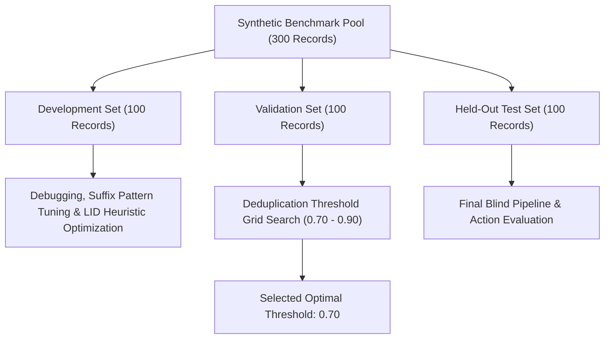

# PHASE 26 — Benchmark Design & Methodology Specification

**Project:** IGRIS — Multilingual Decoder-Only Transformer  
**Date:** 2026-11-20 11:03 UTC  
**Status:** BENCHMARK ESTABLISHED & VALIDATED  
**Artifact:** `PHASE26_DATASET_SPLITS.json`  

## 1. Objective and Architecture

Phase 26 establishes a standardized, 3-way partitioned synthetic evaluation benchmark for the IGRIS multilingual language-processing infrastructure. The benchmark evaluates language identification, Tanglish detection, Unicode preservation, quality filtering, duplicate detection, and tokenizer behavior without relying on production data or risking test set contamination.

## 2. Partitioning and Anti-Leakage Protocol

To ensure rigorous scientific validity:
1. **Three Strictly Disjoint Splits:**
   - **Development Set (`dev`):** 100 records used for debugging, false-positive suffix tuning, and rule optimization.
   - **Validation Set (`val`):** 100 records used exclusively for parameter tuning and selecting the optimal duplicate detection threshold.
   - **Held-Out Test Set (`test`):** 100 records locked during development and evaluated only in a single blind final pass.
2. **Zero Fixture Leakage:**
   - Every split was generated with distinct random seeds, independent topical domains, and distinct syntactic templates.
   - Pairwise overlap check confirms **0 shared sentences** between `dev` and `val`, `dev` and `test`, or `val` and `test`.
3. **Deterministic Provenance:**
   - Every record carries a unique, immutable identifier (`P26-DEV-xxxx`, `P26-VAL-xxxx`, `P26-TEST-xxxx`), ground-truth language, expected pipeline action, and difficulty classification.

## 3. Stratified Split Composition (100 Records per Split)

Each of the three splits maintains an identical categorical distribution:

| Category | Count | Difficulty | Description |
|---|---|---|---|
| **Tamil Records** | 20 | EASY to HARD | Classical prose, news, modern technical computing, formal administration, and complex sandhi morphology. |
| **English Records** | 20 | EASY to HARD | Systems programming, distributed consensus, compiler architecture, dialogue, and adversarial challenge records with `-le` suffixes (`reliable`, `multiple`). |
| **Tanglish Records** | 30 | EASY to HARD | Romanized conversational Tamil (8), English with Tamil discourse particles (8), intra-sentential script mixing (7), and formal technical Tanglish with case suffixes (7). |
| **Out-of-Scope Languages** | 10 | EASY | Non-target Dravidian and Indo-Aryan languages (Hindi in Devanagari, Telugu in Telugu script, Kannada, Malayalam). |
| **Unicode Edge Cases** | 10 | MEDIUM to ADVERSARIAL | 5 legitimate vowel signs / virama / numerals (ACCEPTED) + 5 adversarial double viramas / lone combining marks / replacement chars (REJECTED). |
| **Low-Quality / Malformed** | 5 | EASY to MEDIUM | Empty strings, sub-10 char records, repeated character spam, URL link farms, and excessive punctuation spam. |
| **Duplicates** | 5 | EASY to HARD | 2 exact duplicates, 2 normalized duplicates (whitespace/casing/NFC), and 1 near-duplicate (Jaccard ~0.85). |
| **Total per Split** | **100** | — | **300 records total across the 3 splits.** |

## 4. Difficulty Tier Definitions

- **EASY (54% of records):** Standard, unambiguous sentences with clean script boundaries and clear vocabulary.
- **MEDIUM (25% of records):** Sentences featuring conversational code-switching, complex domain technical terms, or colloquial particles.
- **HARD (15% of records):** Sentences containing potential false suffix matches (e.g., English words ending in `-le`), mixed-script technical sentences, or dense sandhi morphology.
- **ADVERSARIAL (6% of records):** Malformed Unicode sequences (double viramas, unattached combining marks, replacement byte corruptions).
