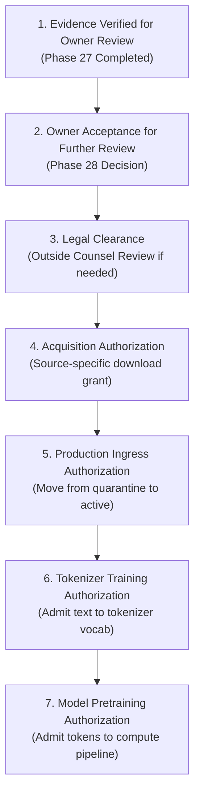

# PHASE 28 — OWNER DECISION GUIDE: GOVERNANCE LEVELS & DECISION FRAMEWORK

**Project:** IGRIS — Multilingual Decoder-Only Transformer  
**Operating Model:** `SOLO_DEVELOPER_OWNER_REVIEW`  
**Reviewer:** Sole Developer / Project Owner  
**Date:** 2026-11-20  
**Phase:** Phase 28

---

## 1. Operating Model Principle

Under `SOLO_DEVELOPER_OWNER_REVIEW`, the sole developer / project owner is the **single accountable authority**. There is no committee, board, or external approval quorum.

No agent, script, or automated system may record an owner decision on the owner's behalf. All candidates remain `NOT_REVIEWED` until the owner provides an explicit directive.

---

## 2. Seven Distinct Governance Levels (Critical Boundary Distinctions)

To maintain absolute legal and operational discipline, the owner must distinguish between seven sequential governance levels:

### Detailed Boundary Definitions:
1. **Evidence Verified for Owner Review (Phase 27):**
   - *Meaning:* The engineering team has audited the repository, pinned version, primary license, copyright ownership, and risks. The evidence dossier is complete.
   - *What it is NOT:* It is **NOT** legal clearance, acquisition approval, or training authorization.
2. **Owner Acceptance for Further Review (Phase 28):**
   - *Meaning:* The owner has reviewed the decision card, agrees the source is strategically valuable, and directs technical pipeline preparation or counsel engagement.
   - *What it is NOT:* It does **NOT** authorize downloading or acquiring the raw dataset.
3. **Legal Clearance:**
   - *Meaning:* Formal written opinion by qualified IP counsel resolving specific statutory questions (e.g. Indian Copyright Act § 52, CC-BY-SA copyleft).
   - *What it is NOT:* It is not an engineering acquisition schedule.
4. **Acquisition Authorization:**
   - *Meaning:* Owner authorizes the technical ingress engine to download a specific dataset at a pinned revision into an isolated quarantine zone.
   - *What it is NOT:* Data remains locked in quarantine; not admitted to active production.
5. **Production Ingress Authorization:**
   - *Meaning:* Sanitization pipeline (PII scrub, benchmark filter, trademark strip) has executed and verified 100% clean. Data is admitted to production workspace.
6. **Tokenizer Training Authorization:**
   - *Meaning:* Data is authorized for tokenizer vocabulary building. (Currently Candidate A is frozen at 32,768; tokenizer training is UNAUTHORIZED).
7. **Model Pretraining Authorization:**
   - *Meaning:* Pretraining compute cluster is authorized to stream tokenized shards into the transformer pretraining loop. (Currently LOCKED).

---

## 3. The Five Standardized Owner Decision Values

When reviewing candidate sources, the owner records exactly one of five standardized values:

| Decision Value | Operational Meaning | Next Action |
| :--- | :--- | :--- |
| **`OWNER_ACCEPTS_FURTHER_REVIEW`** | The owner agrees the candidate is viable in principle. Authorizes engineering to prepare sanitization scripts and filtering pipelines (in sandbox). | Authorize technical pipeline design; do NOT download data. |
| **`OWNER_REQUIRES_LEGAL_COUNSEL`** | The candidate presents unresolved statutory or contractual risks that the owner will not accept without outside counsel advice. | Retain outside IP counsel; issue formal legal question. |
| **`OWNER_REQUIRES_MORE_EVIDENCE`** | The provenance, catalog snapshot, or license evidence is incomplete or ambiguous. | Direct engineering to gather additional primary evidence. |
| **`OWNER_REJECTS_SOURCE`** | The owner rejects the candidate due to license encumbrance, platform risk, quality concerns, or strategic misalignment. | Source is permanently marked REJECTED and excluded. |
| **`NOT_REVIEWED`** | Default initial state. No decision has been rendered by the owner. | Candidate awaits owner review. |

---

## 4. Current State of All Candidates

- **Six English Candidates (`SRC-EN-01`, `SRC-TD-02`, `SRC-TD-03`, `SRC-CV-03`, `SRC-CV-05`, `SRC-CV-06`):**
  - *Evidence Status:* `VERIFIED_FOR_OWNER_REVIEW`
  * *Current Owner Decision:* `NOT_REVIEWED`
  * *Prerequisites if accepted:* Automated PII scrub, benchmark isolation, trademark stripping.
- **Six Pending Candidates (`SRC-TM-01`, `SRC-TM-02`, `SRC-TM-03`, `SRC-TG-01`, `SRC-TG-02`, `SRC-CV-07`):**
  - *Evidence Status:* `PENDING_LEGAL_REVIEW`
  * *Current Owner Decision:* `NOT_REVIEWED`
  * *Blocker:* Require outside legal counsel opinions on Indian fair dealing, CC-BY-SA copyleft, and YouTube platform terms.
- **Three Rejected Candidates (`SRC-TG-03`, `SRC-CV-01`, `SRC-CV-04`):**
  - *Evidence Status:* `REJECTED`
  * *Current Owner Decision:* `NOT_REVIEWED`
  * *Blocker:* Non-commercial clauses or alignment leakage; permanently excluded.
- **Six Out-of-Scope Sources (`SRC-HI-01`, `SRC-OI-01` to `SRC-OI-05`):**
  - *Evidence Status:* `OUT_OF_SCOPE`
  * *Current Owner Decision:* `NOT_REVIEWED`
  * *Blocker:* Excluded by 3-language project boundary policy.
