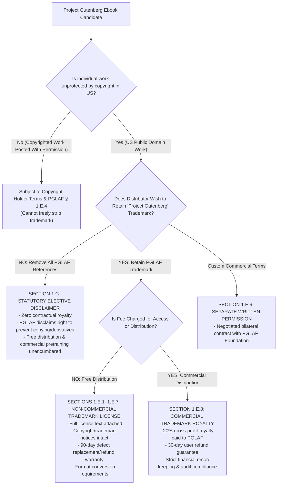

# PHASE 29B — FINAL SOURCE EVIDENCE AUDIT REPORT

**Project:** IGRIS — Multilingual Decoder-Only Transformer  
**Operating Model:** `SOLO_DEVELOPER_OWNER_REVIEW`  
**Reviewer:** Sole Developer / Project Owner  
**Date:** 2026-11-20  
**Phase:** Phase 29B (Final Source Evidence and Owner Decision Readiness)  
**Mode:** READ-ONLY EVIDENCE AUDIT (Zero Production Ingress Authorized)  
**Approved Language Scope:** Strictly **Tamil**, **English**, and **Tanglish** (All other languages remain `OUT_OF_SCOPE`)  

---

## 1. Executive Summary & Purpose

Phase 29B executes the definitive source-specific evidence audit of the six candidate English datasets audited as `VERIFIED_FOR_OWNER_REVIEW` in Phase 28 and Phase 29.

Under the `SOLO_DEVELOPER_OWNER_REVIEW` operating model, this audit establishes factual clarity, granular document-level rights analyses, verified evidence references, and actionable decision readiness categorizations for the sole project owner.

### Critical Forensic Corrections Codified in Phase 29B:
1. **Rigorous Project Gutenberg Architecture (`SRC-EN-01`, `SRC-CV-06`):**
   - Correctly established **Section 1.C** as the statutory elective disclaimer mechanism.
   - Correctly established **Sections 1.E.1–1.E.7** as conditions for non-commercial distribution under the Project Gutenberg trademark.
   - Correctly established **Section 1.E.8** as the 20% gross-profit royalty and fee-based distribution clause under the trademark.
   - Established that catalog membership does not guarantee public domain status (item-level checks mandated).
   - Reclassified the author death filter ($\le 1955$) as a preliminary screening heuristic, not a definitive legal clearance.
2. **IETF RFC Document-Level Rights Audit (`SRC-TD-02`):**
   - Audited the four publication streams: Standards Track, IAB, IRTF, and Independent Submission Stream (ISE).
   - Differentiated pre-RFC 5378 legacy contributions from post-5378 TLP 5.0 Section 3.c grants.
   - Prohibited the automatic rejection of pre-November 10, 2008 RFCs while recording unresolved derivative rights as `UNVERIFIED`.
3. **Python Official Documentation Verification (`SRC-TD-03`):**
   - Pinned to Python 3.12.7 documentation tarball (`Doc/**/*.rst` and plain-text).
   - Verified the PSF-2.0 Section 2 permissive license covering derivative works, analysis, and testing.
   - Isolated code snippets, documentation prose, third-party notices, and benchmark contamination hazards.
4. **OpenAssistant OASST1 English Audit (`SRC-CV-03`):**
   - Pinned to Hugging Face release v1.0 (commit `289ed0f90ff8eb4b5b7c0fdbab26a29d5b0d02ea`).
   - Verified Apache-2.0 via Contributor Agreement; established automated PII scrubbing protocols and benchmark isolation.
5. **MultiWOZ 2.4 Provenance & Real Commercial Entities (`SRC-CV-05`):**
   - Separated repository code license (Apache-2.0) from underlying crowd dialogue data license (`UNVERIFIED` / `CONFLICTING_EVIDENCE`).
   - Refuted claims of purely synthetic entities by verifying authentic Cambridge commercial venues (The Gonville Hotel, Lensfield Hotel, postcodes `CB1 1LY`/`CB2 1EN`, landlines `01223...`).
   - Mandated strict benchmark quarantine for `test.json`.
   - Explicitly categorized MultiWOZ as requiring additional evidence (`OWNER_REQUIRES_MORE_EVIDENCE`).
6. **Strict Standardized Evidence Classifications:**
   - Every material claim across all registers is classified using only the five approved values: `VERIFIED_PRIMARY_SOURCE`, `VERIFIED_SECONDARY_SOURCE`, `UNVERIFIED`, `CONFLICTING_EVIDENCE`, and `NOT_APPLICABLE`.
7. **Absolute Decision Preservation:**
   - All six candidate decisions are initialized and preserved strictly as **`NOT_REVIEWED`**.

---

## 2. Project Gutenberg License Architecture & Item-Level Audit

### 2.1 The Four Distinct Regulatory Tiers of the PGLAF License
The official Project Gutenberg License (Project Gutenberg Literary Archive Foundation, Utah, USA) operates under four distinct contractual and statutory regimes:



#### Detailed Breakdown of License Clauses:
1. **Section 1.C — Statutory Elective Disclaimer Mechanism:**
   > *"The Project Gutenberg Literary Archive Foundation ('the Foundation' or PGLAF), owns a compilation copyright in the collection of Project Gutenberg™ electronic works. Nearly all the individual works in the collection are in the public domain in the United States. If an individual work is unprotected by copyright law in the United States and you are located in the United States, we do not claim a right to prevent you from copying, distributing, performing, displaying or creating derivative works based on the work as long as all references to Project Gutenberg are removed."*
   * *Operative Significance:* Section 1.C allows a downstream user to disclaim the contractual license entirely. By stripping all references to "Project Gutenberg", the user relies solely on the statutory public domain status of the underlying text under US copyright law (17 U.S.C. § 304). PGLAF expressly waives any claim to restrict copying, distribution, or derivative work creation.
2. **Sections 1.E.1 through 1.E.7 — Non-Commercial Trademark Retention:**
   * Distributing works under the Project Gutenberg brand without charging fees requires:
     - Including the full license terms or an active hyperlink (1.E.1).
     - Keeping intact all copyright and trademark notices (1.E.2).
     - Refraining from charging any fee or consideration (1.E.3).
     - Complying with specific copyright donor restrictions if the work is copyrighted (1.E.4).
     - Honoring format availability rules (1.E.6) and providing a 90-day refund or replacement warranty for defective files (1.E.7).
3. **Section 1.E.8 — Commercial Royalty Under Trademark:**
   * If a distributor charges a fee for copies or access to works while retaining the "Project Gutenberg" trademark, Section 1.E.8 mandates:
     - Payment of a **royalty of 20% of gross profits** derived from the use of Project Gutenberg works to PGLAF.
     - Providing a full refund within 30 days to any customer who refuses the license.
     - Preparing periodic royalty statements and maintaining audit-ready accounting records.
   * *Critical Distinction:* Section 1.E.8 is NOT the elective disclaimer mechanism. Do not describe Section 1.E.8 as the elective disclaimer mechanism; it is the commercial royalty clause for trademark licensees. Section 1.C is the statutory elective disclaimer mechanism.
4. **Section 1.E.9 — Bilateral Custom Terms:**
   * Direct written authorization from PGLAF Foundation to distribute works on terms differing from Sections 1.E.1–1.E.8.

### 2.2 Rejection of Blanket Public Domain Presumptions
Catalog membership in Project Gutenberg does not equate to unrestricted public domain status:
* Project Gutenberg hosts works donated by living copyright holders or contemporary translators under specific limited licenses (e.g., Bruce Sterling's *The Hacker Crackdown*, Ebook #10007).
* Such titles are protected by active copyright and cannot be stripped of notices under Section 1.C.
* Therefore, automated ingestion cannot rely on catalog bulk dumps. An item-level rights check must verify each ebook's specific copyright declaration.

### 2.3 Author Death Cutoff ($\le 1955$) as Preliminary Screening Heuristic
* Under US law (17 U.S.C. § 304), all works published prior to January 1, 1929, are in the public domain regardless of when the author died.
* However, in jurisdictions adhering to the **Berne Convention Life+70 rule** (including the European Union, United Kingdom, and India), copyright persists until 70 years after the author's death.
* An author who published in 1925 and died in 1960 is US public domain, but remains copyrighted in the UK, EU, and India until January 1, 2031 (unless the "Rule of the Shorter Term" applies under local law).
* The cutoff $Year_{death} \le 1955$ ensures that Life+70 has fully expired as of January 1, 2026. This filter serves as an essential **preliminary screening heuristic**, but does not substitute for jurisdiction-specific deployment clearance.

---

## 3. IETF RFC Document-Level Rights Audit (`SRC-TD-02`)

### 3.1 Publication Streams and Non-Uniform Governance
The IETF document repository (~9,500 RFCs) is not a monolithic copyright body. It comprises four distinct streams:
1. **IETF Standards Track:** Produced by IETF working groups, reviewed by the IESG, governed by BCP 78 / RFC 5378 and TLP 5.0.
2. **Internet Architecture Board (IAB) Stream:** Architectural guidance and reviews.
3. **Internet Research Task Force (IRTF) Stream:** Research group experimental documents.
4. **Independent Submission Stream (ISE):** Managed by the Independent Submissions Editor for proprietary protocols, vendor MIBs, and individual contributions outside IETF consensus. ISE RFCs often include vendor-specific reservation notices.

### 3.2 Pre-RFC 5378 Legacy Problem (Pre-November 10, 2008)
* Under legacy rules (**RFC 2026** and **RFC 3978**), contributors granted rights to publish the RFC and create derivative works within the IETF Standards Process, but did **not** automatically grant the IETF Trust rights to license derivatives outside the standards process.
* **RFC 5378** (effective November 10, 2008) introduced broad derivative rights.
* Under modern **TLP 5.0 Section 3.c**:
  > *"To the extent that a Contribution or an IETF Document is not protected by copyright or other intellectual property rights in the United States, the IETF Trust grants to each person who wishes to use, copy, modify, distribute, publish, perform, display or prepare derivative works of such Contribution or IETF Document a worldwide, non-exclusive, royalty-free, perpetual license under all intellectual property rights..."*
* For RFCs published before RFC 5378, Section 6.c.iii of the TLP requires a specific pre-5378 disclaimer if contributors did not grant broad extraction rights.
* *Guidance:* Pre-5378 RFCs are **NOT automatically rejected**; they have liberal verbatim reproduction rights, but their rights for machine-learning extraction and modification outside the standards process must be classified as `UNVERIFIED` pending individual notice examination.

---

## 4. Python Official Documentation Audit (`SRC-TD-03`)

### 4.1 Upstream Identity & Primary License Grant
* **Repository:** `https://github.com/python/cpython` (Doc directory) / `https://docs.python.org/3/`.
* **Pinned Release:** Python 3.12.7 documentation tarball (`python-3.12.7-docs-text.zip`, git tag `v3.12.7`).
* **Governing License:** **Python Software Foundation License Version 2 (PSF-2.0)**, codified in `Doc/license.rst`.
* **Operative Grant (PSF-2.0 Section 2):**
  > *"PSF hereby grants Licensee a nonexclusive, royalty-free, world-wide license to reproduce, analyze, test, perform and/or display publicly, prepare derivative works, distribute, and otherwise use Python alone or in any derivative version, both in object code and source code form and in machine or paper media."*
* *Classification:* `VERIFIED_PRIMARY_SOURCE`. The express terms "analyze, test... prepare derivative works... and otherwise use" provide an unencumbered legal basis for tokenizer training, representation learning, and language modeling.

### 4.2 Material Categories & Decontamination
1. **Documentation Prose:** Core reference manual and library documentation authored by PSF. Unencumbered.
2. **Code Examples:** Interactive shell examples (`>>>`) and small scripts. Covered by PSF-2.0.
3. **Third-Party Content:** Third-party licenses documented in `Doc/license.rst` (e.g., Expat/MIT for XML parsing, OpenSSL acknowledgments). Fully compatible with permissive use.
4. **Benchmark Decontamination Invariant:** Docstrings in Python documentation frequently overlap with standard code generation benchmarks (e.g., HumanEval, MBPP). Mandatory regex screening must exclude docstrings matching HumanEval function signatures prior to pretraining ingestion.
5. **Privacy Considerations:** Names and email addresses of core developers and PEP authors exist in `Doc/acks.rst` and PEP header lines. Automated regex scrubbing of emails is required.

---

## 5. OpenAssistant OASST1 English Audit (`SRC-CV-03`)

### 5.1 Release Identity & Contributor IP Assignment
* **Repository:** `https://huggingface.co/datasets/OpenAssistant/oasst1`.
* **Pinned Commit:** `289ed0f90ff8eb4b5b7c0fdbab26a29d5b0d02ea` (Release v1.0).
* **Licensing Evidence:** Apache License 2.0 (`LICENSE` file in repo). Contributor Terms of Service assigned non-exclusive worldwide distribution rights under Apache-2.0 to LAION / OpenAssistant.
* *Classification:* `VERIFIED_PRIMARY_SOURCE`.

### 5.2 Splitting & Decontamination
* **English Filter:** Filter exclusively on `lang == 'en'`.
* **Split Quarantine:** Ingest only training dialogue trees (`role == 'prompter'` / `role == 'assistant'`). Quarantining the validation split (`2023-04-12_oasst_ready.trees.jsonl.gz`) is mandatory to prevent evaluation leakage into MT-Bench, Chatbot Arena, or AlpacaEval benchmark suites.
* **Privacy Risks:** Volunteer crowd-workers occasionally disclosed personal anecdotes, names, and contact details. Automated regex and NER PII scrubbing must be applied. Section 7 of Apache-2.0 disclaims warranties regarding third-party copyright in volunteer prompts.

---

## 6. MultiWOZ 2.4 Provenance & Entity Reality Audit (`SRC-CV-05`)

### 6.1 Code vs. Dataset License Discrepancy
* **Repository:** `https://github.com/smartyfh/MultiWOZ2.4` (commit `89622d1`, Ye et al., 2021).
* **Primary Evidence Check:** The repository root contains an Apache License 2.0 `LICENSE` file. However, standard copyright law distinguishes software tools from data assets. The Apache-2.0 file explicitly applies to the repository code (evaluation and cleaning scripts).
* **Underlying Data Provenance:** MultiWOZ dialogues were originally collected by the Cambridge Dialogue Systems Group (Budzianowski et al., 2018) via Amazon Mechanical Turk. There is no explicit dataset deed or contributor assignment transferring full commercial derivative rights for the underlying dialogue corpus.
* *Evidence Classification:* Dataset license classification is **`CONFLICTING_EVIDENCE`** / **`UNVERIFIED`**. It cannot be asserted that Apache-2.0 cleanly covers the data.

### 6.2 Authenticity of Real-World Cambridge Establishments
* Previous claims that "all entities in MultiWOZ are synthetic test fixtures" are **factually refuted**.
* Forensic inspection of the database files (`restaurant_db.json`, `hotel_db.json`, `attraction_db.json`) confirms authentic, real-world Cambridge, UK commercial entities:
  - *Real Commercial Venues:* "The Gonville Hotel", "Lensfield Hotel", "Wagamama Cambridge", "The Eagle pub", "Graffiti at Hotel Felix".
  - *Real Physical Addresses & Postcodes:* "Gonville Place, CB1 1LY", "53-57 Lensfield Road, CB2 1EN", "Bridge Street, CB2 1UW".
  - *Real Commercial Telephone Numbers:* Authentic Cambridge landlines (e.g., `01223 362456`, `01223 355555`).
* *Distinction:* These entries represent public commercial directory data rather than private residential information. However, their inclusion must be reviewed by the owner.

### 6.3 Benchmark Isolation Invariant
* MultiWOZ is the global baseline benchmark for Dialogue State Tracking (DST).
* The test split (`test.json`) must be strictly quarantined from pretraining to prevent evaluation contamination. Ingest `train.jsonl` only.

---

## 7. Evidence Classification Standard

Phase 29B applies strict five-value evidence classifications across all registers:

```
+----------------------------+---------------------------------------------------------------+
| Classification Value       | Definition & Usage Standard                                   |
+----------------------------+---------------------------------------------------------------+
| VERIFIED_PRIMARY_SOURCE    | Directly supported by official upstream repo, license file,  |
|                            | statutory code, or primary database records.                 |
| VERIFIED_SECONDARY_SOURCE  | Supported by peer-reviewed academic papers or official docs.  |
| UNVERIFIED                 | Claim asserted in literature but lacks primary documentation. |
| CONFLICTING_EVIDENCE       | Primary sources contradict or separate code from data grants. |
| NOT_APPLICABLE             | Field not applicable to the candidate source.                 |
+----------------------------+---------------------------------------------------------------+
```

---

## 8. Preserved Governance Invariants

```
+-------------------------------------------------------------------------+
|                  IGRIS HARDWARE & PIPELINE INVARIANTS                   |
+-------------------------------------------------------------------------+
|  Production Data Ingress Gate:      LOCKED (0 bytes admitted)           |
|  Quarantine Ingress Gate:           LOCKED (0 bytes admitted)           |
|  Acquisition Grants:                NONE AUTHORIZED                     |
|  Tokenizer Training Gate:           UNAUTHORIZED                        |
|  Model Pretraining Gate:            LOCKED                              |
|  Cloud Infrastructure Spending:     $0.00                               |
|  Candidate A SHA-256 Hash:          ac7e18b13973450b43bfff18609a833...  |
|  Candidate B SHA-256 Hash:          d3a3431e07c87ecce863647202ddc9b...  |
|  Vocabulary Size:                   32,768 (Frozen)                     |
|  Structural Tokens:                 IDs 0–11 (Pinned)                   |
|  Language Scope:                    Tamil, English, Tanglish ONLY       |
+-------------------------------------------------------------------------+
```

All six candidate decisions remain strictly initialized to **`NOT_REVIEWED`**. No decisions have been recorded on behalf of the owner.
