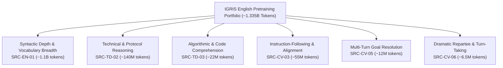

# PHASE 29 — SOURCE COMPARISON & PORTFOLIO ANALYSIS

**Project:** IGRIS — Multilingual Decoder-Only Transformer  
**Operating Model:** `SOLO_DEVELOPER_OWNER_REVIEW`  
**Reviewer:** Sole Developer / Project Owner  
**Date:** 2026-11-20  
**Phase:** Phase 29

---

## 1. Portfolio Comparative Matrix (Six English Candidates)

| Attribute | `SRC-EN-01` (Gutenberg) | `SRC-TD-02` (IETF RFCs) | `SRC-TD-03` (Python Docs) | `SRC-CV-03` (OASST1 En) | `SRC-CV-05` (MultiWOZ 2.4) | `SRC-CV-06` (Gutenberg Plays) |
| :--- | :--- | :--- | :--- | :--- | :--- | :--- |
| **Domain** | Classic Literature | Internet Standards | Programming & Docs | General Instruction Chat | Task-Oriented Booking | Classical Dramatic Drama |
| **Primary License** | Public Domain (US) | IETF TLP 5.0 § 3.c | PSF-2.0 | Apache-2.0 | Apache-2.0 | Public Domain (US) |
| **Legal Risk** | None | Low | None | Low | None | None |
| **Living PII Risk** | None (All deceased) | Low (Business emails) | None | Medium (Incidental PII)| None (Synthetic mock) | None (All deceased) |
| **Eval Leak Risk** | Low (BookCorpus) | Low (Network exams) | High (HumanEval/MBPP) | Medium (Alpaca/MT-Bench)| High (MultiWOZ test) | Low |
| **Raw Volume** | ~4,200 MB (~4.2 GB) | ~550 MB | ~85 MB | ~210 MB | ~45 MB | ~25 MB |
| **Candidate A Tokens**| ~1,100,000,000 | ~140,000,000 | ~22,000,000 | ~55,000,000 | ~12,000,000 | ~6,500,000 |
| **Token Share (%)** | 82.4% | 10.5% | 1.6% | 4.1% | 0.9% | 0.5% |
| **Sanitizer Needed** | PGLAF Header Stripper | Email Regex Mask | RST Parser & Docstring | lang=='en', NER, Val Quat| Split Quarantine (test) | Script Dialogue Parser |
| **Filtering Effort** | Low | Low | Medium | High | Low | Low |

---

## 2. Linguistic and Structural Complementarity

The six candidates form a highly balanced, complementary English text portfolio:

1. **Syntactic Spine (`SRC-EN-01`):** Provides the vast majority of volume (82.4%) and extensive literary vocabulary, establishing strong grammatical foundations for next-token prediction.
2. **Technical Rigor (`SRC-TD-02` & `SRC-TD-03`):** Injects precise formal reasoning, networking concepts, and programming documentation, preventing the model from degenerating into purely creative prose.
3. **Conversational Turn-Taking (`SRC-CV-03`, `SRC-CV-05`, `SRC-CV-06`):** Essential for training the special structural tokens (`<user>=10`, `<assistant>=11`), teaching the model to maintain conversational context across turns.

---

## 3. Synthetic Tanglish Hybridization Potential

A strategic advantage of clearing high-quality English conversational datasets (`SRC-CV-03`, `SRC-CV-05`) is that they provide authentic conversational scaffolding for the **Phase 25/26 validated Synthetic Tanglish Generator**:
* English conversational stems can be hybridized with Tamil discourse markers (`da`, `di`, `machi`, `pa`) and Tamil agglutinative case clitics (`-la`, `-oda`, `-kitta`, `-pannu`).
* This enables the creation of high-volume, legally pristine Tanglish training data without reliance on scraped YouTube comments encumbered by platform terms blockers.
