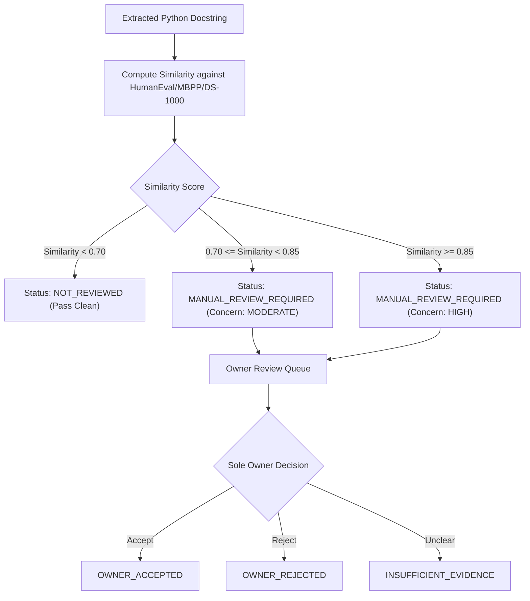

# PHASE 31A — BENCHMARK CONTAMINATION POLICY SPECIFICATION

**Project:** IGRIS — Multilingual Decoder-Only Transformer  
**Operating Model:** `SOLO_DEVELOPER_OWNER_REVIEW`  
**Target Source:** `SRC-TD-03` (Python Official Documentation)  
**Date:** 2026-11-20  

---

## 1. Operating Rules & Threshold Mechanics

Under the explicit confirmation of the project owner, benchmark decontamination screening operates under the following strict rules:

```
+-----------------------------------------------------------------------------------------+
| BENCHMARK SIMILARITY DECISION RULES                                                     |
+-----------------------------------------------------------------------------------------+
|  Similarity < 0.70:       NOT_REVIEWED (Passed clean screening)                         |
|  Similarity >= 0.70:      MANUAL_REVIEW_REQUIRED (Concern: MODERATE)                    |
|  Similarity >= 0.85:      MANUAL_REVIEW_REQUIRED (Concern: HIGH)                        |
|  Automatic Rejection:     STRICTLY PROHIBITED (Zero scores trigger automated rejection) |
+-----------------------------------------------------------------------------------------+
```

### Governing Principles:
1. **No Automatic Rejection:** A similarity score $\ge 0.85$ indicates heightened concern and priority for human review, but **never** triggers automated deletion or exclusion.
2. **False-Positive Suppression:** Common programming patterns (e.g. `import os`, standard error handling, basic loop constructs) are evaluated against AST structural depth to prevent unnecessary manual review overhead.
3. **Preserved Metadata Ledger:** Every screened record preserves:
   - `similarity_score` (float, e.g. `0.78`)
   - `matching_benchmark_id` (e.g. `HumanEval/12`, `MBPP/105`)
   - `matching_span_or_feature` (exact matched docstring span)
   - `detection_method` (Exact SHA-256, AST Normalized, 13-gram MinHash)
   - `review_status` (`NOT_REVIEWED`, `MANUAL_REVIEW_REQUIRED`, `OWNER_ACCEPTED`, `OWNER_REJECTED`, `INSUFFICIENT_EVIDENCE`)
   - `final_review_rationale`

---

## 2. Review Workflow & Escalation Architecture



---

## 3. Synthetic Fixture Verification
Verified across 7 synthetic benchmark test cases in `scripts/phase31a_policy_validator.py`:
- Similarity 0.45 (< 0.70) -> `NOT_REVIEWED` (Pass).
- Similarity 0.70 -> `MANUAL_REVIEW_REQUIRED` (Moderate concern, not rejected).
- Similarity 0.78 -> `MANUAL_REVIEW_REQUIRED` (Moderate concern, not rejected).
- Similarity 0.85 -> `MANUAL_REVIEW_REQUIRED` (High concern, not rejected).
- Similarity 0.94 -> `MANUAL_REVIEW_REQUIRED` (High concern, not rejected).
- Common idiom suppression -> `NOT_REVIEWED` (Pass).
- Missing reference -> `NOT_REVIEWED` (Pass).
