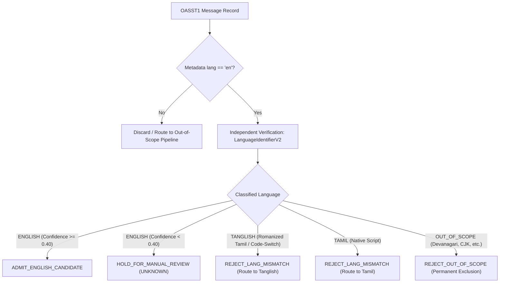

# PHASE 31A — OASST1 LANGUAGE ROUTING SPECIFICATION

**Project:** IGRIS — Multilingual Decoder-Only Transformer  
**Operating Model:** `SOLO_DEVELOPER_OWNER_REVIEW`  
**Target Source:** `SRC-CV-03` (OpenAssistant OASST1 English)  
**Date:** 2026-11-20  

---

## 1. Multi-Stage Language Verification Architecture

To prevent out-of-scope languages and Latin-script code-mixed text from entering the English candidate corpus, OASST1 records must pass a multi-stage combined verification pipeline:

---

## 2. Five Allowed Language Categories

The IGRIS classification engine enforces five mutually exclusive categories:
1. **`TAMIL`:** Native Tamil script dominant ($\ge 80\%$).
2. **`ENGLISH`:** Standard English in Latin script, verified by English stopwords and absence of Tanglish particles.
3. **`TANGLISH`:** Code-mixed Tamil-English, Romanized Tamil in Latin script, Tamil script with English technical vocabulary, or English containing Tamil discourse particles (*da*, *bro*, *romba*, *kandippa*).
4. **`UNKNOWN`:** Ambiguous, low-confidence ($< 0.40$), or low-entropy strings held for manual review.
5. **`OUT_OF_SCOPE`:** Non-target scripts (Hindi, Telugu, Malayalam, Kannada, Bengali, Gujarati, Cyrillic, CJK, etc.).

### Crucial Language Invariants:
- **Latin Script $
eq$ English:** Romanized Tamil written in Latin script must never be admitted to English candidate shards.
- **Discourse Markers:** English sentences containing Tamil discourse particles (*da*, *macha*, *la*) are routed to `TANGLISH`.
- **Zero Silent Admissions:** Low-confidence records are held for manual review.

---

## 3. Synthetic Fixture Verification
Verified across 8 synthetic language test cases in `scripts/phase31a_policy_validator.py`:
- Standard English -> `ADMIT_ENGLISH_CANDIDATE`.
- Native Tamil script -> `ROUTE_TAMIL`.
- Romanized Tamil -> `ROUTE_TANGLISH`.
- Code-mixed English/Tamil -> `REJECT_LANG_MISMATCH`.
- English with Tamil discourse marker (*da*) -> `REJECT_LANG_MISMATCH`.
- Tanglish turn with `lang='en'` metadata -> `REJECT_LANG_MISMATCH`.
- Incorrect metadata -> `REJECT_LANG_MISMATCH`.
- Low-confidence string -> `HOLD_FOR_MANUAL_REVIEW`.
