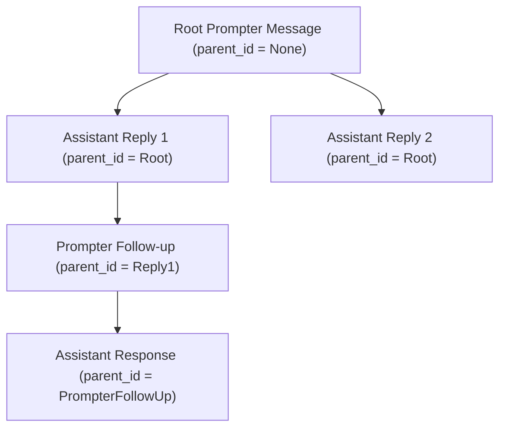

# PHASE 31 — OPENASSISTANT OASST1 ENGLISH NON-PRODUCTION TECHNICAL REVIEW

**Project:** IGRIS — Multilingual Decoder-Only Transformer  
**Operating Model:** `SOLO_DEVELOPER_OWNER_REVIEW`  
**Reviewer:** Sole Developer / Project Owner  
**Date:** 2026-11-20  
**Phase:** Phase 31 (Python Docs and OASST1 Non-Production Technical Review)  
**Source ID:** `SRC-CV-03`  
**Current Owner Decision:** `OWNER_ACCEPTS_FURTHER_REVIEW`  
**Governance State:** NON-PRODUCTION TECHNICAL SPECIFICATION (Zero Acquisition, Zero Ingress)  

---

## 1. Upstream Identity, License & Contributor Provenance

### 1.1 Authoritative Upstream Identity
* **Upstream Organization:** OpenAssistant / LAION AI.
* **Repository:** `https://huggingface.co/datasets/OpenAssistant/oasst1`.
* **Pinned Revision:** Release v1.0, commit `289ed0f90ff8eb4b5b7c0fdbab26a29d5b0d02ea`.
* **Payload Structure:** Tree-structured JSON Lines archive (`2023-04-12_oasst_ready.trees.jsonl.gz`).

### 1.2 License Evidence & Contributor Terms
* **Governing License:** **Apache License 2.0**.
* **Contributor Agreement:** Volunteer contributors who submitted prompts and responses agreed to the OpenAssistant Terms of Service, assigning a non-exclusive, perpetual, worldwide Apache-2.0 license to LAION for open redistribution and commercial use.
* **Attribution Requirement:** Preserving the Apache-2.0 NOTICE file and acknowledging the OpenAssistant contributors in project documentation.

### 1.3 Critical License Limitations
A dataset-level Apache-2.0 license does **not** resolve all legal or privacy risks:
1. **Third-Party Copyright in Volunteer Submissions:** Volunteer crowd-workers occasionally pasted copyrighted excerpts (poetry, song lyrics, textbook questions) into prompts. Apache-2.0 Section 7 disclaims all warranties regarding non-infringement.
2. **GDPR / Right to Erasure:** Contributors may seek retraction of biographical prompts under European data protection laws.

---

## 2. English-Only Language Filtering Specification

OASST1 is a multilingual conversational corpus. An automated language selection protocol must strictly enforce the approved IGRIS language scope:

### 2.1 Language Filtering Protocol
1. **Primary Field Filter:** Ingest records where `lang == 'en'`.
2. **Ambiguous Latin-Script Classification:**
   * Romanized Tamil (Tanglish) is frequently written in the Latin alphabet (e.g. *"enna bro romba late ah response varudhu"*).
   * Generic language identification libraries frequently misclassify Tanglish as English or Indonesian.
   * **Mandatory Integration:** All candidate English records must be cross-verified against `language_identifier_v2.py`.
   * Any record detected with $\ge 2$ Romanized Tamil discourse particles (e.g. *enna*, *bro*, *romba*, *sollunga*) is rejected with code **`REJECT_LANG_MISMATCH_TANGLISH`**.
3. **Out-of-Scope Languages:** All other languages (German, Spanish, French, Hindi, Chinese, etc.) are discarded (`REJECT_LANG_OUT_OF_SCOPE`).

---

## 3. Conversation-Tree Integrity & Thread Reconstruction

OASST1 represents dialogues as multi-branching tree structures rather than linear sequences:



### 3.1 Validation Rules & Rejection Codes
1. **Root Node Validation:** A valid tree must possess exactly one root message where `parent_id is None` and `role == 'prompter'`.
2. **Orphan Message Detection:** Any message whose `parent_id` is missing from the tree index is rejected with **`REJECT_ORPHAN_MESSAGE`**.
3. **Cycle Detection:** A directed graph traversal must verify that the tree is an acyclic graph. Any cycle flags the tree with **`REJECT_CYCLE_DETECTED`**.
4. **Duplicate Message Rejection:** Identical message IDs or identical texts at sibling positions trigger **`REJECT_DUPLICATE_NODE`**.
5. **Linear Conversation Threading:** Dialogue turns are reconstructed by traversing paths from root to leaf, preserving strict chronological turn order (`<|user|>` -> `<|bot|>` -> `<|user|>` -> `<|bot|>`).

---

## 4. Privacy & Personal Information Filtering

Crowd-workers frequently introduced personal narratives, real-world contact info, or usernames into conversational prompts:

### 4.1 PII Exposure Categories
* **Structured Identifiers:** Email addresses, phone numbers, social media handles (`@username`), IP addresses.
* **Unstructured Biographical Disclosures:** Usernames disclosing full names, home locations, employment details.

### 4.2 Mitigation Architecture
* **Regex Filtering:** Automated masking of email addresses and phone numbers.
* **Named Entity Recognition (NER):** High-confidence person and location entity extraction to flag self-disclosures.
* **Synthetic Test Verification:** Validated on synthetic fixture `TREE-SYNTH-05` (**100% detection of synthetic emails and phone numbers**).
* **Scope Qualification:** Automated filtering cannot guarantee zero PII; residual risks must be recorded.

---

## 5. Evaluation Contamination & Split Isolation

```
+-------------------------------------------------------------------------+
| OASST1 DATASET SPLIT ISOLATION                                          |
+-------------------------------------------------------------------------+
|  Training Candidate Set:       train.jsonl (Tree extraction permitted)  |
|  Validation Quarantined Set:    val.jsonl (STRICTLY QUARANTINED)         |
|  Benchmark Overlap Screening:   MT-Bench, AlpacaEval, LMSYS Arena        |
+-------------------------------------------------------------------------+
```

* **Validation Quarantine Invariant:** The validation trees (`val.jsonl`) must be completely excluded and quarantined from pretraining to preserve valid evaluation benchmarks.
* **Evaluation Prompt Screening:** Candidate prompts must be cross-checked against benchmark question sets (e.g. MT-Bench 80 multi-turn turns).
