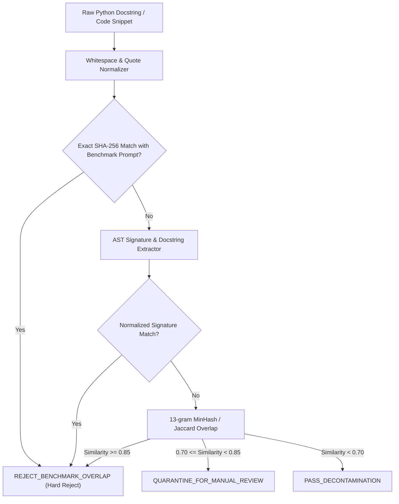

# PHASE 31 — PYTHON DOCUMENTATION BENCHMARK CONTAMINATION PLAN

**Project:** IGRIS — Multilingual Decoder-Only Transformer  
**Operating Model:** `SOLO_DEVELOPER_OWNER_REVIEW`  
**Target Source:** `SRC-TD-03` (Python Official Documentation)  
**Date:** 2026-11-20  

---

## 1. Target Evaluation Benchmarks
The following benchmarks evaluate Python code synthesis and algorithmic reasoning:
1. **OpenAI HumanEval:** 164 hand-crafted Python programming problems with unit tests.
2. **Google MBPP (Mostly Basic Python Problems):** 974 crowd-sourced Python coding problems.
3. **DS-1000:** 1,000 data science coding problems (NumPy, Pandas, SciPy, Scikit-Learn).

---

## 2. Contamination Detection Architecture

### 2.1 Detection Tiers
1. **Tier 1 (Exact Match):** Cryptographic SHA-256 hash comparison of extracted docstrings against canonical benchmark prompts.
2. **Tier 2 (Normalized Match):** Stripping comments, normalizing docstring formatting, and matching normalized AST function definitions.
3. **Tier 3 (Near-Duplicate Overlap):** 13-gram Jaccard similarity. A threshold $\ge 0.70$ triggers review; $\ge 0.85$ triggers immediate rejection.

### 2.2 False-Positive Handling
Common elementary idioms (e.g. standard `fibonacci` docstring, simple list comprehensions, `import sys`) may exhibit token overlap without representing benchmark contamination. Such cases are assigned structural weights based on AST depth before triggering rejection.

### 2.3 Residual Risk Qualification
Automated decontamination significantly minimizes the hazard of pretraining memorization, but does not provide mathematical certainty against subtle algorithmic overlaps.
