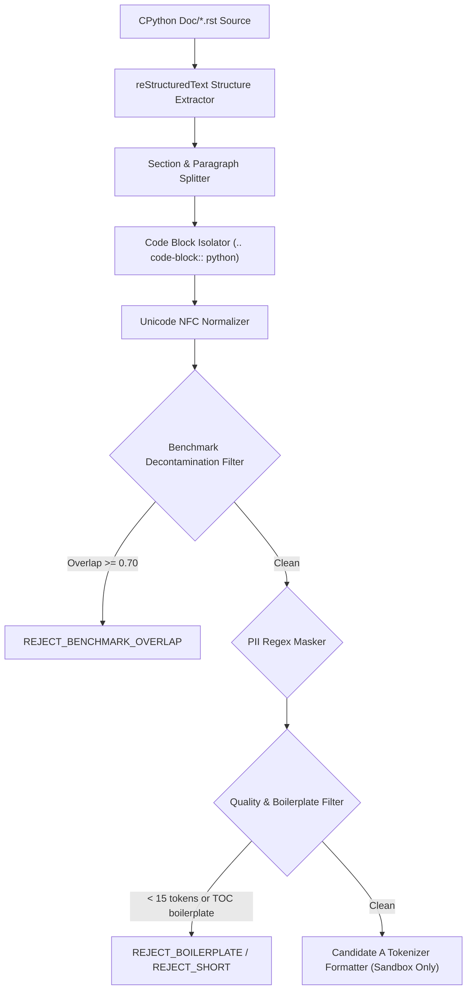

# PHASE 31 — PYTHON OFFICIAL DOCUMENTATION NON-PRODUCTION TECHNICAL REVIEW

**Project:** IGRIS — Multilingual Decoder-Only Transformer  
**Operating Model:** `SOLO_DEVELOPER_OWNER_REVIEW`  
**Reviewer:** Sole Developer / Project Owner  
**Date:** 2026-11-20  
**Phase:** Phase 31 (Python Docs and OASST1 Non-Production Technical Review)  
**Source ID:** `SRC-TD-03`  
**Current Owner Decision:** `OWNER_ACCEPTS_FURTHER_REVIEW`  
**Governance State:** NON-PRODUCTION TECHNICAL SPECIFICATION (Zero Acquisition, Zero Ingress)  

---

## 1. Upstream Identity, License & Provenance Audit

### 1.1 Authoritative Upstream Identity
* **Upstream Organization:** Python Software Foundation (PSF).
* **Official Repository:** `https://github.com/python/cpython` (Doc directory) / `https://docs.python.org/3/`.
* **Pinned Revision:** Python 3.12.7 documentation release tarball (`python-3.12.7-docs-text.zip`, git tag `v3.12.7`).
* **Format:** Sphinx reStructuredText sources (`Doc/**/*.rst`, ~3,500 files) and plain-text renderings.

### 1.2 Primary Source License Evidence
* **Governing License:** **Python Software Foundation License Version 2 (PSF-2.0)**, codified in `Doc/license.rst`.
* **Operative Grant (PSF-2.0 Section 2):**
  > *"PSF hereby grants Licensee a nonexclusive, royalty-free, world-wide license to reproduce, analyze, test, perform and/or display publicly, prepare derivative works, distribute, and otherwise use Python alone or in any derivative version, both in object code and source code form and in machine or paper media."*
* **Scope of Grant:** The express terms "analyze, test... prepare derivative works... and otherwise use" directly encompass subword tokenization representation, computational parsing, and autoregressive language modeling.

### 1.3 Components with Distinct Provenance & Third-Party Material
It is a strict legal error to assume every component of the documentation possesses identical licensing. An audit of `Doc/license.rst` reveals several embedded third-party modules and documentation sections with distinct provenance:
1. **Expat XML Parser:** The `pyexpat` documentation includes references and notices under the MIT/Expat license.
2. **OpenSSL Documentation References:** Cryptographic module documentation contains OpenSSL notices and disclaimer requirements.
3. **Libffi / Ctypes:** Foreign function interface documentation contains libffi acknowledgments.
4. **Unicode Character Database (UCD):** The `unicodedata` documentation references the Unicode Consortium Terms of Use.
5. **Attribution Requirement:** Retaining the standard PSF copyright notice:
   > *"Copyright © 2001-2024 Python Software Foundation. All rights reserved."*
   must be preserved in the IGRIS dataset provenance ledger and published model documentation.

---

## 2. Benchmark Contamination Screening Architecture

Standard programming language benchmarks (e.g. OpenAI HumanEval, Google MBPP, DS-1000) evaluate Python code synthesis. Python documentation contains standard library docstrings that can overlap with benchmark test prompts.

### 2.1 Multitier Screening Protocol
1. **Exact-Match Detection:** Cryptographic SHA-256 hash comparison of extracted docstring prompts against canonical HumanEval problem prompts (`prompt` field) and MBPP docstrings (`text` field).
2. **Normalized-Match Detection:** Normalization of whitespace, docstring quotes (`"""` vs `'''`), indentation, and type annotations before string matching.
3. **Near-Duplicate Detection:** 13-gram Jaccard similarity and MinHash LSH screening with a threshold of $\ge 0.70$.
4. **Action:** Documents exhibiting $\ge 0.70$ similarity to benchmark prompts are automatically assigned rejection code **`REJECT_BENCHMARK_OVERLAP`**.
5. **Scope Limitation:** Filtering mitigates direct memorization leakage but does not mathematically eliminate all semantic overlap.

---

## 3. Privacy & Personal Information Filtering

While technical documentation primarily comprises software specifications, digital source trees contain personal identifiers that must be scrubbed:

### 3.1 Personal Identifiers in Documentation Sources
* **Contributor Acknowledgments:** `Doc/acks.rst` contains full names and personal/corporate email addresses of historical contributors.
* **PEP Headers:** Python Enhancement Proposals in documentation contain author names, email addresses, and GitHub handles.
* **Bug Tracker References:** Patch credits and bug report citations contain contributor names.

### 3.2 Mitigation Specification
* **Automated Regex Email Scrubber:**
  ```regex
  \b[A-Za-z0-9._%+-]+@[A-Za-z0-9.-]+\.[A-Z|a-z]{2,}\b -> [EMAIL_REDACTED]
  ```
* **Phone Number Masker:** E.164 and North American format phone regex scrubbers.
* **Author Header Stripper:** Automated suppression of `Author:` and `Contact:` headers in PEP documentation files.
* **Non-Production Testing:** Validated against synthetic test fixture `PY-SYNTH-03` (**100% regex detection**).

---

## 4. Technical Processing & Extraction Specification



### 4.1 Document Structure & Code Block Preservation
* **Structure Preservation:** Extracted text maintains Markdown/reStructuredText section headers (`#`, `##`, `===`) to preserve hierarchical context.
* **Code Blocks:** Python interactive sessions (`>>>`) and code blocks (`.. code-block:: python`) are preserved with exact indentation and newline formatting.
* **Boilerplate Exclusion:** Tables of contents, index pages, genindex, and license text files are filtered out (`REJECT_BOILERPLATE`).

---

## 5. Machine-Readable Rejection Taxonomy

| Rejection Code | Description | Action |
| :--- | :--- | :--- |
| `REJECT_BENCHMARK_OVERLAP` | Overlaps with HumanEval, MBPP, or DS-1000 prompt | Excluded from corpus |
| `REJECT_BOILERPLATE` | Table of contents, index, or license text | Excluded from corpus |
| `REJECT_SHORT_FRAGMENT` | Document contains $< 15$ semantic tokens | Excluded from corpus |
| `REJECT_UNRESOLVED_PII` | Unmasked personal email or phone detected | Quarantined for review |
