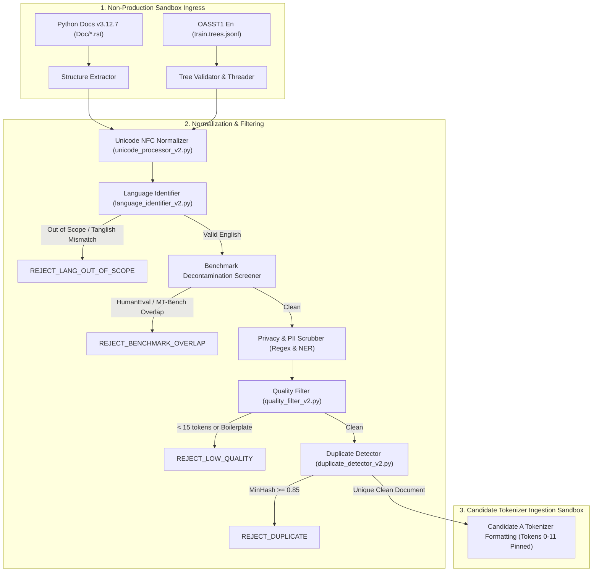

# PHASE 31 — SHARED PIPELINE DESIGN

**Project:** IGRIS — Multilingual Decoder-Only Transformer  
**Operating Model:** `SOLO_DEVELOPER_OWNER_REVIEW`  
**Date:** 2026-11-20  
**Phase:** Phase 31 (Shared Pipeline Architecture Design)  

---

## 1. End-to-End Pipeline Architecture



---

## 2. Reused Infrastructure Modules

The design directly reuses verified components from Phase 24 and Phase 25:
* **`unicode_processor_v2.py`:** Enforces canonical NFC normalization, virama stability, and combining mark preservation.
* **`language_identifier_v2.py`:** Prevents Latin-script Tanglish from contaminating the English corpus.
* **`quality_filter_v2.py`:** Applies document length, repetition, and boilerplate filters.
* **`duplicate_detector_v2.py`:** Computes exact 64-bit MurmurHash and 13-gram MinHash LSH signatures.
* **`language_quality_reporter.py`:** Generates automated rejection metrics and audit logs.

---

## 3. Strict Cryptographic Invariants

```
+-------------------------------------------------------------------------+
|                  IGRIS HARDWARE & PIPELINE INVARIANTS                   |
+-------------------------------------------------------------------------+
|  Candidate A SHA-256 Hash:          ac7e18b13973450b43bfff18609a833...  |
|  Candidate B SHA-256 Hash:          d3a3431e07c87ecce863647202ddc9b...  |
|  Vocabulary Size:                   32,768 (Frozen)                     |
|  Structural Tokens:                 IDs 0–11 (Pinned)                   |
|  Production Data Ingress Gate:      LOCKED (0 bytes admitted)           |
|  Cloud Spending:                    $0.00                               |
+-------------------------------------------------------------------------+
```
